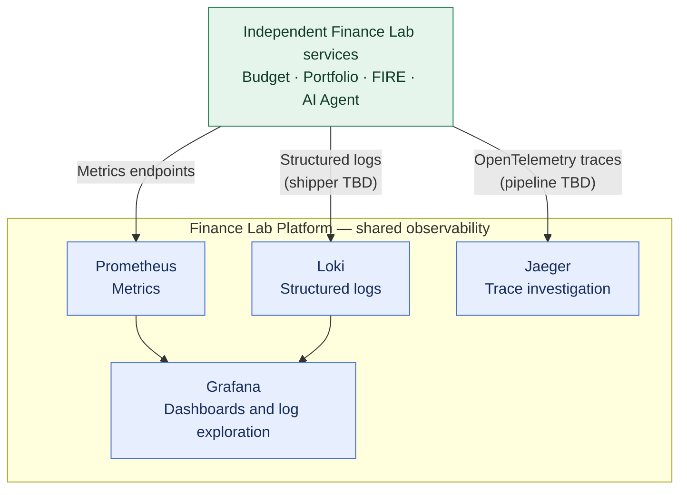

# ADR-001: ShareTrip-derived observability baseline

- **Status:** Accepted (design decision; implementation not yet verified)
- **Recorded:** 2026-10-18
- **Scope:** Finance Lab Platform and all instrumented services
- **Earlier discussion ID:** OBS-001

## Context

Finance Lab will contain independently deployable services. Diagnosing a user operation may require correlating requests, logs and traces across services. The existing ShareTrip learning project introduced a consistent observability stack; reuse those concepts instead of inventing an unrelated platform.

## Decision

Use the following **initial standard** in Finance Lab Platform:

| Component | Responsibility |
| --- | --- |
| Grafana | Dashboards and exploration |
| Prometheus | Scrape, store and query application and infrastructure metrics |
| Loki | Centralized structured application logs |
| OpenTelemetry | Vendor-neutral application instrumentation and context propagation |
| Jaeger | Distributed trace collection/storage and investigation |

The platform operates shared observability infrastructure. **ADR-018 places the private Grafana, Prometheus, Loki, Jaeger and necessary collection/shipping workloads inside K3s for Release 1**, with storage, retention and backup implementation still to be specified. Every application service remains responsible for emitting its own structured logs, metrics and trace context; no financial business logic belongs in the telemetry stack.

Instrument end-to-end user operations rather than relying only on per-service uptime. Propagate W3C `traceparent` across HTTP boundaries; use request and business correlation identifiers as needed. If asynchronous messaging is adopted later, propagate event identifiers and correlation/causation metadata through that transport as appropriate. This ADR **does not decide** whether to use Kafka or another event system.

Treat observability as sensitive: do not emit personal financial values, secrets, credentials, tokens or unnecessary identifiers into logs or metric labels. Prefer bounded-cardinality labels. A public engineering dashboard is accepted in ADR-011: it receives only sanitized, allowlisted, periodically exported metrics as static JSON. Raw observability backends remain private, with special safeguards against identifying users from low-volume traffic.

## Architecture diagram

The arrows describe **logical telemetry flows**, not a selected transport or collector topology. Each service is instrumented independently; the platform centralizes analysis. Jaeger handles trace investigation separately; Grafana-to-Jaeger integration remains optional.
## Consequences and boundaries

- Reuses ShareTrip's practical lessons on logs, metrics, tracing and distributed-process observability.
- Creates infrastructure costs and operational work; set retention, sampling and alert thresholds separately.
- Avoid making application correctness depend on telemetry availability.
- Collector/shipper choices, exporter implementation, private operator-dashboard access controls, storage and retention configuration remain undecided. **K3s deployment location is accepted in ADR-018**; public static-export boundaries are recorded in ADR-011.

## References

- [ShareTrip observability lesson](https://github.com/anton415/job4j_senior_lessons/blob/main/modules/4.9.3-go-sharetrip-in-microservices/14-process-observability.md)
- [ShareTrip implementation](https://github.com/anton415/share_trip)
- [ADR-011: Public sanitized observability dashboard](0011-public-sanitized-observability-dashboard.md)
- [ADR-018: K3s-hosted observability](0018-hybrid-managed-postgresql-k3s-platform-state.md)
