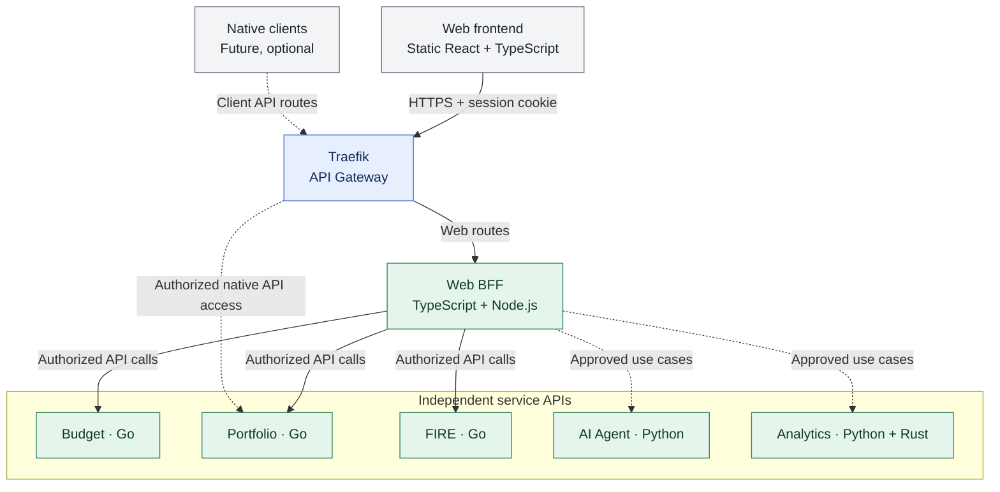

# ADR-002: Traefik as the initial API Gateway

- **Status:** Accepted (design decision; implementation not yet verified)
- **Recorded:** 2026-10-18
- **Scope:** Finance Lab Platform public API ingress

## Context

Budget, Portfolio, FIRE and AI capabilities must not be routed through or controlled by Budget Service. We considered a custom Java gateway (Spring Cloud Gateway), a custom Go gateway and established gateways. The first release needs a predictable public entry point without turning routing into an additional custom application.

## Decision

Use **Traefik** as the initial API Gateway / reverse proxy. It is part of the platform rather than a financial domain service. Configure routing to independently deployable service APIs and relevant edge capabilities (for example TLS termination, when deployed). Do not implement the first gateway from scratch in Java or Go. **For Release 1, deploy Traefik as the Kubernetes cluster's API ingress/gateway component** (ADR-016). **ADR-028 fixes the three public hostname roles**, with Traefik exposing only HTTPS BFF and public Keycloak OIDC routes. Private Go/Python service endpoints, observability and admin consoles stay off the public internet. The choice of Kubernetes Ingress versus Gateway API provider and optional public-IP versus network load-balancer topology remains implementation work.

Financial services retain their own business logic, state and resource-level authorization. Traefik is **not** the authority that decides whether a user owns an individual budget, portfolio or FIRE resource. Keycloak identity is accepted in ADR-006, and a separate TypeScript Web BFF for browser-specific API composition is accepted in ADR-012. BFF-managed browser sessions and server-side OAuth tokens are accepted in ADR-013; detailed cookie/session configuration, token delegation and gateway authentication policy remain implementation decisions.

Service-to-service calls are not required to route through the public gateway. The accepted TypeScript Web BFF (ADR-012) composes browser-specific responses without taking over domain logic. Static frontend hosting is decided in ADR-010; native client implementations remain future work.

## Architecture diagram

Solid arrows represent the web-specific logical ingress path; they do not authorize unrestricted public exposure. Dashed arrows are optional, explicitly secured routes. Keycloak identity is addressed in ADR-006 and BFF-managed browser sessions in ADR-013; session-store implementation and downstream credentials remain open.
## Consequences and boundaries

- Lower custom gateway implementation and maintenance burden for the initial release.
- Provides a platform entry point without making Budget Service a shared controller.
- Keeps Spring Cloud Gateway, Envoy or a managed cloud gateway open for future evaluation against measured needs.
- No commitment to a Java platform runtime follows from this ADR; Java remains a professional skill and an option for justified future components.

## References

- [Traefik documentation](https://doc.traefik.io/traefik/)
- [ADR-012: TypeScript Web BFF](0012-typescript-web-bff-api-composition.md)
- [ADR-013: Browser authentication and BFF-managed sessions](0013-keycloak-bff-managed-browser-sessions.md)
- [ADR-016: Kubernetes Release 1 deployment](0016-kubernetes-release1-deployment.md)
- [ADR-028: Public DNS, private VPC and TLS](0028-public-dns-traefik-private-network-tls.md)
