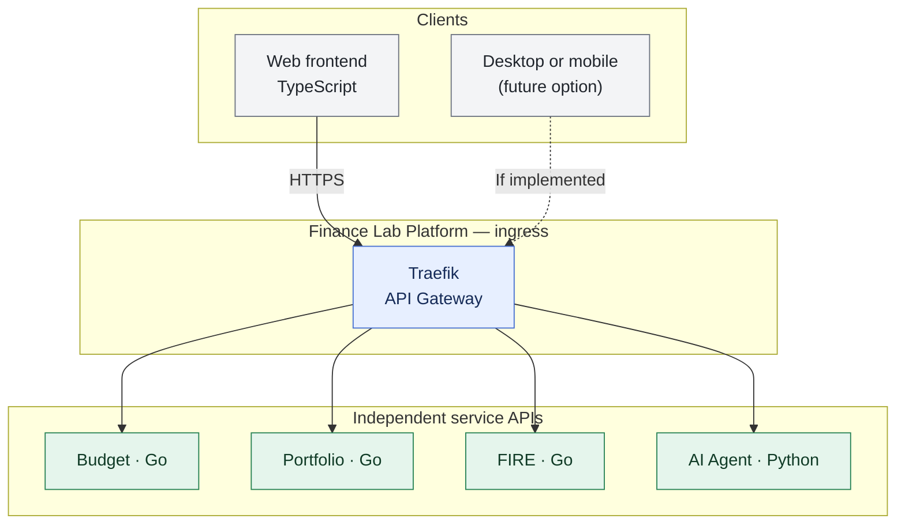

# ADR-002: Traefik as the initial API Gateway

- **Status:** Accepted (design decision; implementation not yet verified)
- **Recorded:** 2026-10-18
- **Scope:** Finance Lab Platform public API ingress

## Context

Budget, Portfolio, FIRE and AI capabilities must not be routed through or controlled by Budget Service. We considered a custom Java gateway (Spring Cloud Gateway), a custom Go gateway and established gateways. The first release needs a predictable public entry point without turning routing into an additional custom application.

## Decision

Use **Traefik** as the initial API Gateway / reverse proxy. It is part of the platform rather than a financial domain service. Configure routing to independently deployable service APIs and relevant edge capabilities (for example TLS termination, when deployed). Do not implement the first gateway from scratch in Java or Go.

Financial services retain their own business logic, state and resource-level authorization. Traefik is **not** the authority that decides whether a user owns an individual budget, portfolio or FIRE resource. The identity provider, token/session architecture, gateway authentication policy and any BFF are **not yet selected** by this decision.

Service-to-service calls are not required to route through the public gateway. Client-specific aggregation can be added as a separate BFF decision if the dashboard requires it. Frontend hosting and future mobile/desktop access are separate architecture decisions.

## Architecture diagram

Solid arrows show **logical ingress routing** to approved service APIs, not unrestricted public exposure. The dashed client is only a future option. Authentication, authorization, frontend hosting and internal service-to-service paths remain separate decisions.
## Consequences and boundaries

- Lower custom gateway implementation and maintenance burden for the initial release.
- Provides a platform entry point without making Budget Service a shared controller.
- Keeps Spring Cloud Gateway, Envoy or a managed cloud gateway open for future evaluation against measured needs.
- No commitment to a Java platform runtime follows from this ADR; Java remains a professional skill and an option for justified future components.

## References

- [Traefik documentation](https://doc.traefik.io/traefik/)
