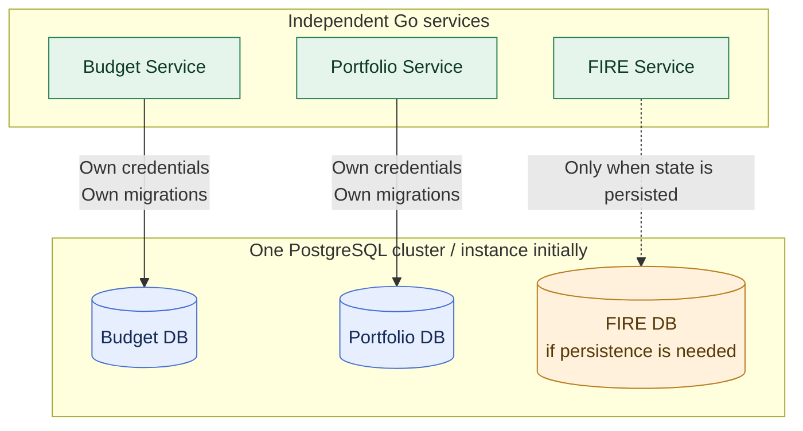

# ADR-003: PostgreSQL with Database-per-Service ownership

- **Status:** Accepted (design decision; implementation not yet verified)
- **Recorded:** 2026-10-18
- **Scope:** Persistent state of Budget, Portfolio and FIRE services

## Context

Finance Lab manages financial records for independent capabilities. Strong transaction boundaries, integrity constraints and clear ownership are more important than adopting multiple storage technologies prematurely. Separate physical database infrastructure per service would add unnecessary initial cost.

## Decision

Use **PostgreSQL as the primary persistent database**. Apply the **Database-per-Service** pattern: each business service owns its own logical database, database credentials, schema changes and migrations. Initially, separate logical databases may run on **one physical PostgreSQL cluster/instance**.

- **Budget Service** owns its budget records and their persistence contract.
- **Portfolio Service** owns investment accounts, transactions, positions or valuations defined by its contracts.
- **FIRE Service** owns any durable FIRE scenarios, assumptions or state it requires; its precise data model remains to be designed. This decision does not impose a stateless implementation.

No service reads or writes another service's database tables directly, even when all databases share the same PostgreSQL instance. Exchange information through explicit, authenticated service APIs or separately designed projections/events. Multi-service transaction and event coordination mechanisms are **not decided** by this ADR.

Service-specific database roles should receive only the privileges needed for their database. Migrations belong with the owning service's code rather than a generic shared database application.

## Architecture diagram

The solid arrows show **service-owned database access**. The dashed FIRE path is conditional on storing durable FIRE state. Sharing one PostgreSQL instance does **not** permit cross-service table access or provide physical fault isolation.
## Consequences and boundaries

- Local transactional integrity and service ownership are explicit; distributed consistency remains a separate design problem.
- One initial database instance is operationally economical, but does **not** provide physical failure isolation between services.
- Data durability, recovery, user isolation, money representations and backup validation remain required regardless of architecture.
- The Go financial domain services retain PostgreSQL as their authoritative store. **ADR-015** separately accepts Redis as an optional Python Analytics simulation cache and MongoDB as a store of derived saved analysis reports; neither replaces Go-owned financial records. Cache-invalidation implementation remains separate.
- Existing budget T2 persistence, exact-string amount semantics, versioning, ownership and idempotency contracts must be preserved or explicitly superseded through a later decision when the Java proof-of-concept is migrated.

## References

- [Current Finance Lab budget persistence and consistency design](../../t2/design.md)
- [Database per Service pattern](https://microservices.io/patterns/data/database-per-service.html)
- [ADR-015: Analytics-owned Redis and MongoDB](0015-analytics-redis-cache-mongodb-reports.md)
