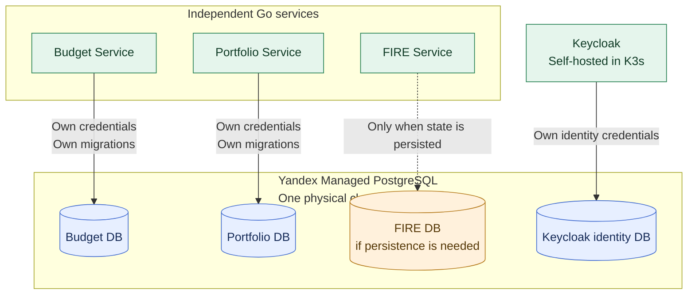

# ADR-003: PostgreSQL with Database-per-Service ownership

- **Status:** Accepted (design decision; implementation not yet verified)
- **Recorded:** 2026-10-18
- **Scope:** Persistent state of Budget, Portfolio and FIRE services

## Context

Finance Lab manages financial records for independent capabilities. Strong transaction boundaries, integrity constraints and clear ownership are more important than adopting multiple storage technologies prematurely. Separate physical database infrastructure per service would add unnecessary initial cost.

## Decision

Use **PostgreSQL as the primary persistent database**. Apply the **Database-per-Service** pattern: each business service owns its own logical database, database credentials, schema changes and migrations. **ADR-018 places the initial physical PostgreSQL cluster in Yandex Managed PostgreSQL, outside K3s**. It can host separate Budget, Portfolio and FIRE databases **and a distinct Keycloak identity database**, each with appropriately scoped credentials. Managed placement does not guarantee physical high availability.

- **Budget Service** owns its budget records and their persistence contract.
- **Portfolio Service** owns investment accounts, transactions, positions or valuations defined by its contracts.
- **FIRE Service** owns any durable FIRE scenarios, assumptions or state it requires; its precise data model remains to be designed. This decision does not impose a stateless implementation.

No service reads or writes another service's database tables directly, even when all databases share the same PostgreSQL instance. Exchange information through explicit, authenticated service APIs or separately designed projections/events. Multi-service transaction and event coordination mechanisms are **not decided** by this ADR.

Service-specific database roles should receive only the privileges needed for their database. Migrations belong with the owning service's code rather than a generic shared database application.

## Architecture diagram

The solid arrows show **separately credentialed database access**. Keycloak owns only its identity database; it is not a finance domain service. The dashed FIRE path is conditional on durable FIRE state. Sharing one managed physical PostgreSQL cluster **does not** permit cross-service table access or provide physical fault isolation.
## Consequences and boundaries

- Local transactional integrity and service ownership are explicit; distributed consistency remains a separate design problem.
- One managed physical PostgreSQL cluster reduces self-managed database work but shares a failure domain among Go domain data and Keycloak identity. **ADR-018 fixes its placement outside K3s**; **ADR-019 sets automated managed backups, PITR, tested restoration and initial RPO/RTO targets**. Host count/HA tier, exact backup retention and measured cost remain implementation work.
- Data durability, recovery, user isolation and backup validation remain required regardless of architecture. **ADR-022 now selects exact decimal Money values and explicit currencies for new versioned production APIs**, stored in each service database with PostgreSQL `NUMERIC`; exact column precision/scale awaits domain design.
- The Go financial domain services retain PostgreSQL as their authoritative store. **ADR-015** separately accepts Redis as an optional Python Analytics simulation cache and MongoDB as a store of derived saved analysis reports; neither replaces Go-owned financial records. Cache-invalidation implementation remains separate.
- Existing V2 budget backup original-string amount semantics and Java/Spring T2 persistence, versioning, ownership and idempotency rules **remain unchanged**. The new ADR-022 production Money contract requires a separately approved, versioned migration.

## References

- [Current Finance Lab budget persistence and consistency design](../../t2/design.md)
- [Database per Service pattern](https://microservices.io/patterns/data/database-per-service.html)
- [ADR-015: Analytics-owned Redis and MongoDB](0015-analytics-redis-cache-mongodb-reports.md)
- [ADR-016: Kubernetes Release 1 deployment](0016-kubernetes-release1-deployment.md)
- [ADR-018: Managed PostgreSQL placement](0018-hybrid-managed-postgresql-k3s-platform-state.md)
- [ADR-019: Backup and disaster recovery](0019-backup-recovery-objectives-drills.md)
- [ADR-022: Exact decimal Money and currency contract](0022-exact-decimal-money-currency-contract.md)
