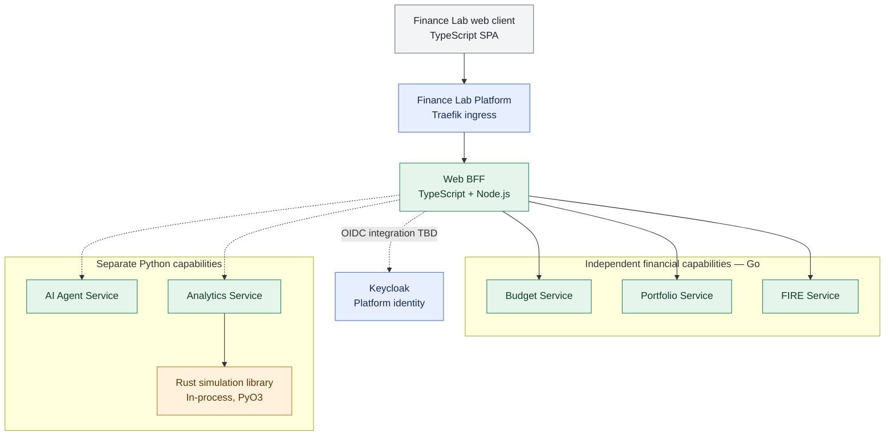

# ADR-004: Independent business services and language distribution

- **Status:** Accepted (target architecture; migration pending)
- **Recorded:** 2026-10-18
- **Scope:** Finance Lab product service boundaries and implementation languages

## Context

Finance Lab must allow users to use budgeting, investments and FIRE tracking independently. Budget Service must not become the gateway, owner of other domains or a required dependency for another feature. The platform supplies common technical infrastructure, not centralized financial business logic. Technology selection should reinforce the Job4j Go curriculum while respecting an existing Python agent prototype and TypeScript frontend.

## Decision

| Component | Selected implementation |
| --- | --- |
| Frontend | TypeScript (existing React application) |
| Web BFF | TypeScript + Node.js, independent deployment (ADR-012) |
| Budget Service | Go |
| Portfolio Service | Go |
| FIRE Service | Go |
| AI Agent Service | Python (existing `finance-lab-agent`) |
| Analytics Service | Python with an in-process Rust library (see ADR-007) |
| Identity provider | Keycloak (see ADR-006) |
| Primary persistence | SQL with PostgreSQL (see ADR-003) |
| Public API Gateway | Traefik (see ADR-002) |

Budget, Portfolio and FIRE are **peer services** with independent business responsibilities, API contracts, deployment lifecycles and data ownership. A user can use Portfolio or FIRE without creating a budget, and can use Budget without Portfolio or FIRE. Any cross-service information exchange must be explicit; the platform does not act as a universal business orchestrator.

The frontend is a client, not the owner of domain state. Release 1 uses an independently deployed React/TypeScript static SPA, with Yandex Object Storage + Cloud CDN as its hosting target and reusable APIs for possible desktop/mobile clients (ADR-010). Frontend availability depends on static hosting, DNS and network health; it is not guaranteed.

## Architecture diagram

This is a **logical capability and ingress diagram**, not a deployment diagram. There are deliberately no mandatory dependencies between Budget, Portfolio and FIRE: users can use any one without using the others. A hybrid REST + Kafka integration flow beginning with Portfolio is accepted separately in ADR-009. Web-specific composition through a separate TypeScript BFF is accepted in ADR-012; internal business-service availability and authorization remain independent. Further service interactions, frontend outage behavior and messaging contracts remain to be designed. Keycloak identity is accepted in ADR-006.

## Migration and deferred choices

- The existing `finance-lab` repository currently contains a Java/Spring Boot budget backend. Selecting Go as the **target** does not assert that migration has happened, delete that work, or cancel existing T2 contracts. Plan migration and preservation of verified behavior separately.
- Java is not chosen merely to fill a platform role; introduce a Java component only if future requirements justify one.
- Python Analytics with an in-process Rust library is accepted for Release 1 (ADR-007); a separate Rust computation service is planned for Release 2. This does not turn Rust into an independent microservice in 2026.
- Keycloak identity and per-service authorization are accepted in ADR-006; REST + Kafka Portfolio integration is accepted in ADR-009. Browser session design, delegated service identity, event contracts, any future native-client BFFs and detailed deployment configuration remain separate design work. The Web BFF is accepted in ADR-012, and independent static SPA hosting in ADR-010.

## Related decisions

- [ADR-001: Observability baseline](0001-observability-baseline.md)
- [ADR-002: Traefik Gateway](0002-traefik-api-gateway.md)
- [ADR-003: PostgreSQL Database-per-Service](0003-postgresql-database-per-service.md)
- [ADR-006: Keycloak identity and service-owned authorization](0006-keycloak-identity-service-authorization.md)
- [ADR-007: Python Analytics with in-process Rust](0007-python-analytics-rust-library.md)
- [ADR-009: Hybrid REST + Kafka starting with Portfolio](0009-hybrid-rest-kafka-portfolio-events.md)
- [ADR-010: Independent static SPA and API-first clients](0010-independent-spa-and-api-first-clients.md)
- [ADR-012: TypeScript Web BFF](0012-typescript-web-bff-api-composition.md)
