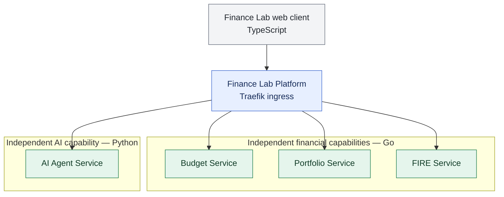

# ADR-004: Independent business services and language distribution

- **Status:** Accepted (target architecture; migration pending)
- **Recorded:** 2026-10-18
- **Scope:** Finance Lab product service boundaries and implementation languages

## Context

Finance Lab must allow users to use budgeting, investments and FIRE tracking independently. Budget Service must not become the gateway, owner of other domains or a required dependency for another feature. The platform supplies common technical infrastructure, not centralized financial business logic. Technology selection should reinforce the Job4j Go curriculum while respecting an existing Python agent prototype and TypeScript frontend.

## Decision

| Component | Selected implementation |
| --- | --- |
| Frontend | TypeScript (existing React application) |
| Budget Service | Go |
| Portfolio Service | Go |
| FIRE Service | Go |
| AI Agent Service | Python (existing `finance-lab-agent`) |
| Primary persistence | SQL with PostgreSQL (see ADR-003) |
| Public API Gateway | Traefik (see ADR-002) |

Budget, Portfolio and FIRE are **peer services** with independent business responsibilities, API contracts, deployment lifecycles and data ownership. A user can use Portfolio or FIRE without creating a budget, and can use Budget without Portfolio or FIRE. Any cross-service information exchange must be explicit; the platform does not act as a universal business orchestrator.

The frontend is a client, not the owner of domain state. The deployment topology of web/mobile/desktop clients and their availability guarantees require a separate decision. An independently deployed, always-available frontend is a stated product goal, not a verified behavior under this ADR.

## Architecture diagram

This is a **logical capability and ingress diagram**, not a deployment diagram. There are deliberately no mandatory dependencies between Budget, Portfolio and FIRE: users can use any one without using the others. Optional service interactions, frontend availability, identity and asynchronous messaging are undecided.
## Migration and deferred choices

- The existing `finance-lab` repository currently contains a Java/Spring Boot budget backend. Selecting Go as the **target** does not assert that migration has happened, delete that work, or cancel existing T2 contracts. Plan migration and preservation of verified behavior separately.
- Java is not chosen merely to fill a platform role; introduce a Java component only if future requirements justify one.
- Rust remains a potential performance-learning experiment rather than an accepted runtime dependency.
- Domain event architecture, identity and authorization infrastructure, client-specific BFFs, public dashboard access and deployment destinations are separate decisions.

## Related decisions

- [ADR-001: Observability baseline](0001-observability-baseline.md)
- [ADR-002: Traefik Gateway](0002-traefik-api-gateway.md)
- [ADR-003: PostgreSQL Database-per-Service](0003-postgresql-database-per-service.md)
