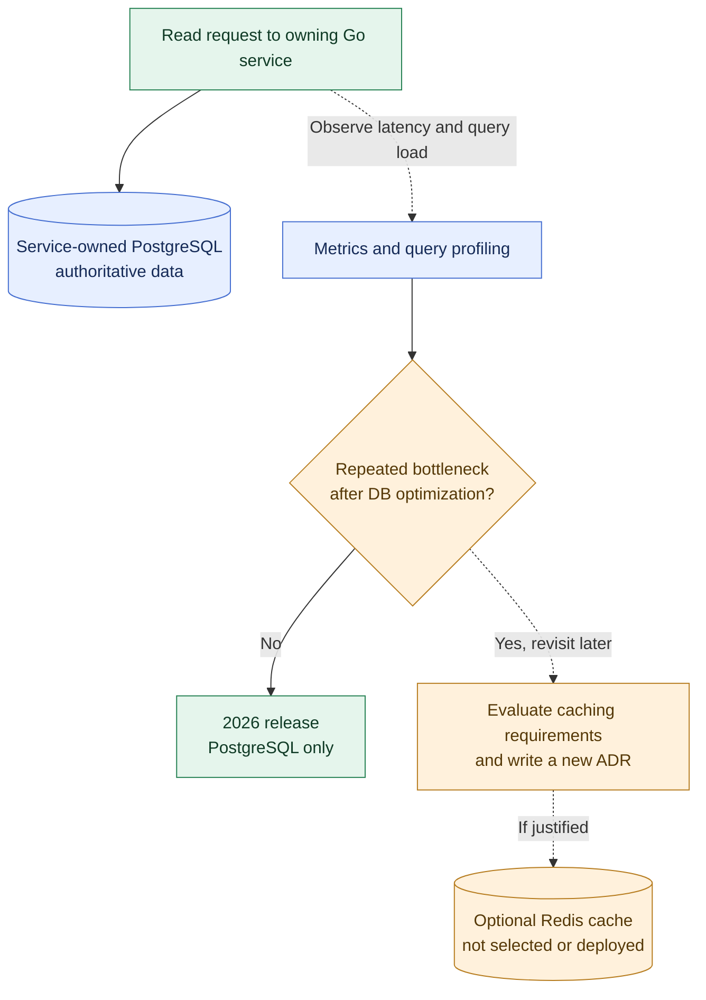

# ADR-005: Defer Redis until a demonstrated caching need

- **Status:** Superseded by [ADR-008](0008-redis-mongodb-2026-learning.md) on 2026-10-18
- **Recorded:** 2026-10-18
- **Scope:** Finance Lab microservice caching strategy
- **Potential review point:** Second product release in 2027 (tentative, not a commitment)

## Historical note

This records the **previous** decision to defer Redis and is preserved for traceability. The current accepted direction is to include **Redis and MongoDB in the 2026 Finance Lab learning scope** (ADR-008), with their exact implementations still subject to design. The diagram and statements below are historical, not the current release plan.

## Context

Finance Lab's Budget, Portfolio and FIRE services will use service-owned PostgreSQL databases (ADR-003). A dedicated cache adds invalidation rules, data-staleness risks, resource consumption and new operational failure modes. No measured caching bottleneck currently justifies those costs.

## Decision

- **First release (2026):** Do not introduce Redis or require a distributed cache. Each service uses its own PostgreSQL database as its source of truth.
- Consider Redis **later only when a concrete, measured read-performance or load problem is demonstrated**, after examining queries, indexes, data modeling and simpler optimizations.
- The **second release in 2027 is a possible opportunity** to investigate caching and databases more deeply; it does not commit us to deploying Redis.
- If a cache becomes justified, make a **separate architecture decision** covering service ownership, cache-aside/write strategy, TTL and invalidation, per-user isolation, staleness expectations, fallback when Redis is unavailable, security, observability and cost.
- Redis must not become the authoritative record of budgets, investment transactions or other persistent financial state by default.

## Decision diagram

The diagram distinguishes today's accepted PostgreSQL-only architecture (solid path) from **conditional future evaluation** (dashed paths). It is not a Redis deployment plan.

## Consequences

- Simpler first-release architecture and fewer consistency problems.
- The engineering curriculum can revisit SQL tuning, profiling, NoSQL and caching in more depth during 2027.
- Finance Lab may later introduce Redis, a different cache, or no cache at all depending on measured evidence.

## Related decisions

- [ADR-003: PostgreSQL with Database-per-Service ownership](0003-postgresql-database-per-service.md)
- [ADR-001: ShareTrip-derived observability baseline](0001-observability-baseline.md)
