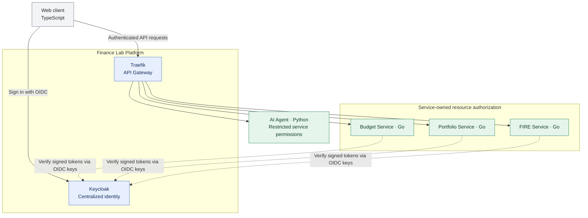

# ADR-006: Centralized Keycloak identity and service-owned authorization

- **Status:** Accepted (target architecture; not yet implemented)
- **Recorded:** 2026-10-18
- **Scope:** Finance Lab Platform identity and independent domain-service resource access

## Context

Finance Lab has independently usable Budget, Portfolio and FIRE services, plus a separate AI Agent. Sign-in must work consistently without making Budget Service the identity authority. A public, limited portfolio/observability experience may coexist with private financial APIs. ShareTrip's Job4j Keycloak exercise provides learning background, but its simplified refresh-token-in-request-header example must **not** become a production authentication design.

## Decision

- Adopt **Keycloak** as the **central identity provider**, operated as part of Finance Lab Platform. It authenticates users and issues standards-based OpenID Connect/OAuth 2.0 tokens.
- Keep **Traefik** as the public API Gateway. It handles routing and can apply coarse edge protections; it is **not** the sole authorization enforcement point.
- Each financial Go service (Budget, Portfolio, FIRE) verifies the security context presented to its API and makes its **own resource-level authorization decision** using service-owned records. For example, Portfolio Service determines ownership of a portfolio, independently of Budget Service.
- The AI Agent and Analytics Service must not bypass user authorization when requesting financial data. Service-to-service credentials, delegation and agent permissions need an explicit follow-up design.
- No service should take the calling user's ID from an untrusted request body or forwarded header in place of a verified identity.
- Public read-only endpoints, if introduced, must be explicitly scoped. Publishing sanitized aggregate operational data **does not** grant anonymous access to private budgets, investments, FIRE scenarios, application logs, tracing infrastructure or administrator tools.

## Architecture diagram

Dashed arrows indicate **identity verification metadata** (e.g., cached signing keys/discovery), not a need to call Keycloak for every request. The flow is logical; it does not finalize token storage, clients or internal network routing.

## Security baseline and open implementation details

For browser/native public clients, prefer standards-based **Authorization Code + PKCE** rather than password grant, implicit flow, or transmitting refresh tokens through arbitrary API headers. Where services accept bearer JWTs, verify signature, issuer, audience, expiration and other required claims using maintained libraries and trusted keys; authorization checks remain per-resource and per-operation. Do not expose Keycloak administrative endpoints to the public dashboard.

Whether the web client uses a BFF with secure session cookies or obtains tokens directly, precise gateway auth middleware, fine-grained policies, refresh/logout behavior, MFA, service-to-service authentication and agent delegation **remain implementation decisions**. They are not implied by this ADR.

## Consequences

- Centralizes accounts and sign-in while preserving domain independence and ownership.
- Adds Keycloak operations, configuration and security maintenance to the platform.
- Maintains a coherent user identity across Go services, but requires separate authorization tests in each.
- Requires an explicit public/private route policy for any portfolio and observability showcase.

## References

- [Job4j ShareTrip Keycloak lesson](https://github.com/anton415/job4j_senior_lessons/blob/main/modules/4.9.2-go-sharetrip-in-code/10-keycloak-authentication-authorization.md)
- [Keycloak OpenID Connect endpoints and supported flows](https://www.keycloak.org/securing-apps/oidc-layers)
- [ADR-002: Traefik Gateway](0002-traefik-api-gateway.md)
- [ADR-004: Independent polyglot services](0004-independent-polyglot-services.md)
