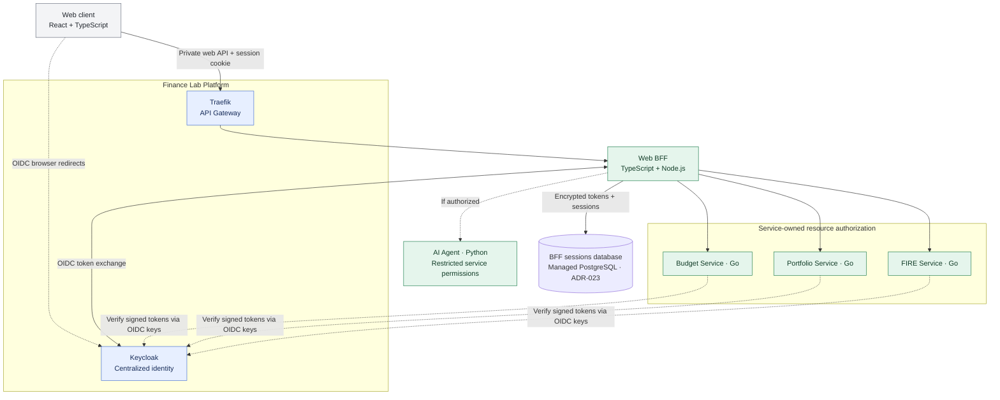

# ADR-006: Centralized Keycloak identity and service-owned authorization

- **Status:** Accepted (target architecture; not yet implemented)
- **Recorded:** 2026-10-18
- **Scope:** Finance Lab Platform identity and independent domain-service resource access

## Context

Finance Lab has independently usable Budget, Portfolio and FIRE services, plus a separate AI Agent. Sign-in must work consistently without making Budget Service the identity authority. A public, limited portfolio/observability experience may coexist with private financial APIs. ShareTrip's Job4j Keycloak exercise provides learning background, but its simplified refresh-token-in-request-header example must **not** become a production authentication design.

## Decision

- Adopt **Keycloak** as the **central identity provider**, operated as part of Finance Lab Platform. It authenticates users and issues standards-based OpenID Connect/OAuth 2.0 tokens. **ADR-018 hosts the Keycloak workload in K3s and its dedicated identity database in Yandex Managed PostgreSQL**, using credentials separate from the financial databases.
- Keep **Traefik** as the public API Gateway. It handles routing and can apply coarse edge protections; it is **not** the sole authorization enforcement point.
- Each financial Go service (Budget, Portfolio, FIRE) verifies the security context presented to its API and makes its **own resource-level authorization decision** using service-owned records. For example, Portfolio Service determines ownership of a portfolio, independently of Budget Service.
- The AI Agent and Analytics Service must not bypass user authorization when requesting financial data. The accepted Web BFF (ADR-012) uses Keycloak user-token exchange for delegated downstream calls; background workloads use restricted client credentials (ADR-014). AI Agent user delegation and exact approval rules remain separate security design work.
- No service should take the calling user's ID from an untrusted request body or forwarded header in place of a verified identity.
- Public read-only endpoints, if introduced, must be explicitly scoped. Publishing sanitized aggregate operational data **does not** grant anonymous access to private budgets, investments, FIRE scenarios, application logs, tracing infrastructure or administrator tools.

## Architecture diagram

Dashed arrows indicate browser OIDC redirects, optional calls or identity verification metadata (e.g., cached signing keys), not required per-request Keycloak calls. The BFF holds encrypted OAuth tokens in its dedicated Managed PostgreSQL sessions database under ADR-023. Detailed cookie policies, encryption/key implementation and internal trust require verification. The BFF does not replace per-service resource authorization.

## Security baseline and open implementation details

For browser/native public clients, prefer standards-based **Authorization Code + PKCE** rather than password grant, implicit flow, or transmitting refresh tokens through arbitrary API headers. Where services accept bearer JWTs, verify signature, issuer, audience, expiration and other required claims using maintained libraries and trusted keys; authorization checks remain per-resource and per-operation. Do not expose Keycloak administrative endpoints to the public dashboard.

The web client uses a TypeScript Web BFF (ADR-012) with **server-side OAuth tokens and Secure/HttpOnly browser session cookies** (ADR-013). Authorization Code + PKCE, CSRF protection, session lifecycle and restricted CORS are accepted security requirements. Service-to-service identity is governed by Token Exchange + Client Credentials in ADR-014. Exact gateway middleware, cookie/CSRF implementation, **PostgreSQL session-schema/key-management details**, refresh/logout integrations, MFA, claims mapping and AI-specific delegated actions remain implementation details (ADR-023).

## Consequences

- Centralizes accounts and sign-in while preserving domain independence and ownership.
- Adds Keycloak operations, configuration and security maintenance to the platform. Keycloak runs in K3s while its identity database runs in managed PostgreSQL (ADR-018), so cluster outages can still prevent login even when the database remains healthy.
- Maintains a coherent user identity across Go services, but requires separate authorization tests in each.
- Requires an explicit public/private route policy for any portfolio and observability showcase.

## References

- [Job4j ShareTrip Keycloak lesson](https://github.com/anton415/job4j_senior_lessons/blob/main/modules/4.9.2-go-sharetrip-in-code/10-keycloak-authentication-authorization.md)
- [Keycloak OpenID Connect endpoints and supported flows](https://www.keycloak.org/securing-apps/oidc-layers)
- [ADR-002: Traefik Gateway](0002-traefik-api-gateway.md)
- [ADR-004: Independent polyglot services](0004-independent-polyglot-services.md)
- [ADR-012: TypeScript Web BFF](0012-typescript-web-bff-api-composition.md)
- [ADR-013: BFF-managed browser sessions](0013-keycloak-bff-managed-browser-sessions.md)
- [ADR-014: Service-to-service security](0014-keycloak-service-to-service-security.md)
- [ADR-018: Keycloak placement and identity database](0018-hybrid-managed-postgresql-k3s-platform-state.md)
- [ADR-023: BFF session storage and lifecycle](0023-postgresql-bff-sessions-and-oauth-lifecycle.md)
