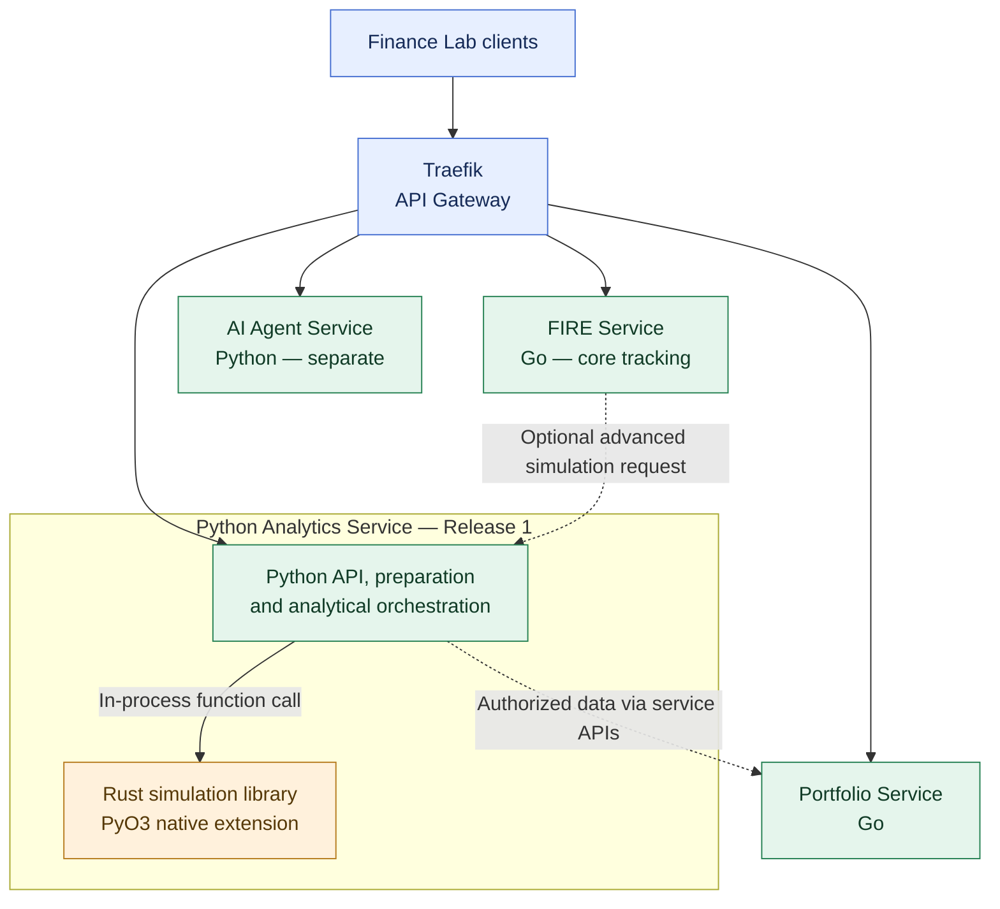

# ADR-007: Python Analytics with an in-process Rust library

- **Status:** Accepted (Release 1 target architecture; implementation pending)
- **Recorded:** 2026-10-18
- **Scope:** Financial analytics and simulation capabilities, 2026 Release 1 and planned 2027 Release 2 evolution

## Context

Finance Lab needs analytical workloads beyond basic domain calculations, and its engineering curriculum benefits from hands-on Python and Rust. The Go FIRE Service must remain usable without Budget Service or a mandatory Analytics dependency. A separately deployed Rust math service adds networking, deployment and failure handling before we know which computation requires it.

## Decision

**Release 1 — by December 31, 2026**

- Create a **Python Analytics Service**, distinct from both the **Go FIRE Service** and the **Python AI Agent Service**.
- Integrate **Rust as a native in-process Python extension module**, using **PyO3** and an appropriate packaging/build tool such as **maturin**. Rust is a library in the Analytics process, **not** another network microservice.
- Start with **one narrowly scoped, reproducible computation**, such as a Monte Carlo financial-independence scenario engine. Python owns API/data preparation/orchestration; Rust implements the computational kernel.
- Keep core FIRE functionality in Go. Advanced analytics is **optional**: a user can track FIRE using manual assumptions even if Analytics is unavailable.
- Supply authorized, validated financial inputs via service APIs or explicit request snapshots, **not by direct reads from Budget or Portfolio databases**.
- Preserve the distinction between deterministic numerical verification, simulation uncertainty and financial prediction. Benchmark against a simple reference implementation and test numeric correctness and reproducibility. **ADR-022 requires exact Money/currency representation at financial-service boundaries**, even if stochastic Rust simulation algorithms use explicitly documented approximate arithmetic internally.
- AI Agent remains independent and does not receive privileged analytics or financial database access by default.

**Release 2 — 2027 planned evolution**

- Plan to **extract the Rust computation engine into an independently deployable Math/Simulation Service** (Option B) with its own contract, tracing, resilience and deployment once the Release 1 interface and operational characteristics are understood.
- Reassess the extraction against measured needs and demonstrated learning value before introducing unnecessary operational coupling. Preserve the calculations and test cases during extraction.

## Architecture diagram

The highlighted Rust box is an **in-process library**, not a separate service or database. The dashed connections are **optional interactions**, not dependencies required for basic FIRE tracking. The second-release Rust service is a future evolution and is not shown as already running.

## Consequences and boundaries

- Gains Rust programming and numerical-performance experience without a fourth financial domain service or separate Rust deployment in 2026.
- The Python Analytics Service owns the library build, packaging, compatibility, observability and error boundaries.
- Financial data remains owned by existing Go domain services. **ADR-015** now defines Analytics-owned Redis caching of expensive simulations and MongoDB persistence of explicitly saved, versioned analysis reports. Neither store is the source of financial records; exact schema, TTL, operational and security implementation details remain separate work.
- Scope a single simulation use case for 2026; do not imply broad production-grade investment advice or formally validated retirement probabilities.

## References

- [PyO3 User Guide](https://pyo3.rs/main/)
- [ADR-004: Independent polyglot services](0004-independent-polyglot-services.md)
- [ADR-003: PostgreSQL Database-per-Service](0003-postgresql-database-per-service.md)
- [ADR-015: Redis simulation cache and MongoDB saved reports](0015-analytics-redis-cache-mongodb-reports.md)
- [ADR-022: Exact monetary domain boundaries](0022-exact-decimal-money-currency-contract.md)
