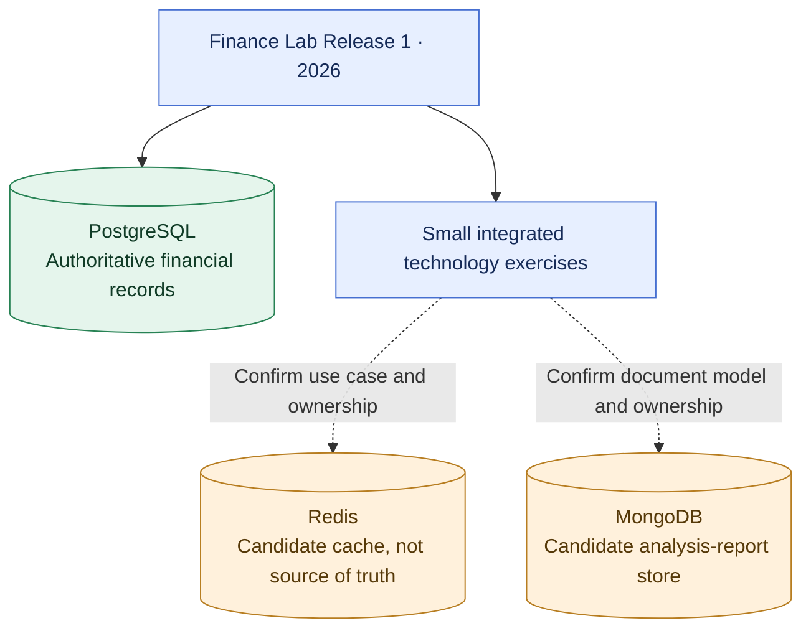

# ADR-008: Redis and MongoDB are in the 2026 Finance Lab learning scope

- **Status:** Accepted (learning and integration goal; detailed storage roles not yet decided)
- **Recorded:** 2026-10-18
- **Scope:** Finance Lab Release 1 in 2026
- **Supersedes:** [ADR-005: Defer Redis until a demonstrated caching need](0005-defer-redis-until-measured-need.md)

## Context

The Job4j Senior learning reference contains lessons on Redis, MongoDB, access patterns and cache invalidation. Finance Lab is both a financial application and a practical software-engineering learning project. The earlier plan deferred Redis until a performance problem was measured; the user has explicitly revised that priority to include **Redis and MongoDB in the 2026 Finance Lab learning scope**.

## Decision

- Include **hands-on Redis and MongoDB integrations in Finance Lab by the end of 2026**, using small, isolated and testable exercises that run in the Finance Lab environment.
- Preserve [ADR-003](0003-postgresql-database-per-service.md): **PostgreSQL remains the authoritative store** for budgets, investment transactions and any durable FIRE state.
- Candidate exercises, **not yet accepted implementations**:
  - Redis: non-authoritative analytical-result caching, with TTL, invalidation and graceful cache failure.
  - MongoDB: a document-oriented, versioned analytical-report collection, with explicit service ownership and indexing.
- Decide exact owning service, schema, security boundaries, retention, data sensitivity and failure behavior **before implementing either integration**. Learning them does not justify putting Redis or MongoDB on the critical path for saving or retrieving financial records.
- Keep the 2027 second release available for deeper database optimization and comparison; this decision does not imply that either technology is required for all future deployments.

## Learning-scope diagram

Solid arrows indicate **accepted 2026 scope**, and dashed arrows indicate specific uses awaiting separate design. A learning integration does not imply public production exposure.

## Consequences

- Adds measurable exercises in TTL, invalidation, cache failure, document modeling and indexes to the 2026 learning plan.
- Increases test and deployment work; these integrations must remain bounded so they do not compromise reliability or the 2026 release deadline.
- Keeps transactional finance data trustworthy and avoids inventing a premature distributed consistency model.

## References

- [Job4j Redis lesson](https://github.com/anton415/job4j_senior_lessons/blob/main/modules/4.9.8-microservices-interview/04-redis.md)
- [Job4j MongoDB lesson](https://github.com/anton415/job4j_senior_lessons/blob/main/modules/4.9.8-microservices-interview/05-nosql-mongodb.md)
- [Job4j storage selection lesson](https://github.com/anton415/job4j_senior_lessons/blob/main/modules/4.9.5-system-design/05-storage-selection.md)
