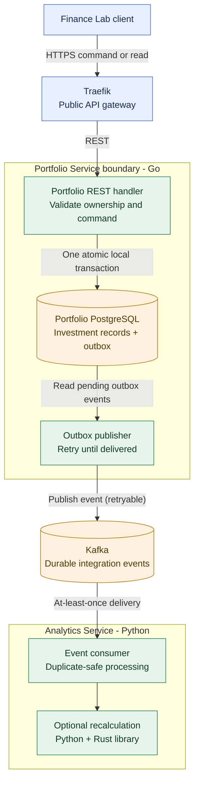

# ADR-009: Hybrid REST + Kafka communication, beginning with Portfolio

- **Status:** Accepted (Release 1 target architecture; implementation and verification pending)
- **Recorded:** 2026-10-18
- **Scope:** Finance Lab service communication and initial Portfolio integration events

## Context

Clients need immediate results when they record and retrieve investments. Other capabilities, such as advanced analytics, can react to portfolio changes later without blocking the original request. A synchronous dependency from Portfolio to Analytics would reduce availability and increase coupling. The Job4j ShareTrip curriculum demonstrates synchronous HTTP, Kafka, transactional outbox/inbox, and distributed-process observability.

## Decision

Adopt **hybrid synchronous REST + asynchronous Kafka** communication for Finance Lab Release 1, **starting with Portfolio Service**:

- **REST** handles direct, authorized client operations and reads. Traefik routes external API calls to independent services; internal calls do not have to traverse Traefik.
- **Portfolio Service (Go)** owns investment changes in its PostgreSQL database (ADR-003). When an investment change needs an integration event, persist the financial change **and the corresponding outbox record in one local PostgreSQL transaction**; acknowledge success only after that transaction commits.
- A separate **outbox relay** eventually publishes pending integration events to **Kafka**. Kafka or Analytics unavailability must **not prevent a successfully validated Portfolio command from committing**. The event remains pending for later delivery when the broker recovers.
- A consumer, initially **Python Analytics Service** (ADR-007), can subscribe and refresh or invalidate optional derived calculations. Redis caching in Analytics (ADR-015) must use source/version-aware keys or explicit staleness behavior: **delayed Kafka delivery alone cannot guarantee cache freshness**. Core Portfolio, Budget and FIRE functionality must remain usable without the Analytics consumer.
- Treat Kafka delivery as **at least once**, with duplicate publication/consumption possible. Consumers with durable side effects must apply **idempotent processing**, typically using a persisted processed-`event_id` record (inbox/deduplication) in the **same local transaction** as the derived write, where applicable. Do not claim end-to-end exactly-once processing.
- Keep financial authorization and database ownership with the respective services (ADR-003, ADR-006). Events do not authorize subscribers to access another service's private data. A consumer calling a protected API must authenticate with narrowly scoped machine credentials or an explicitly authorized user delegation (ADR-014); user bearer tokens must not be carried in events.

This decision **does not require** all Finance Lab interactions to be events, nor does it turn Kafka into the source of truth for financial balances and transactions. Publishing and subscribing beyond the initial Portfolio workflow require their own defined use cases.

## Architecture diagram

This is a **logical process diagram**, not a final deployment specification. The one local transaction covers Portfolio state and its outbox only; it does **not** include Kafka or Analytics. The diagram intentionally does not suggest that Analytics must be available for a Portfolio command to complete.

## Required design and verification before implementation

1. Define the **first Portfolio event** and its business semantics, schema/version, owner, publication trigger, topic and partition key (e.g., ordered by portfolio/account where necessary). Do not prematurely equate every purchase with an immediately recalculated valuation.
2. Include stable `event_id`, `event_type`, `occurred_at`, schema version and appropriate `correlation_id`, `causation_id` and trace propagation, based on ShareTrip observability lessons (ADR-001). Keep payloads minimal and avoid leaking sensitive financial data or user identities into logs and public dashboards.
3. Specify producer retries, outbox recovery, consumer idempotency, replay, error handling and poison-message policy. Exact retry limits, dead-letter behavior, broker security and operational topology require implementation-level design.
4. Test failure after database commit but before Kafka publication, Kafka downtime, duplicate delivery, consumer downtime and eventual catch-up. Assert that committed financial records remain correct and independent of Analytics availability.
5. Monitor outbox backlog, publish failures, consumer lag and end-to-end event-processing delay; connect traces/logs via correlation context. Observability must never be required for a financial command to succeed.

## Consequences

- Supports immediate financial commands and loosely coupled asynchronous follow-up processing.
- Introduces eventual consistency for derived analytics, Kafka operations and outbox/inbox complexity.
- Provides realistic Job4j learning exercises without coupling business correctness to broker availability.

## Related decisions and learning references

- [ADR-001: Observability](0001-observability-baseline.md)
- [ADR-002: Traefik](0002-traefik-api-gateway.md)
- [ADR-003: PostgreSQL Database-per-Service](0003-postgresql-database-per-service.md)
- [ADR-006: Keycloak identity and authorization](0006-keycloak-identity-service-authorization.md)
- [ADR-007: Python Analytics + Rust](0007-python-analytics-rust-library.md)
- [ADR-014: Service-to-service security](0014-keycloak-service-to-service-security.md)
- [ADR-015: Analytics Redis cache and MongoDB saved reports](0015-analytics-redis-cache-mongodb-reports.md)
- [Job4j: Asynchrony and Kafka](https://github.com/anton415/job4j_senior_lessons/blob/main/modules/4.9.3-go-sharetrip-in-microservices/09-asynchrony-and-events-kafka.md)
- [Job4j: Transactional outbox and inbox](https://github.com/anton415/job4j_senior_lessons/blob/main/modules/4.9.3-go-sharetrip-in-microservices/11-outbox-inbox-transaction.md)
