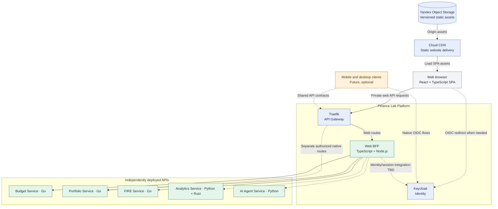

# ADR-010: Independently hosted SPA with an API-first multi-client backend

- **Status:** Accepted (Release 1 target architecture; not yet deployed or verified)
- **Recorded:** 2026-10-18
- **Scope:** Finance Lab frontend availability, static hosting and reusable client APIs

## Context

Finance Lab has independently deployable financial services behind Traefik (ADR-002 and ADR-004). The existing React/TypeScript web frontend should remain loadable when the API is degraded, and API services should remain functional when the web frontend is unavailable. Future desktop and mobile clients should be able to use the same domain APIs without depending on the web application's server process.

The main alternatives were static Single-Page Application (SPA) hosting with a CDN, a server-side rendered frontend, and colocating the frontend with the backend.

## Decision

**Release 1 (2026):**

- Deploy the existing **React + TypeScript application as a static SPA**, separately from the API and business service runtime.
- Target **Yandex Object Storage + Cloud CDN** for the public website's versioned static assets. Cloud deployment settings, domain names and network topology are implementation work, not verified by this decision.
- Keep **Traefik** as the public API ingress (ADR-002) for independent Go Budget, Portfolio and FIRE services and separate Python AI/Analytics services (ADR-004/ADR-007).
- Implement the web client as an **API consumer** with explicit loading, failed-request and service-degradation states. When the API is unavailable, the HTML/JS/CSS should still load if the static hosting infrastructure is reachable. The UI must **not** represent missing balances or unavailable service responses as zero.
- Use **shared, versioned API contracts** usable by the web client and potential future desktop/mobile applications; do not create mandatory backend coupling to the SPA runtime.
- Treat desktop and mobile clients as **future supported client types**, not required applications for Release 1.
- Keep user authentication centralized in Keycloak (ADR-006). A separately deployed TypeScript/Node.js Web BFF handles browser-specific aggregation and is the intended integration point for web sessions (ADR-012). Exact session/token, logout, refresh and CSRF policies still require implementation decisions. Configure cross-origin browser access narrowly if frontend and API reside on separate origins.
- A public engineering dashboard will use allowlisted, sanitized, periodically published static JSON, as decided in ADR-011. Raw Grafana, Loki, Prometheus, Jaeger and private financial APIs remain inaccessible to anonymous visitors.

## Architecture diagram

Solid arrows show static asset delivery and the Release 1 private Web BFF path; dashed paths represent **optional integrations, pending security details or future native clients**. The CDN serves public frontend assets, **not authenticated financial data**. The browser calls Traefik/BFF after loading the SPA, not the CDN.

## Failure boundaries and implementation requirements

- **Backend or Web BFF unavailable:** The existing published SPA can still load **if CDN, static origin, DNS and network remain available**; authenticated financial operations fail or degrade explicitly.
- **Frontend hosting unavailable:** The BFF and independent domain APIs can continue to operate **if gateway, identity provider, backend, network and their dependencies remain available**. A user cannot load a new SPA when its static delivery fails.
- **Identity provider unavailable:** Public static assets may load, but sign-in and some authenticated requests can be unavailable.
- **Same cloud provider:** Separate deployments reduce direct application coupling but **do not guarantee independent regional/provider availability**.
- **Deployment details:** Use versioned immutable assets and a safe SPA HTML fallback, limit CORS to approved client origins, ensure correct TLS policies, and avoid shipping secrets or sensitive financial data in static assets. Browser token storage and cross-origin cookie behavior must be resolved with ADR-006 before deployment.
- **Compatibility:** Define backwards-compatible or explicitly versioned API changes so clients deployed on different release schedules can coexist.

## Consequences and deferred decisions

- Eliminates the requirement to run a web application server merely to serve the existing React SPA.
- Supports independent deployment and failure isolation between static assets and financial APIs, with explicit availability limits.
- Introduces CDN/origin configuration, CORS, client/API compatibility and client-side degraded-state handling.
- Does **not** select SSR, a specific BFF framework, native mobile/desktop frameworks, offline persistence or an exact production DNS/cookie architecture. The TypeScript Web BFF is accepted in ADR-012; public metrics exposure is governed by ADR-011.

## Related decisions

- [ADR-002: Traefik API Gateway](0002-traefik-api-gateway.md)
- [ADR-004: Independent services and language distribution](0004-independent-polyglot-services.md)
- [ADR-006: Keycloak identity](0006-keycloak-identity-service-authorization.md)
- [ADR-007: Python Analytics and Rust library](0007-python-analytics-rust-library.md)
- [ADR-011: Public sanitized observability dashboard](0011-public-sanitized-observability-dashboard.md)
- [ADR-012: TypeScript Web BFF](0012-typescript-web-bff-api-composition.md)
