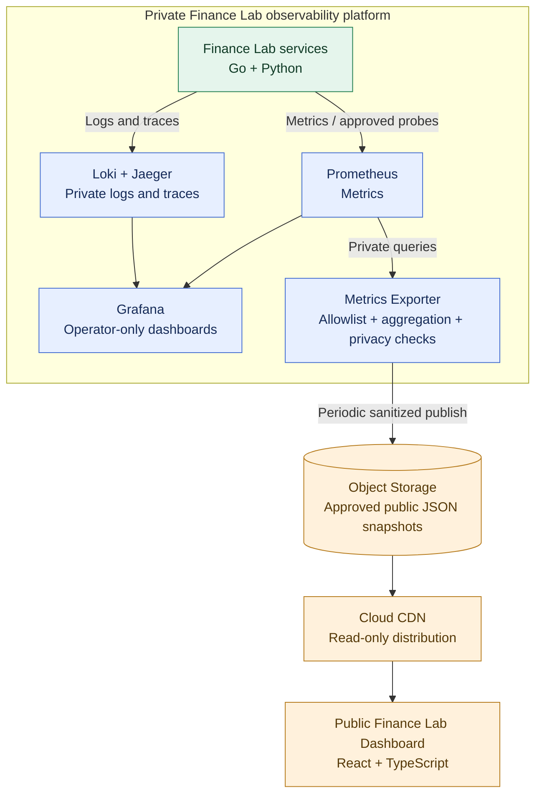

# ADR-011: Public dashboard through sanitized, periodically exported metrics

- **Status:** Accepted (Release 1 target architecture; not yet implemented)
- **Recorded:** 2026-10-18
- **Scope:** Public Finance Lab engineering dashboard and its observability-data boundary

## Context

Finance Lab is both a personal-finance application and an engineering portfolio. Visitors should be able to see evidence of real observability and reliability engineering without gaining access to personal financial information or the private monitoring platform. The frontend is already planned as an independently hosted React/TypeScript SPA (ADR-010); Grafana, Prometheus, Loki, OpenTelemetry and Jaeger are part of the private platform (ADR-001).

Sharing Grafana or exposing Prometheus/Loki/Jaeger directly would increase both attack surface and accidental data-disclosure risk. Even metrics without user labels can reveal individual activity patterns when the product has very few active users.

## Decision

- Publish a **public, read-only engineering dashboard** as part of Finance Lab's static React/TypeScript website (ADR-010).
- Keep **Grafana, Prometheus, Loki, Jaeger and any operational administration endpoints private**. Neither the public browser nor public assets should query those internal monitoring services directly.
- Add a private **metrics export/sanitization process** with a strict **allowlist** of approved metric names and output fields. Query private observability data, aggregate/validate results, and **periodically publish a small static JSON snapshot** to an Object Storage path served through Cloud CDN. The exporter requires write access; anonymous clients receive only published read-only JSON.
- **Initial 2026 public scope:** coarse service availability, response-latency summaries (including p95 where enough samples exist) and error-rate summaries. Use **synthetic monitoring/probe traffic or other explicitly reviewed non-user-sensitive measurements** as the default source. When real-user traffic is sparse, do not publish live request volume or fine-grained metrics that could reveal personal usage.
- Show measurement **window, source/provenance, last-updated time and a visible stale/unavailable state**. If export fails, preserve accurate staleness information; never present an old successful measurement as fresh current availability.
- Optional future public information (Kafka processing delay, deployment history, architectural views and richer metrics) requires a separate privacy/security review of each field or dataset.
- If the public app demonstrates financial workflows, use **clearly marked synthetic demonstration data**, never real account balances or private user information.

The public metrics export is **not** a user-facing financial API, identity provider, business orchestrator or database. This decision does not authorize publishing internal service addresses, sensitive build/deployment details or customer telemetry.

## Architecture diagram

**Boundary:** This is a logical data flow. All telemetry backends and the exporter are private; only allowlisted, periodically published JSON becomes public. The CDN serves static snapshots, not live Grafana queries or personal-finance API responses.

## Security, privacy and release verification

- Define a versioned public JSON schema with a **positive allowlist**; reject unexpected fields and avoid raw labels, trace IDs, user IDs, account IDs, request paths with parameters, tokens, balances, secrets and internal endpoint addresses.
- Explicitly review the risk of **low-volume traffic inference**. Prefer synthetic availability/latency checks or coarse, delayed, thresholded metrics over granular production usage.
- Limit exporter credentials to required Prometheus queries and a specific public-snapshot write destination; prevent browsing of private buckets/prefixes or arbitrary paths.
- Make the public JSON unauthenticated and cacheable, but never place sensitive information in objects or client-side application bundles. Keep operator dashboards behind appropriate authentication and network controls.
- Validate data contract, field allowlist, timestamp/freshness logic and failure behavior with tests. Perform a privacy review on sample output before making its storage path public.
- Release 1 should start with **availability, latency and error rates**; display missing/insufficient-sample states instead of fabricating values.

## Consequences

- Real observability can be showcased without exposing monitoring infrastructure or individual financial activity.
- The static dashboard can remain available during temporary monitoring/backend outages, but its displayed measurements become **stale** until the next successful export.
- Requires a small export job, sanitization rules, static asset publishing and freshness checks; exact cadence, SLO thresholds and hosting security settings are implementation details.

## Related decisions

- [ADR-001: ShareTrip-derived observability baseline](0001-observability-baseline.md)
- [ADR-010: Independently hosted SPA and API-first clients](0010-independent-spa-and-api-first-clients.md)
- [ADR-006: Keycloak identity and service-owned authorization](0006-keycloak-identity-service-authorization.md)
