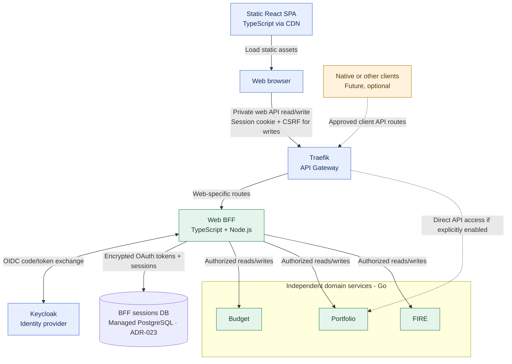

# ADR-012: A separate TypeScript Web BFF for API composition

- **Status:** Accepted (Release 1 target architecture; implementation pending)
- **Recorded:** 2026-10-18
- **Scope:** Private financial web experience and its presentation-specific backend

## Context

The React/TypeScript SPA is hosted independently as static assets (ADR-010). Budget, Portfolio and FIRE are independent Go services (ADR-004); none may become a shared business orchestrator. The private financial overview may combine authorized results from several services and needs predictable partial-failure behavior. Browser sign-in with Keycloak is a separate security concern (ADR-006).

We compared browser-side aggregation, a Go BFF, a separate TypeScript/Node.js BFF, full-stack TypeScript frameworks such as Next.js, and GraphQL composition. A Go BFF would reinforce Job4j, but TypeScript better aligns the web-specific adaptation layer with the existing UI. Adopting a server-rendering framework solely for this purpose would undermine the accepted static-SPA deployment.

## Decision

- Add an **independently deployed Web BFF written in TypeScript on Node.js**. It is separate from both the static React SPA and Go business services. BFF instances should not rely on in-process-only session state; server-side session persistence is provided by a **dedicated Yandex Managed PostgreSQL logical database** under ADR-023. The HTTP framework (e.g., Fastify or NestJS) is **not yet selected**.
- Route the private web application's BFF endpoints through **Traefik** (ADR-002). The BFF composes **read-only, browser-specific overview responses** and also forwards **all other private browser API calls, including writes**, to the appropriate authorized domain service (ADR-013). It has **no financial business database**, does not own business entities or compute authoritative financial values, and must not become a general-purpose domain orchestrator.
- Keep domain APIs independently usable via explicitly configured, authenticated routes for future native clients and other approved consumers (ADR-010). No frontend client is required to use Budget before Portfolio or FIRE.
- Preserve Keycloak as the central identity provider and keep **resource-level authorization within each domain service** (ADR-006). The Web BFF **is the browser-facing OIDC client**: Authorization Code + PKCE, **server-side access/refresh tokens**, an opaque Secure/HttpOnly cookie and CSRF safeguards are accepted in ADR-013. Exact cookie scope, **BFF-owned PostgreSQL session schema and encryption key handling**, OAuth callbacks and refresh/logout operations require implementation design under ADR-023. Downstream user delegation uses Keycloak Token Exchange under ADR-014; exact service audience/scope mappings require testing.
- A BFF must never authorize resources solely from user identifiers supplied by the browser. Under ADR-014, exchange signed-in user tokens for audience-restricted tokens when accessing domain APIs; domain services validate claims and enforce their own resource ownership. Effective downscoping must be enforced rather than assumed. **For an AI-generated financial suggestion, ADR-026 requires a fresh authenticated user confirmation bound to the exact payload/resource version before the BFF uses the ordinary Go-service write API.** The model has no write authority.
- Bound downstream calls with timeouts and cancellation. Where the product supports it, return **explicitly partial or unavailable** data with freshness/error indicators rather than converting failed reads into zero balances. Define the exact response/error contract before implementation.
- The **public engineering/observability dashboard** (ADR-011) stays on the static website using sanitized JSON exports; it does **not** require this private Web BFF.

## Architecture diagram

The solid path is the **private browser read-composition and write-forwarding path**, not a mandatory route for other client types. Dashed paths show optional approved native API routes. The BFF uses Keycloak and server-managed sessions (ADR-013); domain services still enforce resource-level authorization. The BFF may fail without taking down the static SPA or independently running domain services.

## Consequences and verification

- Adds another service to build, deploy, monitor and secure, but centralizes UI-specific aggregation without moving financial domain logic into Traefik or Budget Service.
- Allows parallel requests, bounded response times and isolated per-service failures, preserving domain independence.
- Maintain **contract-first OpenAPI 3.1 REST APIs, independently versioned by each service and the BFF** (ADR-024). Generate TypeScript client types where helpful, but validate response payloads at runtime; use safe RFC 9457 Problem Details for standardized errors. **Under ADR-022, monetary values are validated decimal strings with currencies and must not pass through JS `number` for authoritative computations**; the owning Go service performs financial arithmetic.
- Add integration tests for user isolation, missing/invalid security context, partial outages, unexpected response data, deadline propagation and disconnected clients.
- Does not select GraphQL, a mobile BFF, server-side rendering, an HTTP framework or the exact browser cookie/refresh/logout implementation. **ADR-023 selects a dedicated Managed PostgreSQL session database**, while ADR-013 establishes the BFF-managed browser session model.

## Related decisions

- [ADR-002: Traefik API Gateway](0002-traefik-api-gateway.md)
- [ADR-004: Independent polyglot services](0004-independent-polyglot-services.md)
- [ADR-006: Keycloak identity and service-owned authorization](0006-keycloak-identity-service-authorization.md)
- [ADR-010: Independent static SPA and future clients](0010-independent-spa-and-api-first-clients.md)
- [ADR-011: Public observability dashboard](0011-public-sanitized-observability-dashboard.md)
- [ADR-013: BFF-managed browser authentication](0013-keycloak-bff-managed-browser-sessions.md)
- [ADR-014: Service-to-service security](0014-keycloak-service-to-service-security.md)
- [ADR-022: Exact Money DTO](0022-exact-decimal-money-currency-contract.md)
- [ADR-023: PostgreSQL BFF sessions](0023-postgresql-bff-sessions-and-oauth-lifecycle.md)
- [ADR-024: API versioning and standard errors](0024-openapi-contract-first-rest-versioning.md)
- [ADR-026: Least-privilege product agents and human-approved writes](0026-least-privilege-ai-agent-human-approved-writes.md)
