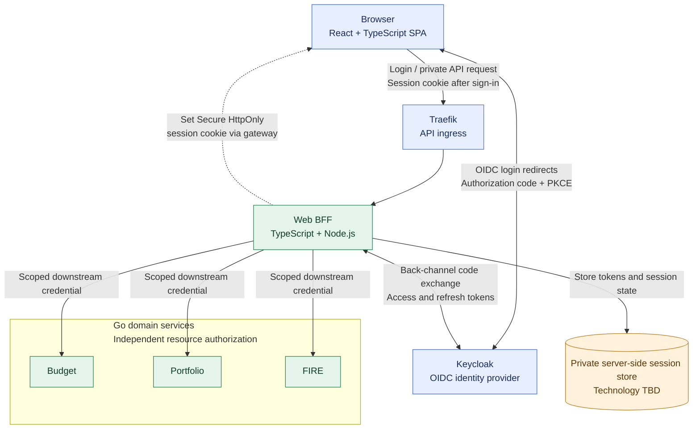

# ADR-013: Keycloak login with BFF-managed browser sessions

- **Status:** Accepted (Release 1 target architecture; implementation pending)
- **Recorded:** 2026-10-18
- **Scope:** Private Finance Lab web authentication, session security and browser API access

## Context

The web frontend is a separately hosted React/TypeScript SPA (ADR-010). Traefik routes API traffic to an independent TypeScript/Node.js Web BFF (ADR-012), and Keycloak is the central identity provider (ADR-006). Finance Lab contains private financial data: exposing OAuth access or refresh tokens to browser JavaScript would increase the impact of malicious scripts. A browser-facing BFF can retain tokens server-side while providing secure session-based access.

We compared direct SPA token handling, a token-mediating backend, and a BFF that owns the browser login/session lifecycle. The **BFF-managed session** approach is accepted for Release 1.

## Decision

- The **Web BFF is the OAuth/OIDC client** for the browser application. Authenticate users through **Keycloak using Authorization Code + PKCE**, with validated `state` (and OIDC `nonce` where appropriate), a trusted redirect URI and secure back-channel code exchange. Do not use implicit or resource-owner-password flows.
- **Keep OAuth access and refresh tokens on the server side**, not in frontend JavaScript, `localStorage`, URLs, or browser-visible API responses. The BFF manages obtaining/refreshing tokens according to a bounded server-side session.
- The browser receives a **secure, HttpOnly session cookie** holding only an opaque session reference. Require HTTPS, an appropriate `SameSite` setting, narrow cookie scope, session-ID rotation on authentication and explicit session expiry/termination. The exact cookie/domain settings depend on the deployment and OIDC redirect design.
- The Web BFF handles **all private browser API requests, including reads and writes**. It can compose read-only overview responses (ADR-012) and forward authorized mutation requests to the owning Go service, but does **not** own financial transactions or financial business rules.
- Protect state-changing browser requests against **CSRF** using a validated anti-CSRF scheme and origin checks as appropriate; `SameSite` is defense in depth, not the only protection. Restrict cross-origin access to approved origins and configure credentials deliberately.
- Each Go domain service continues to **authenticate the security context it receives and enforce resource-level authorization itself** (ADR-006). The BFF must pass an appropriately scoped, verified downstream security credential. The exact delegated-token or token-exchange design and audiences are **still open**; never trust a browser-supplied user ID or unsigned identity header.
- The BFF can run multiple instances without persisting session state in application memory alone. The **server-side session-store technology**, token encryption/rotation policy, logout propagation, MFA policy, back-channel trust and service-to-service delegation still require implementation decisions. Redis or MongoDB are **not implicitly selected** as the session store.
- The public static observability dashboard (ADR-011) remains independently available without a browser session; this decision does not expose private financial resources to anonymous users.

## Authentication and request flow

**Diagram boundary:** OIDC authorization redirects and callbacks travel through the browser and approved BFF route; the BFF exchanges the authorization code with Keycloak server-to-server. The session cookie is issued in a BFF response routed through Traefik. The session store is conceptual, **not a chosen database technology**. Access to domain APIs is authorized separately by each domain service.

## Consequences and implementation verification

- Browser JavaScript does not receive financial API bearer/refresh tokens; secure cookies still require XSS prevention, CSRF safeguards and correct lifecycle management.
- The BFF becomes critical for private **web** requests but **not** for static website asset delivery or independently authorized native clients.
- Test: successful/failed login; invalid `state` or code; token/session expiry; logout and session invalidation; CSRF attempts; forbidden CORS origins; session fixation; cross-user access; and Go-service rejection of missing/incorrect audience tokens.
- Verify browser redirect, cookie and CORS behavior with the **actual chosen domain/origin layout** before accepting the deployment.
- Select session persistence, BFF HTTP framework, logout mechanics and downstream delegation in separate follow-up designs rather than inventing them here.

## Related decisions

- [ADR-002: Traefik API Gateway](0002-traefik-api-gateway.md)
- [ADR-006: Keycloak identity and service-owned authorization](0006-keycloak-identity-service-authorization.md)
- [ADR-010: Independent static SPA](0010-independent-spa-and-api-first-clients.md)
- [ADR-012: TypeScript Web BFF](0012-typescript-web-bff-api-composition.md)
