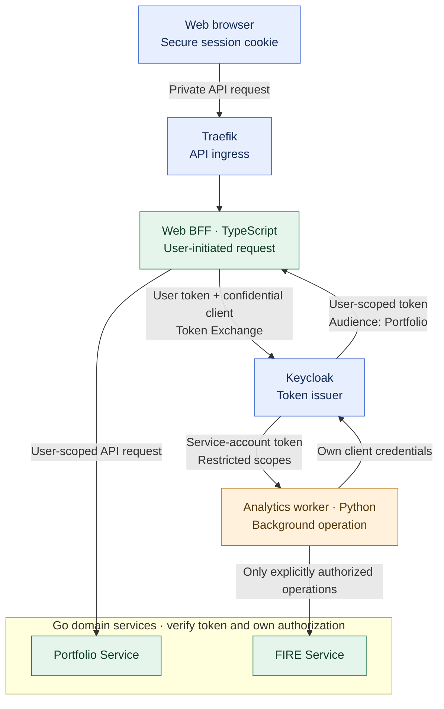

# ADR-014: Keycloak service-to-service identity with least-privilege tokens

- **Status:** Accepted (Release 1 target architecture; implementation pending)
- **Recorded:** 2026-10-18
- **Scope:** BFF → Go domain APIs and authorized backend-to-backend operations

## Context

Finance Lab already uses Keycloak for centralized identity (ADR-006) and a TypeScript Web BFF for private browser operations (ADRs 012–013). Go Budget, Portfolio and FIRE services own independent resource authorization. Python Analytics and AI Agent may process user-initiated or background work; the two cases **must not** receive interchangeable permissions.

A mere network connection through Traefik, an internal hostname or possession of an arbitrary service token must not become permission to read or modify private financial data.

## Decision

Use **Keycloak as the token issuer** for two distinct types of service-to-service requests:

1. **Acting for a signed-in user — OAuth 2.0 Token Exchange.** The confidential Web BFF exchanges the user's valid Keycloak access token for a **short-lived, audience-restricted downstream token** intended for the specific Go service. Preserve the authenticated user subject and only the permissions needed for that operation. Each Go API verifies issuer, signature (or equivalent trusted introspection), expiration, intended audience and required scopes/roles, **then checks resource ownership** against its own records. A token's presence alone is not permission to access every resource.
2. **Background work without a user session — OAuth 2.0 Client Credentials.** Each machine workload requiring API access (for example an authorized Analytics worker) has its **own Keycloak service account**, with narrowly defined client roles, audiences and scopes. The target Go API verifies the machine token and authorizes only service-account operations explicitly allowed by its policy. **A service-account token does not impersonate a user or automatically grant access to arbitrary budgets, portfolios or FIRE scenarios.** Any operation requiring user-specific consent/delegation needs an explicit, auditable design.

**Keycloak standard token exchange V2** is the preferred first-release implementation for first-party clients in the same realm. The requesting client must be confidential and configured for standard token exchange; Keycloak's audience and scope mappings must be validated against the actual token. **Keycloak's standard exchange can expand scopes under some configurations**, so enforce genuine **downscoping / no privilege escalation** using the appropriate client policy (such as a downscope assertion grant enforcer), strict client scopes and tests. Request a single necessary resource audience where possible.

Confine application and identity traffic to authenticated **TLS-protected channels**, keep backend APIs off the public network except explicitly approved routes, protect service credentials via controlled secret delivery and rotation, and never log bearer tokens or client secrets. **mTLS is an optional future hardening measure**, not a prerequisite for this ADR.

Kafka event delivery (ADR-009) is **not** an authorization credential: do not put user access tokens into event payloads or headers. Consumers validate event source/trust/schema; if they later call private APIs, obtain purpose-limited service credentials or a properly designed user delegation rather than inheriting arbitrary user rights.

## Architecture diagram

The diagram shows **two independent security flows**; it does **not** imply that background Analytics can read individual FIRE records by default. REST calls remain subject to Go service policy, and real client audiences, route contracts and service scopes are to be configured and tested.

## Required security verification

- Test valid user exchange to the intended service and rejection of missing/invalid subject, mismatched audience, expired token and requests outside granted scopes.
- Confirm that an exchange **cannot produce a token with broader effective privileges** than intended. Do not rely solely on an `audience` request parameter: inspect issued claims and configure Keycloak's downscoping policy.
- Test cross-user access denial **inside each financial service**, even for properly signed user tokens.
- Test client-credentials requests with wrong/expired tokens, wrong audiences, excessive scope and unauthorized user-specific data access.
- Test Keycloak unavailability, TLS verification, credential rotation and safe operational errors without exposing tokens.
- For Kafka consumers, keep authentication and event validation distinct; duplicate-safe consumption remains governed by ADR-009.

## Consequences and deferred details

- Centralizes identity issuance while preserving service-specific authorization and independent data ownership.
- Distinguishes human authority from machine authority and reduces blast radius through per-audience/per-service credentials.
- Adds Keycloak client configuration, exchange policy tests, protected secret management and token lifecycle behavior.
- Concrete scopes/roles, service account inventory, outbound mTLS, workload identity alternatives and token caching remain implementation/security work. **ADR-026 now accepts the product AI rule: read-only user-scoped tools by default, with exact human-confirmed financial writes through the normal BFF and owning domain API.** Detailed AI on-behalf-of scopes, approval binding and consent implementation are still pending; never infer unrestricted agent rights.

## References

- [Keycloak standard token exchange](https://www.keycloak.org/securing-apps/token-exchange)
- [Keycloak OIDC / Client Credentials](https://www.keycloak.org/securing-apps/oidc-layers)
- [RFC 8693: OAuth 2.0 Token Exchange](https://www.rfc-editor.org/rfc/rfc8693.html)
- [ADR-006: Identity and resource authorization](0006-keycloak-identity-service-authorization.md)
- [ADR-009: REST + Kafka](0009-hybrid-rest-kafka-portfolio-events.md)
- [ADR-013: BFF-managed browser sessions](0013-keycloak-bff-managed-browser-sessions.md)
- [ADR-026: Least-privilege product agents and human-approved writes](0026-least-privilege-ai-agent-human-approved-writes.md)
