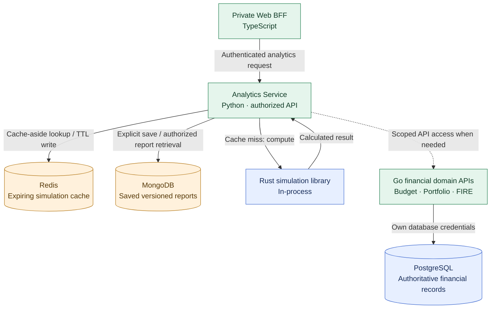

# ADR-015: Analytics-owned Redis simulation cache and MongoDB saved reports

- **Status:** Accepted (Release 1 target architecture; not yet implemented or verified)
- **Recorded:** 2026-10-18
- **Scope:** Finance Lab Release 1 (2026), Python Analytics Service and secondary data stores

## Context

ADR-008 includes both Redis and MongoDB in Finance Lab's 2026 learning and integration scope. ADR-003 keeps PostgreSQL authoritative for Budget, Portfolio and FIRE financial records. The Python Analytics Service (ADR-007) computes optional advanced financial simulations using an in-process Rust library; financial domain services remain independently usable without it.

We need two bounded, meaningful persistence exercises without turning secondary storage into a new source of financial truth or adding dependencies to ordinary financial operations.

## Decision

**The Python Analytics Service owns both integrations for Release 1.** ADR-018 places both Redis and MongoDB inside self-managed K3s, while the authoritative PostgreSQL cluster remains external in Yandex Managed PostgreSQL:

1. **Redis: optional cache of expensive analytical/simulation results.** Use a cache-aside pattern for a narrowly scoped FIRE/Monte Carlo simulation. After authenticating and authorizing the request, Analytics looks up a cache entry, computes with its Rust library on a miss, and writes the result with a bounded **TTL**. Redis is **not authoritative**; cache failure or cache eviction does not delete financial records or saved reports. Compute normally on a cache miss or Redis outage where possible.
2. **MongoDB: durable, versioned documents for explicitly saved analytical reports.** When an authorized user chooses to save a generated report, Analytics persists the report as a document with an ownership reference, report/schema version, model version, input assumptions (handled as sensitive), data-snapshot/version metadata, calculation timestamp and output. MongoDB stores **derived report artifacts**, not budgets, portfolio transactions, FIRE's authoritative business state or source data from other services. Index and query only through the Analytics Service's authorized API; the report-storage contract, backup/retention and exact indexes remain implementation work.

**The 2026 goal is one complete cache integration and one complete saved-report workflow**, with appropriate tests and observability; the exercise must not become a prerequisite for core Budget, Portfolio or FIRE operation.

### Correctness, security and failure boundaries

- **Service ownership:** Analytics alone holds Redis/MongoDB database credentials and maintains its report schema/indexes. Other services and the Web BFF use explicit authenticated Analytics APIs, **never** Analytics storage or another domain service's PostgreSQL tables directly (ADR-003).
- **User isolation:** Authenticate/authorize **before cache lookup or report retrieval**. Cache keys distinguish authenticated ownership/security context, normalized input parameters, **source-data snapshot/version**, model version and random seed (where reproducibility needs it). Use opaque/hash-derived key components rather than raw personal/financial data; do not log cache keys carrying sensitive information.
- **Freshness:** A cached result is reusable only when its input and source versions match the request. TTL caps lifetime. Kafka events may help invalidate/warm analytics entries (ADR-009), but **asynchronous event delivery is not a guarantee of immediate freshness**. If authoritative source version cannot be verified, recompute or clearly mark a result as potentially stale instead of silently showing outdated balances or valuations.
- **Save versus compute:** Simulations can run without MongoDB. If a user requests report saving and MongoDB fails, **return an explicit save error**; do not report a successful save. Redis failure should degrade cache efficiency, not calculation correctness.
- **Restricted data access:** Fetch private financial inputs only through domain service APIs and verified delegated/user-scoped credentials or specifically authorized machine permissions (ADR-014). No arbitrary service-account access to users' financial records.
- **Data protection:** Enforce report-level ownership on every request; encrypt transport and stored sensitive report data appropriately; plan access control, retention/deletion, backups and recovery. Neither saved reports nor cache contents become public metrics (ADR-011).

## Architecture diagram

The arrows describe logical read/compute/save paths, **not a synchronous requirement that every request uses every component**. MongoDB is used only for saved analysis documents. The cache can be bypassed. The dashed API access is authorized under ADR-014. Financial business services retain their independent PostgreSQL data and are not dependent on Analytics.

## Required implementation verification

- **Cache:** Compare hits/misses against the Rust reference output; test TTL expiry, Redis outage, cache poisoning/cross-user isolation, changes in assumptions/source version/model version, and reproducible simulation seeds.
- **Reports:** Test explicit save, fetch, owner-only access, document schema versioning, indexing, unauthorized reads, data retention/deletion, **daily off-cluster encrypted backups and recovery of MongoDB reports** (ADR-019), and MongoDB outage without false success.
- **Integration:** Verify that Kafka delivery delay or duplicates cannot silently resurrect stale results and that core domain APIs continue to operate if either Redis or MongoDB is unavailable.
- **Operations:** Instrument cache hit/miss/latency/error, report-save latency/errors, and expiry/staleness counts without exposing financial inputs or user identifiers in metric labels.

## Consequences and deferred decisions

- Includes both Redis and MongoDB in practical 2026 Finance Lab development as required by ADR-008, while isolating their complexity inside Analytics.
- Adds two datastores and associated security, backup, test and operational work; keep the Release 1 use cases deliberately small.
- Cache TTL, exact MongoDB document/index schema, retention policies, encrypted storage configuration, persistent-volume/backup implementation and event-based invalidation strategy are deferred to implementation. **Storage placement in K3s is accepted by ADR-018**.
- Redis is **not selected** as the BFF session store; that remains an independent open question under ADR-013.
- Nothing here changes the planned Release 2 evaluation of extracting Rust simulations to a separate service (ADR-007).

## Related decisions

- [ADR-003: PostgreSQL database-per-service](0003-postgresql-database-per-service.md)
- [ADR-007: Python Analytics with Rust library](0007-python-analytics-rust-library.md)
- [ADR-008: Redis and MongoDB 2026 learning scope](0008-redis-mongodb-2026-learning.md)
- [ADR-009: REST + Kafka Portfolio events](0009-hybrid-rest-kafka-portfolio-events.md)
- [ADR-011: Public observability dashboard](0011-public-sanitized-observability-dashboard.md)
- [ADR-014: Keycloak service-to-service security](0014-keycloak-service-to-service-security.md)
- [ADR-018: K3s-hosted Redis/MongoDB](0018-hybrid-managed-postgresql-k3s-platform-state.md)
- [ADR-019: MongoDB backup and recovery](0019-backup-recovery-objectives-drills.md)
