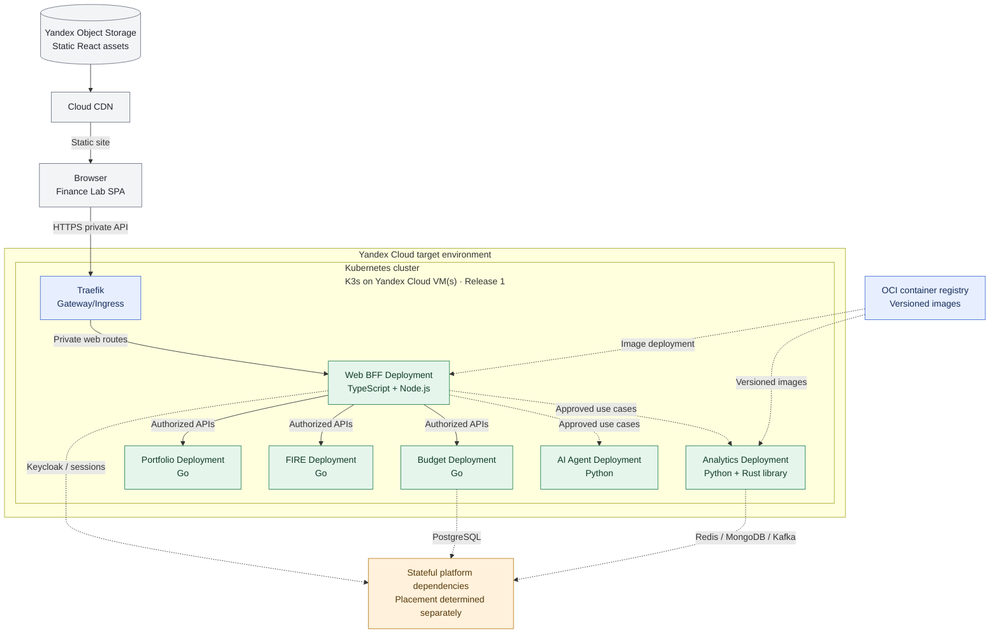

# ADR-016: Kubernetes for Release 1 container orchestration

- **Status:** Accepted (Release 1 deployment target; not yet provisioned or verified)
- **Recorded:** 2026-10-18
- **Scope:** Finance Lab containerized services and platform ingress, first release by 2026-12-31

## Context

The Finance Lab Release 1 architecture includes independently deployable Go domain services (ADR-004), TypeScript/Node.js Web BFF (ADR-012), Python Analytics and AI Agent services (ADRs 004 and 007), Traefik (ADR-002) and multiple stateful dependencies. Docker Compose would be a simpler initial deployment, but the user **explicitly prefers Kubernetes in Release 1** for hands-on orchestration and platform-engineering practice despite increased cost and implementation work.

Yandex Cloud remains the planned deployment environment. Its managed Kubernetes service charges for the control plane and worker resources separately; a self-managed Kubernetes distribution trades infrastructure costs for operational responsibility. **ADR-017 now selects self-managed K3s on Yandex Cloud VM(s) for Release 1, followed by a temporary Yandex Managed Kubernetes evaluation in early 2027.** No measured cost estimate or final node sizing has been approved.

## Decision

**Release 1 (target: December 31, 2026)**

- Use **Kubernetes as the deployment/orchestration platform for containerized Finance Lab backend application workloads** in the Yandex Cloud target environment. The accepted **Release 1 distribution is self-managed K3s on Yandex Cloud VM infrastructure** (ADR-017), not a deferred 2027 upgrade. Yandex Managed Kubernetes is planned as a temporary **comparative evaluation in early 2027**, not as an always-on second production cluster.
- Run **Traefik as the cluster's API ingress/gateway component**, routing explicitly approved external API requests to the Web BFF and other approved services (ADR-002). Keep the Go Budget, Portfolio and FIRE services, TypeScript Web BFF and Python AI Agent/Analytics as **separately deployable Kubernetes workloads**; do not combine their runtimes or business ownership.
- Continue to serve the **static React/TypeScript SPA from Yandex Object Storage + Cloud CDN**, outside the Kubernetes backend runtime (ADR-010). Likewise, the public observability dashboard uses prepublished static sanitized JSON (ADR-011), not live private metrics.
- Build **versioned OCI container images** and maintain **declarative Kubernetes deployment configuration**. For normally stateless HTTP workloads use `Deployment` and `Service` resources with suitable readiness, liveness and (where justified) startup probes, resource requests/limits and controlled rollout/rollback. Deploy service updates independently and verify that one service can be restarted without unnecessarily redeploying another.
- Treat Kubernetes as a shared infrastructure failure domain: **Kubernetes does not by itself guarantee high availability, zero downtime, multi-zone resilience, backup recovery or fault isolation at the node/cluster level**. Those require separately specified capacity, node counts, topology and tests.
- Require explicit security configuration for HTTPS/API exposure, workload/service accounts and minimal RBAC, namespace and network isolation where supported, restricted secret delivery, secure internal service transport and observability (ADRs 001, 006, 013, 014). Do not store financial credentials in plain Kubernetes manifests or container images.
- Preserve domain database ownership from ADR-003. **This decision does not require PostgreSQL, Kafka, Keycloak, Redis, MongoDB, or the observability backends to run inside Kubernetes.** Choose managed/external vs in-cluster placement **per stateful component** using cost, privacy, backup, restoration and operational-risk assessments. Do not assume a `StatefulSet` alone solves data durability.
- Docker Compose, kind or k3d **may be used as local development/test conveniences**, but Docker Compose is **not** the target cloud deployment platform for Release 1.

## Architecture diagram

The diagram shows **logical application deployment and API paths**, not approved node counts, availability zones or managed-service choices. Individual downstream arrows to the stateful-dependencies box are illustrative; no component receives direct cross-domain database access by implication. The SPA and CDN are intentionally outside the cluster.

## Minimum release verification

- Deploy the selected Release 1 API workloads and Traefik to a real Kubernetes cluster using reproducible configuration and versioned images; prove startup, readiness, routing, authenticated requests and isolation of internal-only endpoints.
- Demonstrate a service-specific rollout and rollback, a failed/unready pod excluded from traffic, and an application restart with recorded recovery behavior.
- Define and verify resource requests, limits, storage/recovery for selected stateful systems, cluster access controls and protection of secrets. Include cost measurement and an explicit budget ceiling **before provisioning a long-running cluster**.
- Connect application logs/metrics/traces to the observability design (ADR-001), retaining the public/private telemetry separation (ADR-011).
- Test the failure boundaries honestly: losing a sole worker or control plane can take the platform offline. Do not claim an HA or multi-zone SLO without deploying and testing it.

## Consequences and deferred choices

- Adds substantial Kubernetes, networking, provisioning, monitoring and security work to the 2026 deadline. Scope should prioritize **one functioning end-to-end deployment** over advanced orchestration features.
- **ADR-017 accepts K3s first and a temporary Yandex Managed Kubernetes comparison in early 2027.** The cluster's worker count, VM sizing, regions/zones, cost ceiling, precise infrastructure-as-code and CI/CD/GitOps mechanism remain unselected. The eventual production cluster after comparison must be chosen from measured evidence and an approved migration plan.
- **Traefik provider/routing API** (Kubernetes Ingress vs Gateway API), CNI/network policy behavior, ingress load balancer/DNS/TLS details and secret-management implementation remain configuration decisions.
- Stateful workload location (managed/external or in-cluster), backup/restore, persistent-volume design, message-broker topology and session-store technology remain open.
- The 2027 release can pursue additional reliability or scaling capabilities, but **the initial use of Kubernetes is not postponed**.

## References

- [Kubernetes Deployments](https://kubernetes.io/docs/concepts/workloads/controllers/deployment/)
- [Kubernetes readiness, liveness and startup probes](https://kubernetes.io/docs/tasks/configure-pod-container/configure-liveness-readiness-probes/)
- [Traefik Kubernetes Gateway provider](https://doc.traefik.io/traefik/reference/install-configuration/providers/kubernetes/kubernetes-gateway/)
- [Yandex Managed Service for Kubernetes pricing](https://yandex.cloud/en/docs/managed-kubernetes/pricing)
- [ADR-002: Traefik gateway](0002-traefik-api-gateway.md)
- [ADR-003: PostgreSQL database-per-service](0003-postgresql-database-per-service.md)
- [ADR-004: Independent polyglot services](0004-independent-polyglot-services.md)
- [ADR-010: Static SPA and independent APIs](0010-independent-spa-and-api-first-clients.md)
- [ADR-017: K3s-first and managed Kubernetes comparison](0017-k3s-first-managed-kubernetes-comparison.md)
