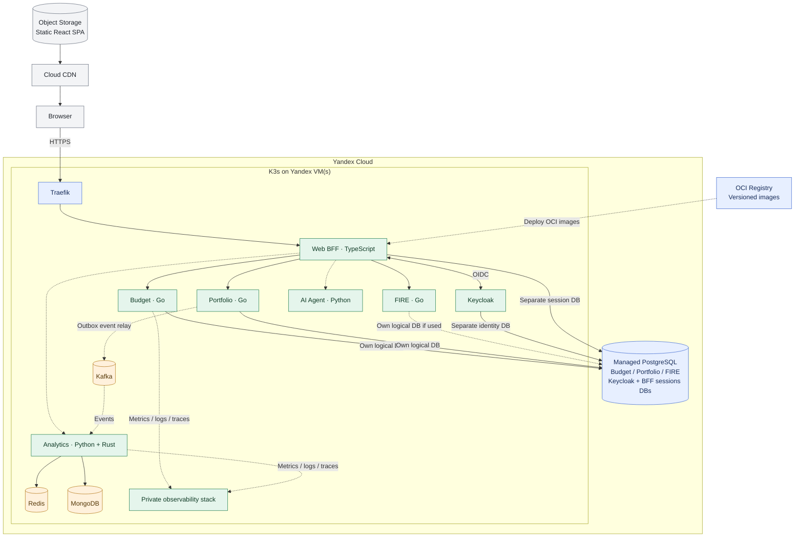

# ADR-016: Kubernetes for Release 1 container orchestration

- **Status:** Accepted (Release 1 deployment target; not yet provisioned or verified)
- **Recorded:** 2026-10-18
- **Scope:** Finance Lab containerized services and platform ingress, first release by 2026-12-31

## Context

The Finance Lab Release 1 architecture includes independently deployable Go domain services (ADR-004), TypeScript/Node.js Web BFF (ADR-012), Python Analytics and AI Agent services (ADRs 004 and 007), Traefik (ADR-002) and multiple stateful dependencies. Docker Compose would be a simpler initial deployment, but the user **explicitly prefers Kubernetes in Release 1** for hands-on orchestration and platform-engineering practice despite increased cost and implementation work.

Yandex Cloud remains the planned deployment environment. Its managed Kubernetes service charges for the control plane and worker resources separately; a self-managed Kubernetes distribution trades infrastructure costs for operational responsibility. **ADR-017 now selects self-managed K3s on Yandex Cloud VM(s) for Release 1, followed by a temporary Yandex Managed Kubernetes evaluation in early 2027.** No measured cost estimate or final node sizing has been approved.

## Decision

**Release 1 (target: December 31, 2026)**

- Use **Kubernetes as the deployment/orchestration platform for containerized Finance Lab backend application workloads** in the Yandex Cloud target environment. The accepted **Release 1 distribution is self-managed K3s on Yandex Cloud VM infrastructure** (ADR-017), not a deferred 2027 upgrade. Yandex Managed Kubernetes is planned as a temporary **comparative evaluation in early 2027**, not as an always-on second production cluster.
- Run **Traefik as the cluster's API ingress/gateway component**, routing only allowlisted public **HTTPS BFF and Keycloak OIDC routes** using the `api.<domain>` and `auth.<domain>` roles accepted by ADR-028. Keep Go Budget, Portfolio and FIRE services, TypeScript Web BFF and Python AI Agent/Analytics as **separately deployable private Kubernetes workloads**; do not publicly expose internal or administrative endpoints and do not combine their runtimes or business ownership.
- Continue to serve the **static React/TypeScript SPA from Yandex Object Storage + Cloud CDN**, outside the Kubernetes backend runtime (ADR-010). Likewise, the public observability dashboard uses prepublished static sanitized JSON (ADR-011), not live private metrics.
- Build **versioned OCI container images** and maintain **declarative Kubernetes deployment configuration**. ADR-021 chooses **GitHub Actions for CI/image builds and Argo CD for GitOps**, with human approval before protected production promotion of tested digests. For normally stateless HTTP workloads use `Deployment` and `Service` resources with suitable readiness, liveness and (where justified) startup probes, resource requests/limits and controlled rollout/rollback. Deploy service updates independently and verify that one service can be restarted without unnecessarily redeploying another.
- Treat Kubernetes as a shared infrastructure failure domain: **Kubernetes does not by itself guarantee high availability, zero downtime, multi-zone resilience, backup recovery or fault isolation at the node/cluster level**. Those require separately specified capacity, node counts, topology and tests.
- Require explicit security configuration for HTTPS/API exposure, workload/service accounts and minimal RBAC, namespace and network isolation where supported, restricted secret delivery, secure internal service transport and observability (ADRs 001, 006, 013, 014). **ADR-027 chooses Yandex Lockbox → External Secrets Operator → encrypted K3s Secrets for production, with per-workload ServiceAccounts and metadata-token protections.** Do not store financial credentials in plain Kubernetes manifests or container images.
- Preserve domain database ownership from ADR-003. **ADR-018 now places PostgreSQL in Yandex Managed PostgreSQL outside K3s**, with separate Go-domain and Keycloak logical databases; **Kafka, Keycloak, Redis, MongoDB and private observability run inside K3s**. Exact broker/storage/backup details remain implementation decisions; a `StatefulSet` alone does not solve durability.
- Docker Compose, kind or k3d **may be used as local development/test conveniences**, but Docker Compose is **not** the target cloud deployment platform for Release 1. **ADR-020 adds isolated local K3s staging**, not a production replica; synthetic user, load and security testing should not target production by default.

## Architecture diagram

The diagram shows **logical placement**, not approved node counts or availability zones. ADR-018 accepts Managed PostgreSQL outside K3s and the remaining stateful platform systems inside K3s. The PostgreSQL node represents separate logical databases and credentials, **not cross-service database access**. The SPA/CDN are outside the cluster.

## Minimum release verification

- Deploy the selected Release 1 API workloads and Traefik to a real Kubernetes cluster using reproducible configuration and versioned images; prove startup, readiness, routing, authenticated requests and isolation of internal-only endpoints.
- Demonstrate a service-specific rollout and rollback, a failed/unready pod excluded from traffic, and an application restart with recorded recovery behavior.
- Define and verify resource requests, limits, storage/recovery for selected stateful systems, cluster access controls and protection of secrets. Include cost measurement and an explicit budget ceiling **before provisioning a long-running cluster**.
- Connect application logs/metrics/traces to the observability design (ADR-001), retaining the public/private telemetry separation (ADR-011).
- Test the failure boundaries honestly: losing a sole worker or control plane can take the platform offline. Do not claim an HA or multi-zone SLO without deploying and testing it.

## Consequences and deferred choices

- Adds substantial Kubernetes, networking, provisioning, monitoring and security work to the 2026 deadline. Scope should prioritize **one functioning end-to-end deployment** over advanced orchestration features.
- **ADR-017 accepts K3s first and a temporary Yandex Managed Kubernetes comparison in early 2027.** The cluster's worker count, VM sizing, regions/zones, cost ceiling, precise infrastructure-as-code and CI/CD/GitOps mechanism remain unselected. The eventual production cluster after comparison must be chosen from measured evidence and an approved migration plan.
- **ADR-028 selects the public DNS hostname pattern, HTTPS certificate strategies and private VPC/admin boundaries.** Traefik provider/routing API (Kubernetes Ingress vs Gateway API), actual registered domain, K3s CNI/policy enforcement, optional direct-public-IP versus network-load-balancer entry, internal TLS PKI and detailed DNS/certificate challenge configuration remain implementation decisions. Secret source/delivery follows ADR-027.
- Stateful component **placement is accepted in ADR-018**, and **ADR-019 establishes backup/recovery objectives and mandatory restore drills**. Specific backup tooling, persistent-volume design, message-broker topology, managed PostgreSQL tier and **the implementation of the ADR-023 PostgreSQL-backed BFF session store** remain open.
- The 2027 release can pursue additional reliability or scaling capabilities, but **the initial use of Kubernetes is not postponed**.

## References

- [Kubernetes Deployments](https://kubernetes.io/docs/concepts/workloads/controllers/deployment/)
- [Kubernetes readiness, liveness and startup probes](https://kubernetes.io/docs/tasks/configure-pod-container/configure-liveness-readiness-probes/)
- [Traefik Kubernetes Gateway provider](https://doc.traefik.io/traefik/reference/install-configuration/providers/kubernetes/kubernetes-gateway/)
- [Yandex Managed Service for Kubernetes pricing](https://yandex.cloud/en/docs/managed-kubernetes/pricing)
- [ADR-002: Traefik gateway](0002-traefik-api-gateway.md)
- [ADR-003: PostgreSQL database-per-service](0003-postgresql-database-per-service.md)
- [ADR-004: Independent polyglot services](0004-independent-polyglot-services.md)
- [ADR-010: Static SPA and independent APIs](0010-independent-spa-and-api-first-clients.md)
- [ADR-017: K3s-first and managed Kubernetes comparison](0017-k3s-first-managed-kubernetes-comparison.md)
- [ADR-018: Managed PostgreSQL and self-hosted platform state](0018-hybrid-managed-postgresql-k3s-platform-state.md)
- [ADR-019: Backup and disaster recovery](0019-backup-recovery-objectives-drills.md)
- [ADR-020: Local staging and automated reliability testing](0020-local-staging-automated-reliability-tests.md)
- [ADR-021: GitHub Actions CI and Argo CD GitOps](0021-github-organization-actions-argocd-gitops.md)
- [ADR-023: Managed PostgreSQL sessions](0023-postgresql-bff-sessions-and-oauth-lifecycle.md)
- [ADR-027: Yandex Lockbox, ESO and workload security](0027-lockbox-external-secrets-k3s-workload-security.md)
- [ADR-028: Public DNS, private VPC and TLS](0028-public-dns-traefik-private-network-tls.md)
