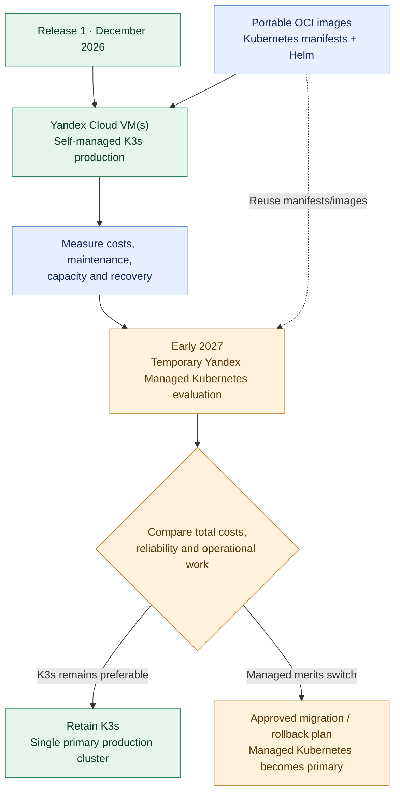

# ADR-017: K3s first, then compare Yandex Managed Kubernetes

- **Status:** Accepted (Release 1 deployment and 2027 evaluation strategy; not yet implemented)
- **Recorded:** 2026-10-18
- **Scope:** Finance Lab Kubernetes environment selection, operational cost and future migration
- **Follows:** [ADR-016: Kubernetes in Release 1](0016-kubernetes-release1-deployment.md)

## Context

ADR-016 requires Kubernetes in the first Finance Lab release (target December 31, 2026). The project needs practical Linux/Kubernetes operations experience without paying for two always-on production clusters. Self-managed **K3s on Yandex Cloud virtual machines** may reduce infrastructure charges by avoiding a managed control-plane fee, but its operation, hardening, upgrades and incident recovery are the project's responsibility. Yandex Managed Kubernetes can reduce control-plane maintenance but introduces separate control-plane and worker-node costs. Neither choice guarantees high availability.

The user accepted a staged strategy: **start with K3s, try Yandex Managed Kubernetes afterward, then retain whichever offers the better cost/reliability/maintenance tradeoff**.

## Decision

### Phase 1 — Release 1 (by December 31, 2026)

- Deploy the containerized Finance Lab backend and **Traefik on self-managed K3s running on Yandex Cloud VM infrastructure**, satisfying ADR-016. Start as economically as practical; favor a single VM **only if measured CPU, memory, storage and workload demands fit**. A single-VM K3s deployment is **not highly available**.
- Maintain portable OCI images and **reproducible, standards-based Kubernetes manifests/Helm charts** with environment-specific settings. Avoid relying on K3s-only APIs or storage behavior in application manifests when reasonable.
- Keep the independently hosted React SPA on Object Storage + CDN (ADR-010). **ADR-018 now places Yandex Managed PostgreSQL outside K3s and Kafka, Keycloak, Redis, MongoDB and the private observability stack inside K3s**; include their actual memory, disk and backup costs when sizing the initial cluster.
- Verify installation, upgrades/restarts, authenticated ingress, application rollouts, failure recovery, backups/restores for stateful systems under ADR-019, resource utilization and **actual monthly cost**. Approve a spending ceiling before long-running provisioning. Define an explicit operational owner for security updates and cluster maintenance.

### Phase 2 — Temporary managed comparison (planned early 2027)

- Bring up a **temporary Yandex Managed Kubernetes environment** using the same container images, portable manifests/Helm configuration, external access rules and representative workloads.
- Prefer **synthetic/demo financial data or a restored anonymized test dataset**. **Do not point both clusters at the same writable production databases**, run uncontrolled simultaneous migrations, or accidentally expose production secrets. A separate evaluation environment is **not automatically a second active production site**.
- Measure **comparable total cloud costs** (VM workers, managed control plane, load balancers, disks, traffic, backups and other required services), deployment/rollback behavior, operational effort, upgrade handling and failure/recovery time. Include the labor/maintenance burden of self-managed K3s in the comparison.
- **Retain one primary production platform after evaluation**: keep K3s if sufficient and more economical overall, or migrate to Managed Kubernetes **only after a separately approved, tested migration/cutover plan** that covers private data, persistent storage, DNS/traffic changes, downtime, rollback and cost.
- Shut down the **temporary** comparison cluster when tests finish, unless a later ADR explicitly authorizes a multi-cluster availability architecture.

## Architecture diagram

**The two clusters are sequential stages, not an active-active design.** The managed cluster is a time-bounded test. ADR-018 chooses Release 1 component placement; **cross-cluster data copies, persistent-volume migration and cutover mechanics remain unapproved**.

## Required verification and risks

- For the **Release 1 K3s cluster**, demonstrate a successful deployment from source-controlled configuration, recover from pod failure, test rollback, preserve access-control boundaries and restore backed-up data. Measure actual resource utilization to determine whether one VM is sufficient.
- During the managed-cluster evaluation, run comparable scenarios and document costs, administrative hours, security update responsibilities, restart/upgrade procedures and realistic failure recovery. Do not infer a reliability improvement merely from the provider name.
- For any eventual migration, perform dry-run restore, check data integrity, establish rollback points and ensure a single writer for authoritative financial databases unless a separately reviewed replication design exists.
- Self-managed K3s requires operating its control plane, nodes, patches, networking and etcd/SQLite data (as configured); budget sufficient time for maintenance and backups.
- Exact VM/node sizing, cost ceiling, cluster access, storage classes, CNI/network-policy capabilities, the 2027 evaluation window and the final winner remain **open decisions**. This ADR does **not** commit to running two paid clusters permanently.

## References

- [K3s documentation](https://docs.k3s.io/)
- [Yandex Managed Kubernetes pricing](https://yandex.cloud/en/docs/managed-kubernetes/pricing)
- [Kubernetes documentation](https://kubernetes.io/docs/home/)
- [ADR-016: Release 1 Kubernetes platform](0016-kubernetes-release1-deployment.md)
- [ADR-003: PostgreSQL database ownership](0003-postgresql-database-per-service.md)
- [ADR-010: Independently hosted SPA](0010-independent-spa-and-api-first-clients.md)
- [ADR-018: Stateful infrastructure placement](0018-hybrid-managed-postgresql-k3s-platform-state.md)
- [ADR-019: Backup and disaster recovery](0019-backup-recovery-objectives-drills.md)
