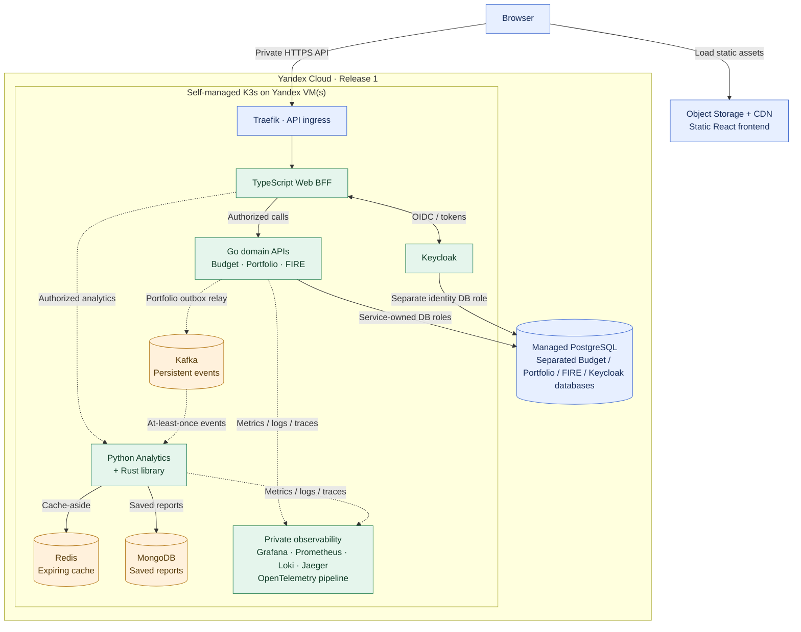

# ADR-018: Managed PostgreSQL with self-hosted stateful platform components in K3s

- **Status:** Accepted (Release 1 target infrastructure placement; not yet provisioned or verified)
- **Recorded:** 2026-10-18
- **Scope:** Stateful services, databases and observability infrastructure for Finance Lab Release 1 (2026)

## Context

Finance Lab uses **K3s on Yandex Cloud VM(s)** for its Release 1 backend runtime (ADRs 016–017), with an independently hosted SPA/CDN (ADR-010). Financial data in Go Budget, Portfolio and FIRE services requires a durable, authorized PostgreSQL source of truth (ADR-003). The rest of the platform includes Keycloak (ADR-006), Kafka (ADR-009), Redis and MongoDB owned by Analytics (ADR-015), and Grafana/Prometheus/Loki/OpenTelemetry/Jaeger observability (ADR-001).

Running every database and broker inside a potentially single-node learning cluster is inexpensive in some configurations but exposes authoritative financial data to the cluster's failure, storage and maintenance risks. Making all components separate managed services would add fixed costs and reduce hands-on infrastructure learning. The accepted approach is therefore **hybrid**: protect the most important relational source of truth with a managed PostgreSQL deployment, while operating the rest inside K3s.

## Decision

### Release 1 component placement

| Component | Accepted location | Boundary / justification |
| --- | --- | --- |
| **PostgreSQL** | **Yandex Managed PostgreSQL, outside K3s** | Authoritative Budget, Portfolio and FIRE state; managed backup capabilities and independently operated database infrastructure |
| **Keycloak** | **Self-hosted in K3s** | Owns sign-in and OIDC flows; uses a **separate Keycloak logical database and credentials** in the managed PostgreSQL cluster |
| **Kafka** | **Self-hosted in K3s** | Release 1 event broker for Portfolio outbox integration; broker persistence, monitoring and recovery are project responsibilities |
| **Redis** | **Self-hosted in K3s** | **Analytics-only, non-authoritative simulation cache**. Entries may be evicted/lost and reconstructed (ADR-015) |
| **MongoDB** | **Self-hosted in K3s** | **Analytics-owned saved report documents**. Requires durable storage, backups and tested recovery; records are private (ADR-015) |
| **Grafana, Prometheus, Loki, Jaeger, OpenTelemetry collector/shipper components as needed** | **Self-hosted in K3s** | Private operational observability platform. Instrumentation is emitted by each workload (ADRs 001, 011) |

PostgreSQL remains **one managed physical cluster initially**, with distinct logical databases, service roles and migrations for the Go domains and a separate Keycloak identity database. **Logical separation does not imply physical high availability**: one managed PostgreSQL host can still be a single point of failure. Do not claim HA or zero data loss solely because the offering is managed.

The K3s cluster hosts containerized business services, BFF, Python services and Traefik under ADR-016 in addition to the supporting infrastructure above. **The static React frontend stays outside K3s** in Object Storage + Cloud CDN (ADR-010); the public dashboard receives only sanitized static metrics exports (ADR-011).

### Storage, security and failure boundaries

- **Managed PostgreSQL:** use private network connectivity from K3s workloads where supported, TLS, separate least-privilege roles, per-service migrations, automated backups configured under the actual service plan and **tested point-in-time/backup restores** under ADR-019. Approve storage, backup-retention and **monthly cost budget** before provisioning. Keycloak loss does not imply that Go services may directly access Keycloak tables.
- **K3s stateful workloads:** give Kafka, MongoDB and any observability components that need durable state appropriate **persistent volumes**, storage policies, backup targets and test restores. ADR-019 specifies encrypted off-cluster backups for MongoDB and the K3s datastore plus mandatory restoration tests. Kubernetes `StatefulSet`, persistent-volume claims and VM disks **do not guarantee replication or disaster recovery**.
- **Kafka:** a single broker can lose availability or acknowledged data after a failure; verify broker persistence, acknowledgment/recovery assumptions and outbox behavior. The Portfolio PostgreSQL/outbox transaction remains authoritative for committed financial changes (ADR-009). An outbox entry already marked published cannot necessarily reconstruct a subsequently lost broker message without an explicit replay/reconciliation design.
- **Keycloak:** store its durable account/configuration state in its managed PostgreSQL logical database; back up realm configuration and sensitive settings securely. If the single K3s VM or Keycloak fails, login/token exchange can be unavailable **even if managed PostgreSQL remains healthy**.
- **MongoDB:** saved analysis reports are **durable private data**, not a disposable cache. Define an independent backup/restore strategy, retention and owner authorization; losing MongoDB may lose reports even while Go financial records survive.
- **Redis:** optional derived cache data can be lost; calculation must fall back or explicitly fail without incorrect financial results. **This ADR does not select Redis as the Web BFF session store** (ADR-013).
- **Observability:** keep operator endpoints on protected networks, configure retention and resource limits and prohibit financial data in metrics/logs/traces. Public metrics flow through the sanitized export design (ADR-011), never by publishing full Grafana/Prometheus/Loki/Jaeger.
- **Operational cost/capacity:** benchmark combined VM memory/CPU/disk pressure for Keycloak, Kafka, MongoDB, Redis and observability **before selecting VM count and size**. A single VM may be insufficient and is **not highly available**. Do not assume self-hosting is cheaper once VM capacity, disks, backups, operational time and managed PostgreSQL charges are included.

## Logical deployment diagram

This is a **logical placement diagram**, not a final network map, storage topology or permission grant. In particular, the Go services have distinct database credentials and **cannot query one another's tables**; the single PostgreSQL node represents a managed cluster with separate logical databases. The Kafka connection applies to the approved Portfolio event workflow, not arbitrary writes from every Go domain service.

## Minimum release verification and tradeoffs

- Record a **cost estimate and approved spending ceiling** for Managed PostgreSQL, K3s VMs, persistent disks, load balancing, backups and network traffic; test whether the full stack fits its proposed hardware before leaving it running continuously.
- Verify PostgreSQL logical database/user isolation, TLS/private routing and recoverability of both financial and Keycloak state.
- Verify Kafka outage/restart and duplicate replay, persistent MongoDB reports and restoration, Redis cache loss, Keycloak restart, and observability outage without corrupting the authoritative financial records.
- Configure resource requests/limits, storage monitoring, appropriate probes and recovery runbooks for the in-cluster dependencies. Keep production secrets in approved protected delivery mechanisms, not committed manifests.
- The managed PostgreSQL service reduces some database operations but does **not** eliminate backup validation, database maintenance planning, region/provider dependency or single-host failure risk.
- Specific Managed PostgreSQL host configuration/HA tier, Kafka broker topology, persistent-storage class, backup tooling/retention, Keycloak upgrade process, exact observability collectors, K3s VM sizing and BFF session-store selection remain follow-up implementation decisions.
- The early-2027 temporary Managed Kubernetes evaluation (ADR-017) must use a **separate test data environment** or an approved migration plan; it must not become a second uncontrolled writer to production PostgreSQL.

## Related decisions

- [ADR-001: Observability](0001-observability-baseline.md)
- [ADR-003: PostgreSQL database-per-service](0003-postgresql-database-per-service.md)
- [ADR-006: Keycloak identity](0006-keycloak-identity-service-authorization.md)
- [ADR-009: Portfolio REST + Kafka events](0009-hybrid-rest-kafka-portfolio-events.md)
- [ADR-011: Public metrics export](0011-public-sanitized-observability-dashboard.md)
- [ADR-015: Redis cache and MongoDB reports](0015-analytics-redis-cache-mongodb-reports.md)
- [ADR-016: Kubernetes deployment](0016-kubernetes-release1-deployment.md)
- [ADR-017: K3s-first rollout](0017-k3s-first-managed-kubernetes-comparison.md)
- [ADR-019: Backup and disaster recovery](0019-backup-recovery-objectives-drills.md)
