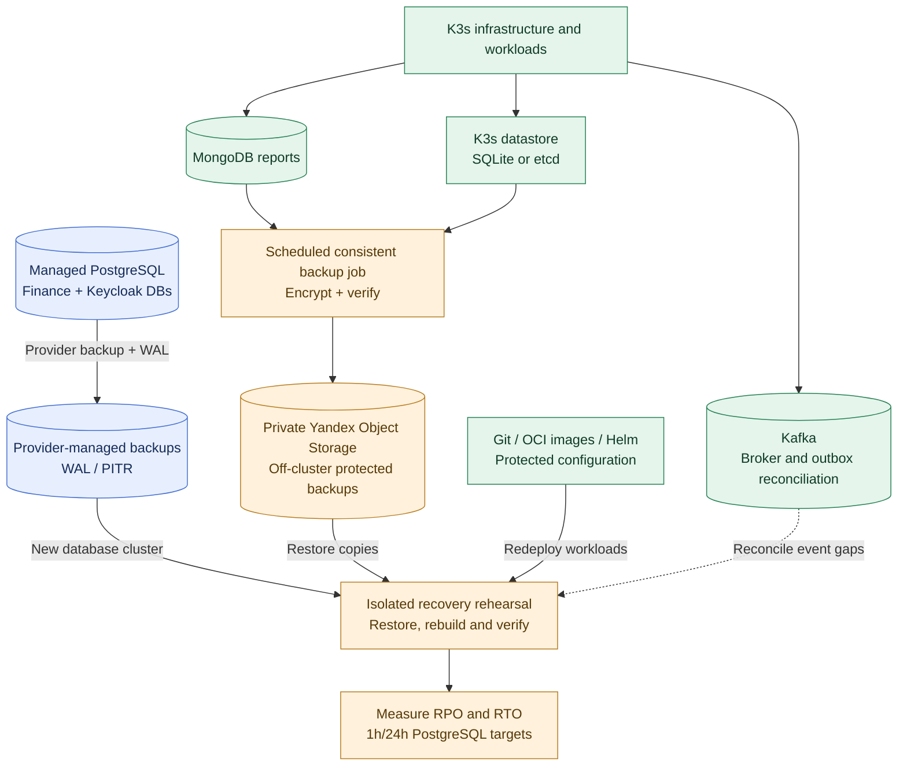

# ADR-019: Backups, recovery objectives and tested disaster recovery

- **Status:** Accepted (Release 1 recovery strategy and initial targets; implementation not yet verified)
- **Recorded:** 2026-10-18
- **Scope:** Financial data, Keycloak, in-cluster state, K3s and recovery of Finance Lab Release 1 by 2026-12-31

## Context

Finance Lab's production workloads initially run on K3s in Yandex Cloud (ADRs 016–017). **Yandex Managed PostgreSQL** outside the cluster stores authoritative Go-domain and Keycloak identity databases; self-hosted Kafka, MongoDB, Redis and the observability infrastructure run inside K3s (ADR-018). A VM/node failure, volume corruption, misconfiguration or accidental deletion must not silently destroy private financial data or saved analysis reports.

Backups and **recovery** are deliberately prioritized before adding high-availability infrastructure. **Recovery from backups is not automatic failover** and does not guarantee uninterrupted service or zero data loss.

## Decision

### Backup and recovery mechanisms

| State / component | Release 1 strategy | Essential safeguards |
| --- | --- | --- |
| **Managed PostgreSQL: Budget, Portfolio, FIRE and Keycloak** | Configure managed backups, WAL/PITR capability and provider-supported retention; restore into an **isolated new PostgreSQL cluster** during a drill | Test restore, logical DB/service credential isolation, consistent recovery point and post-restore connectivity. Availability and precise PITR granularity depend on service configuration |
| **MongoDB saved Analytics reports** | Schedule at least **daily encrypted backups**, stored outside the K3s VM in a **private Yandex Object Storage backup bucket** | Consistent database backup method, restore to isolated MongoDB, owner permissions, checksums, retention and deletion tests |
| **K3s control-plane state** | Back up the K3s datastore with the **appropriate method for its actual SQLite or etcd configuration**, plus required server token/cluster recovery material protected separately | Preserve encryption keys/secret material, test rebuilding a new cluster; Git/Helm is not a substitute for all cluster-state data |
| **Kafka** | Durable broker volumes plus tested restart/recovery; keep Portfolio outbox records in managed PostgreSQL, and design explicit **reconciliation/replay** for lost or already-acknowledged Kafka events | A broker backup or outbox alone does **not** ensure recovery of every message after the relay marks an event published; test duplicate and missing-event cases |
| **Keycloak** | Restore its **separate logical database** as part of the PostgreSQL managed-cluster recovery and preserve secure realm/client configuration exports where useful | Validate login, OIDC flow, token verification, secrets/keys and realm/client consistency in an isolated environment |
| **Redis** | **No mandatory cache backup**: discard and recompute derived simulation entries | Verify cache loss is safe and does not corrupt financial state or private reports |
| **Prometheus, Loki, Jaeger and Grafana** | Recreate services/configuration from versioned manifests; retain only required dashboard/configuration backups, optional telemetry retention | Historical telemetry may be lost; do not make financial correctness or restored operation depend on it |
| **Application workloads, Traefik and K3s infrastructure** | Reproducible OCI images + Git/Helm/manifests, protected configuration and secrets; tested deployment/runbooks | Avoid depending on an inaccessible registry or a secret that was never backed up; validate traffic/TLS after rebuild |

**Backups of the self-hosted MongoDB and K3s state must be encrypted, access-controlled and stored off the production K3s VM**, in a **private backup bucket/prefix separate from the public SPA/metrics assets**. Apply narrowly scoped backup credentials, versioning or Object Lock where supported and appropriate, tested retention/lifecycle policies, encryption-key recovery, and alerts for failed or stale backup runs. Never place tokens or private financial information in public artifacts.

Managed PostgreSQL provider snapshots/WAL are a separate mechanism from those Object Storage backup objects. Do not imply the exporter or an ordinary Kubernetes PV snapshot backs up managed PostgreSQL.

### Initial recovery objectives (targets, not verified guarantees)

| Scope | Target RPO: maximum intended data loss | Target RTO: intended restoration window |
| --- | --- | --- |
| Managed PostgreSQL financial + Keycloak databases | **1 hour** | **24 hours** |
| MongoDB saved analysis reports | **24 hours** | **24 hours** |
| Rebuild of application/K3s platform | **Reproducible from source-controlled configuration and safely stored state**; stateful loss follows its component RPO | **24 hours** |

RPO/RTO values are **engineering targets**, not claims about the provider or the deployed system. Confirm whether Managed PostgreSQL's actual WAL/PITR settings and retention can meet the one-hour RPO; validate last recoverable point during drills. A daily MongoDB backup meets a 24-hour RPO only when backups complete successfully on schedule and no additional gap is introduced. Kafka event-recovery guarantees require their own replay/reconciliation validation.

### Required disaster-recovery rehearsal before first release

1. In an **isolated temporary environment**, restore a Managed PostgreSQL backup to a **new cluster**, verify the four separate logical databases and access permissions, validate data integrity and at least one domain query and Keycloak sign-in.
2. Restore MongoDB analytical reports from private Object Storage, confirm hashes/versions/owner isolation, and verify a deliberately deleted or expired Redis cache is rebuilt correctly.
3. Rebuild K3s application services, Traefik and platform configuration from versioned Git/Helm and trusted images, restoring the K3s control-plane state by its actual datastore procedure where relevant. Confirm private secrets, TLS, authorized requests and service probes.
4. Simulate a Kafka interruption including **an already-published event lost from the broker**, and verify that any required reconciliation replays missing work without duplicating durable side effects.
5. Measure actual **RPO/RTO**, cost and operator effort; store a concise recovery runbook and evidence of outcomes. A failed RPO/RTO check should result in a documented gap/mitigation, **not a false compliance claim**.

## Architecture diagram

The flow represents **backup sources and controlled recovery**, not live replication, instant restoration or automatic traffic failover. The K3s datastore might be SQLite or etcd; backups must follow the chosen configuration. Redis and disposable telemetry history are intentionally omitted from the durable-data backup flow.

## Consequences and deferred work

- Establishes measurable operational recovery work for 2026 without the cost or complexity of a second always-on production cluster.
- Off-cluster backups protect against some single-VM disasters but **do not guarantee independence from a full Yandex Cloud/provider or regional outage**. A geographically separate restore site and tested off-provider copies are possible future additions.
- Final backup tooling, encryption/retention configuration, storage costs, IAM/KMS policies, concrete managed PostgreSQL host settings, Kubernetes datastore choice and procedures require implementation decisions.
- **A local development/test or potential independent failover site is not selected by this ADR**. Active/passive cross-site replication, promotion/fencing, automatic DNS/traffic failover and split-brain prevention require a separate architectural decision before use with private real data.
- The early-2027 temporary managed-cluster comparison (ADR-017) must not concurrently write to the live financial database.

## Related decisions

- [ADR-003: PostgreSQL database-per-service](0003-postgresql-database-per-service.md)
- [ADR-009: Kafka, outbox and event replay](0009-hybrid-rest-kafka-portfolio-events.md)
- [ADR-013: Web BFF sessions](0013-keycloak-bff-managed-browser-sessions.md)
- [ADR-015: MongoDB reports and Redis simulation cache](0015-analytics-redis-cache-mongodb-reports.md)
- [ADR-016: Kubernetes Release 1](0016-kubernetes-release1-deployment.md)
- [ADR-017: K3s then managed Kubernetes comparison](0017-k3s-first-managed-kubernetes-comparison.md)
- [ADR-018: Hybrid managed/stateful placement](0018-hybrid-managed-postgresql-k3s-platform-state.md)
