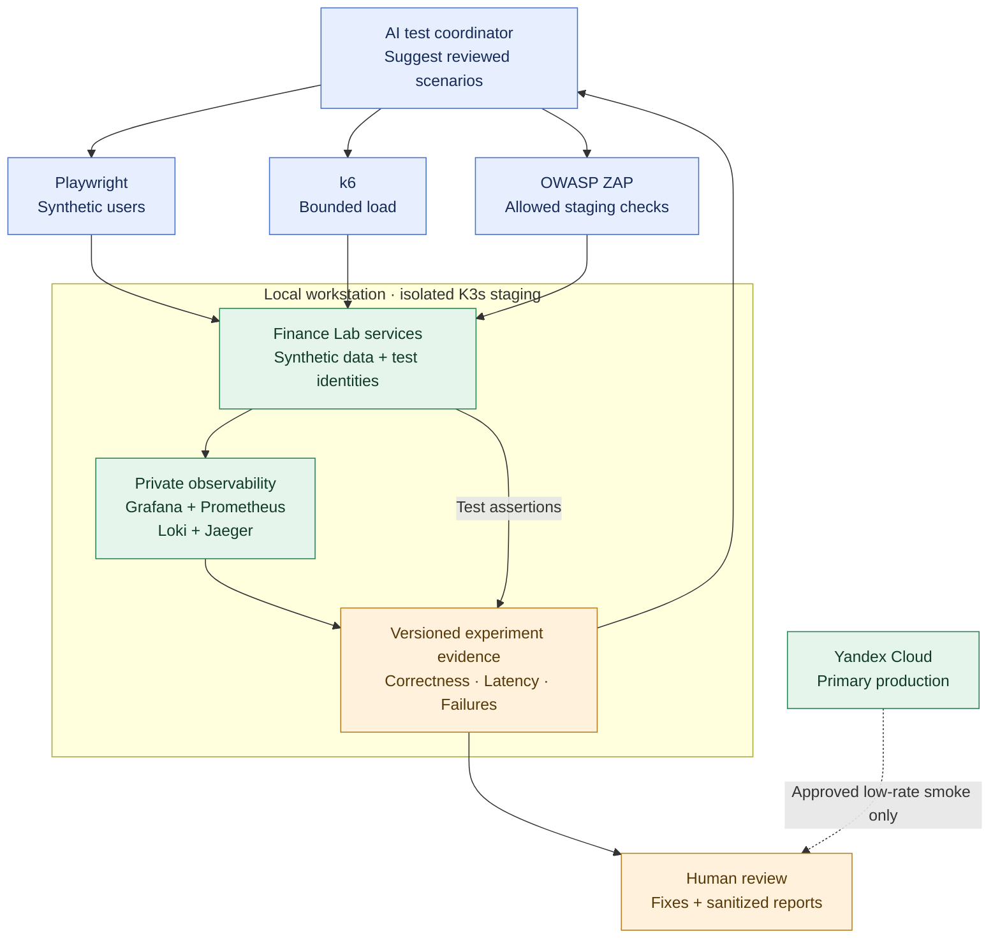

# ADR-020: Isolated local K3s staging and automated reliability testing

- **Status:** Accepted (Release 1 target testing architecture; not yet provisioned or verified)
- **Recorded:** 2026-10-18
- **Scope:** Finance Lab Release 1 synthetic users, security/load tests and observable engineering experiments

## Context

Finance Lab initially runs in Yandex Cloud: K3s application workloads with managed PostgreSQL and separately hosted frontend assets (ADRs 010, 016–018). A small initial real-user base is unlikely to generate enough traffic and failure cases to understand application capacity or identify reliability weaknesses. We want a repeatable environment where automated synthetic users, constrained load generators, and authorized security tests can reveal failures and measure improvements.

The local Linux workstation is proposed for **testing**, not for production failover. Automatic Yandex-to-local or local-to-Yandex service failover, cross-site replication and split-brain control are separate possible future architecture decisions, not part of Release 1.

## Decision

### Environment separation

- Retain **Yandex Cloud as primary production**, consistent with ADRs 016–019.
- Set up an **isolated local Linux workstation running K3s for staging/testing** when the planned workstation is available. Deploy representative versions of the React/TypeScript SPA, TypeScript Web BFF, Go Budget/Portfolio/FIRE, Python AI/Analytics, Keycloak, Kafka, Redis, MongoDB and observability components as the scenario requires.
- Prefer shared **versioned OCI images, API contracts and portable Kubernetes manifests/Helm charts**, with staging-specific sizing, configuration, database initialization and secrets.
- Use **fully synthetic users and financial records**, staging-only test credentials and a separate local/test PostgreSQL. **Never connect staging tests to the writable production PostgreSQL, Kafka, MongoDB, Keycloak realm, or private users' real financial data.** Test identity, networks and credentials are isolated from production.
- If the local workstation is not procured or capable by the release date, run equivalent tests in a temporary **isolated nonproduction environment** and record that substitution. The ADR does not claim a purchased workstation, deployed K3s cluster or measured capacity.

### Initial three automated workflows (2026)

1. **Synthetic user behavior — Playwright.** Reproduce login, budget changes, portfolio transactions, FIRE calculations, error and degraded-state handling. Include distinct synthetic users and verify that one user **cannot read or modify another user's resources**.
2. **Incremental load — Grafana k6.** Apply bounded, stepped staging load with explicit duration, concurrency, request-rate limits, abort thresholds and approved target endpoints. Measure throughput, p50/p95 latency, error rates, CPU/memory/IO pressure, database behavior and bottlenecks.
3. **Authorized security regression — OWASP ZAP and scripted checks.** Start with passive/baseline scans and limited, explicitly reviewed active tests **only on allowlisted, owned staging endpoints**. Exercise invalid or expired tokens, authorization boundaries, CSRF and input validation. Do not run destructive, uncontrolled or intrusive scans against production.

The AI coordinator can propose scenarios, choose from approved test plans, summarize traces and metrics and recommend fixes. **Executable test jobs remain deterministic, reviewable, target-allowlisted and bounded.** No agent receives unrestricted attack privileges, real production secrets or independent permission to raise testing limits. Human review is required for new invasive or disruptive scenarios.

**Production testing is restricted** to separately approved low-rate, non-destructive smoke/health probes; no high-load simulation or active penetration scanning is authorized for the live service by this ADR.

### Evidence, correctness and limits

- Record test scenario, versions, synthetic dataset/seed, hardware and resource limits, measured p95 latency, throughput, error rates, response correctness and recovery time. Correlate failures with **Grafana, Prometheus, Loki, OpenTelemetry and Jaeger** traces/metrics under ADR-001.
- Follow an engineering loop: **hypothesis → controlled experiment → observable failure or limit → root-cause analysis → improvement → repeated measurement**. Do not invent failures or claim capacity not actually measured.
- Include financial invariants and authorization tests, not merely successful HTTP status: user isolation, idempotency, correct amounts, committed changes and explicit errors when a dependency fails. **Test ADR-022 exact decimals/currencies, cross-currency rejection, and round-trip correctness during retries/concurrent saves.**
- A load result for the **local workstation is not a cloud-production capacity estimate**: network, cloud VM, resource caps and managed PostgreSQL can differ. Any production capacity claim needs separate approved testing under a representative environment.
- Manually review and sanitize any experiment summary before publishing as portfolio evidence through the public engineering dashboard (ADR-011). Do not expose credentials, raw security findings, private financial records, internal topology or unsanitized traces in public content.

### Release acceptance and future work

- Before Release 1, execute at least one repeatable workflow for each of Playwright user simulation, bounded k6 load, and allowlisted security/authorization tests **on isolated staging** and retain measurements and findings. Under ADR-021, promote reviewed, versioned images via GitHub Actions and Argo CD and **require explicit human approval before production**. Expensive tests and active scans must stay within approved staging scopes.
- Record the tested environment honestly if local workstation provisioning is still pending. Exact local hardware, K3s node sizing, fixture generation and test scheduling are implementation decisions.
- Broader **chaos engineering** experiments, automated root-cause investigations and potential **local/cloud active-passive failover** are future evolutions and must be explicitly scoped, authorized and tested before exposing private data.
- ADR-019 still governs backups and disaster recovery. A local test cluster alone does not protect against a full Yandex outage; no automatic backup replication or production traffic cutover is implied.

## Architecture diagram

**Boundary:** The test runners target only isolated staging. The diagram does **not** show production attack traffic, live replication, automatic failover or a second writable production database.

## Consequences

- Gains practical experience in Kubernetes/SRE testing, reproducible load generation, security regression, reliability investigations and measured optimization despite few real users.
- Adds maintenance of a representative second environment, synthetic fixtures, test harnesses, identity isolation and monitoring. Work must stay small enough for the December 2026 release.
- Makes a stronger evidence-based engineering portfolio possible by recording real measurements and the failures they explain.
- Leaves autonomous chaos experiments, local-to-cloud production migration and automatic cross-site failover unapproved and outside the first release.

## Related decisions

- [ADR-001: Observability](0001-observability-baseline.md)
- [ADR-011: Public engineering dashboard](0011-public-sanitized-observability-dashboard.md)
- [ADR-013: Keycloak and BFF sessions](0013-keycloak-bff-managed-browser-sessions.md)
- [ADR-016: Release 1 Kubernetes](0016-kubernetes-release1-deployment.md)
- [ADR-017: K3s-first strategy](0017-k3s-first-managed-kubernetes-comparison.md)
- [ADR-018: Production stateful placement](0018-hybrid-managed-postgresql-k3s-platform-state.md)
- [ADR-019: Backups and disaster recovery](0019-backup-recovery-objectives-drills.md)
- [ADR-021: GitHub Actions and Argo CD pipeline](0021-github-organization-actions-argocd-gitops.md)
- [ADR-022: Exact decimal Money and currencies](0022-exact-decimal-money-currency-contract.md)

## Technical references

- [Playwright](https://playwright.dev/docs/intro)
- [Grafana k6](https://grafana.com/docs/k6/latest/)
- [OWASP ZAP](https://www.zaproxy.org/docs/)
