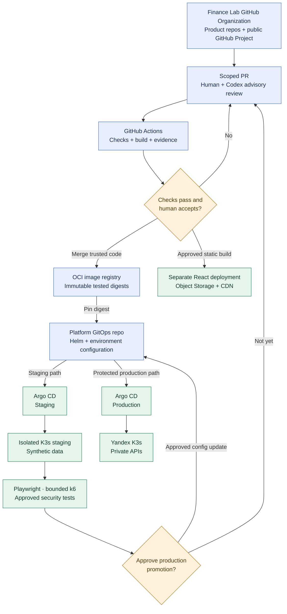

# ADR-021: GitHub Organization, GitHub Actions CI, and Argo CD GitOps

- **Status:** Accepted (Release 1 target architecture and governance; not yet implemented)
- **Recorded:** 2026-10-18
- **Scope:** Finance Lab organization, multi-repo portfolio, code verification and production promotion

## Context

Finance Lab has a polyglot, independently deployed service architecture (ADR-004), static SPA (ADR-010), Yandex K3s production (ADRs 016–018) and isolated local K3s staging/test workflows (ADR-020). The current `anton415/finance-lab` repository already has GitHub Actions for Python workflow tests, Node.js linting, Vitest, coverage, metrics checks, TypeScript building and CI evidence. It also uses GitHub's PR lifecycle/observation workflows, Codex-assisted implementation/review and human issue acceptance.

The user compared GitLab against GitHub for grouping many repositories into one recognizable project, portfolio visibility and possible paid GitHub/Copilot experimentation. They chose **a dedicated GitHub Organization**, not self-hosted GitLab or keeping every product repository under the personal namespace. The proposed CI/CD stack is **GitHub Actions plus Argo CD**, with human production approval.

## Decision

### Product identity and repository boundaries

- Adopt a **dedicated, public GitHub Organization** as the future parent for Finance Lab's product repositories, with an organization profile/overview, architectural documentation, links to a working demo and a **dedicated GitHub Project** spanning issues and PRs from multiple service repositories. Personal career/learning repositories may remain under the personal account.
- Target individual repositories for independently deployed components: React frontend, TypeScript Web BFF, Go Budget/Portfolio/FIRE services, Python Analytics/AI Agent, and a platform/infrastructure repository for Kubernetes/Helm/Argo CD and environment configurations. Database migrations remain with their owning service (ADR-003), not arbitrary independent database repositories.
- **Do not create an organization or transfer/rename repositories automatically based on this ADR.** The actual organization slug, repo names and transfer order are not yet selected or executed. Continue to use `anton415/finance-lab` and retain open **Draft PR #136** until the architecture review is complete; separate approval is required to move any repo or GitHub Project.
- Do not select or purchase GitHub Team/Pro, Copilot Pro/Pro+ or GitLab hosting as a consequence of this decision. Future Copilot-versus-Codex comparisons and paid plans are optional experiments, not Release 1 requirements.

### Continuous integration and review

- Use **GitHub Actions** as the primary CI system, extending the existing workflows rather than replacing them. Apply relevant language-specific lint, unit tests, API contract tests, integration checks, build validation, dependency/security checks and test evidence to each changed component; avoid requiring expensive full-system tests for every small PR. **ADR-024 adds OpenAPI 3.1 document validation, comparison against released provider contracts, and generation/verification of affected TypeScript/Python clients** without mistaking schema-diff success for semantic compatibility.
- Keep human-owned issue acceptance criteria and **scope-bounded AI implementation/review**. Codex/cloud reviews are advisory; merge requires passing applicable checks and a **human review/acceptance decision**. Never claim pending workflows or Codecov results have passed.
- On trusted mainline commits, build traceable **versioned OCI images** for services, pin deployments to **immutable image digests**, and promote the **same verified digest** from staging to production rather than rebuilding an unverified substitute.
- Preserve least-privilege workflow tokens. The existing `pull_request_target` workflows that write PR metrics must execute trusted default-branch code only, **never untrusted PR checkout/scripts with a write-capable credential**. Do not expose deploy tokens, cloud secrets or privileged self-hosted runners to untrusted/fork PRs.

### Deployment and production promotion

- Use **Argo CD GitOps** against a separate environment configuration in the platform repository for **local/test K3s staging** and **Yandex Cloud K3s production**. Argo CD pulls the desired Kubernetes configuration; GitHub Actions need not hold wide production Kubernetes credentials.
- Staging uses synthetic data, separate identity/secrets and approved Playwright verification. Run bounded k6 and scoped OWASP ZAP tests as approved staging/release checks, **not** high-rate/invasive automatic tests against production or arbitrary external PRs (ADR-020). If local staging hardware is not yet available, use an isolated temporary nonproduction environment.
- **Require human approval before changing the production GitOps desired state** (for example, protected reviewed promotion PR). Restrict Argo CD's production access to approved configuration so automatic reconciliation **cannot bypass the promotion gate**. Verify rollout/readiness and approved non-destructive production smoke checks; maintain a tested rollback to a previous image/configuration.
- Deploy React static assets to **Yandex Object Storage + Cloud CDN via a separate release pipeline**, not Argo CD, preserving independent frontend availability (ADR-010).
- Do not assume application rollback also reverses database migrations or financial records; preserve ADR-019 recovery procedures.

## Architecture diagram

This is a **future logical workflow**, not an assertion that the organization, multi-repository migration, container registry, Argo CD deployments or local staging are already operational. The organization name, GitOps permissions and promotion mechanisms must be verified when implemented.

## Migration and implementation verification

- Create the organization only after selecting a unique slug and explicit approval; inventory source repositories, open PRs/issues, GitHub Projects, workflow secrets, deployment keys, registries and external references before transferring them. Verify actions, branch rules, collaborator rights, old links and connected-app permissions afterward.
- Start by retaining and extending existing GitHub Actions. Each future repository must document its relevant checks and truthfully report observed results, aligned with existing `AGENTS.md`.
- Test image-digest promotion, isolated local staging, Argo CD sync/rollback and a gated production deployment; do not present unexecuted integration/CI work as complete.
- Argo CD, runner and stateful-cluster resource overhead must be included in K3s sizing. A production promotion must remain manually controlled even if staging reconciliation is automatic.
- Exact GitHub organization slug, repository transfer schedule, self-hosted versus hosted runners, OCI registry choice, GitOps layouts, credentials, protection features and costs remain implementation decisions.

## Related decisions

- [ADR-004: Service language/boundaries](0004-independent-polyglot-services.md)
- [ADR-010: Static frontend/CDN](0010-independent-spa-and-api-first-clients.md)
- [ADR-016: K3s container orchestration](0016-kubernetes-release1-deployment.md)
- [ADR-020: Local staging and automated testing](0020-local-staging-automated-reliability-tests.md)
- [ADR-024: Service-owned OpenAPI governance](0024-openapi-contract-first-rest-versioning.md)

## References

- [GitHub Organizations](https://docs.github.com/en/organizations)
- [GitHub Projects](https://docs.github.com/en/issues/planning-and-tracking-with-projects)
- [GitHub Actions security](https://docs.github.com/en/actions/security-for-github-actions/security-guides/security-hardening-for-github-actions)
- [Argo CD](https://argo-cd.readthedocs.io/en/stable/)
