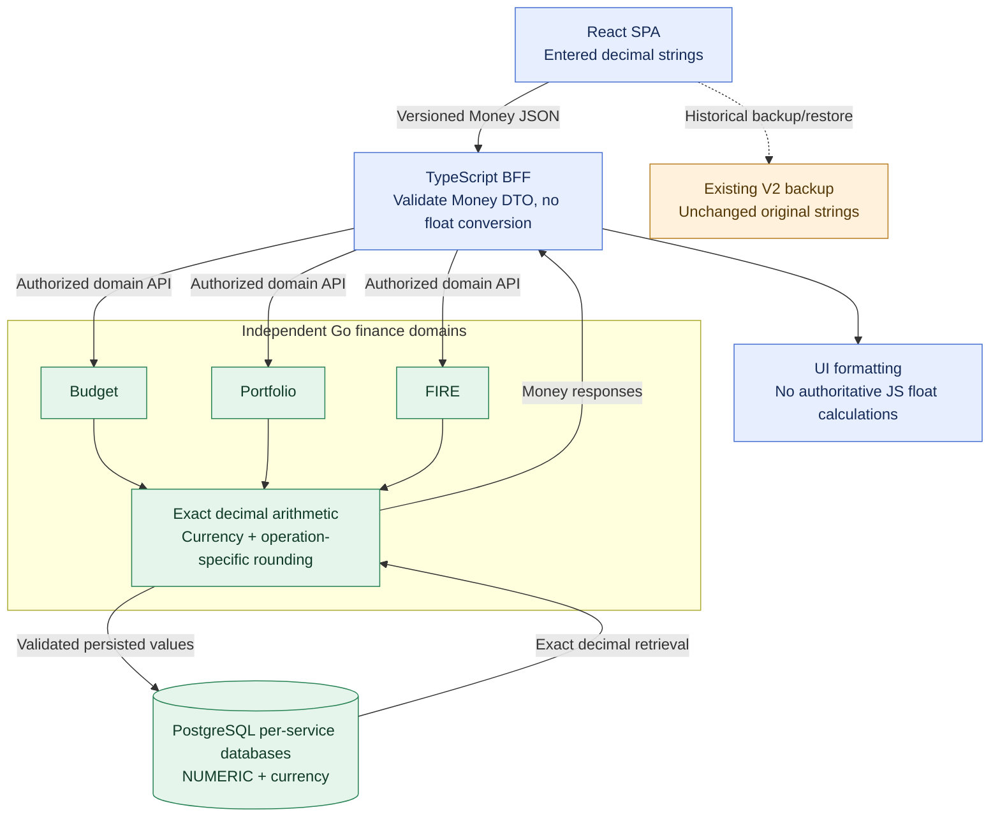

# ADR-022: Exact decimal Money values with explicit currency

- **Status:** Accepted (Release 1 target design; not yet implemented)
- **Recorded:** 2026-10-18
- **Scope:** New versioned Budget, Portfolio and FIRE API contracts, Go domain calculations, PostgreSQL financial persistence and client adapters

## Context

Authoritative financial operations must preserve decimal precision, distinguish currencies and avoid implicit mixed-currency arithmetic. Go Budget, Portfolio and FIRE services own business logic and data (ADRs 003–004), while the TypeScript Web BFF is an adapter, not the financial calculation authority (ADR-012).

**Existing behavior is separate.** Finance Lab's implemented `docs/budget-backup-contract.md` V2 preserves original amount strings, accepts exponential forms, leading zeros and other valid spellings, and currently validates via finite nonnegative binary64 numbers. Its browser UI calculates derived display totals with JavaScript numbers. The existing T2 design adds optimistic concurrency and idempotency rules (see `docs/t2/design.md`). **Neither the V2 contract nor those T2 rules are changed by this target-architecture ADR.**

## Decision

### New versioned financial-service API Money contract

Represent money using a **decimal string and a mandatory currency identity** in new, explicitly versioned production-service APIs:

```json
{
  "amount": "1250.75",
  "currency": "RUB"
}
```

- `amount` is a JSON **string**, not a JSON floating-point number. Each Go financial service parses and calculates using an **exact decimal or appropriately bounded fixed-point type**, not `float32` or `float64` for authoritative monetary amounts, totals, balances or transactions.
- `currency` is explicit and validated. Prefer recognized ISO 4217 alphabetic codes for fiat money (e.g. `RUB`, `USD`, `EUR`). Non-ISO units, such as digital assets, require a **separate explicit asset/unit contract**, not informal treatment as fiat currency.
- **Reject adding, comparing or aggregating different currencies as if they were the same.** Currency conversion must be a named operation with an explicit rate, source/effective timestamp and defined precision/rounding policy.
- No universal two-decimal assumption: validation rules for permitted sign, magnitude, input representation, scale, currency increments and rounding are **defined by the owning domain and operation**. Specify exact rounding boundaries/modes and test them before implementation. Negative values are not universally allowed or forbidden: their validity depends on the business operation.
- **Distinguish money from investment quantities, instrument prices, percentages, exchange rates and simulation probabilities**. Each needs its own precision and unit rules. A Monte Carlo simulation may use appropriately documented approximate numerical methods for modeling, but it must not silently turn approximate floats into authoritative financial account balances.
- Each Go domain service stores authoritative money in **its own PostgreSQL database** using `NUMERIC`/exact decimal columns and explicit currency identity (ADR-003). Choose supported precision/scale and constraints based on the use case; do not assume `NUMERIC(*,2)` suits every currency or instrument.
- The **TypeScript BFF preserves and validates the Money DTO without converting `amount` to JavaScript `number`** or moving financial calculations into the BFF. React should format exact string values for presentation without silently introducing authoritative float computations; financial decisions and totals are computed within the owning Go domain service.
- If a Kafka event conveys a monetary value, use the same explicit decimal-string/currency semantics in a **versioned event schema** (ADR-009). Event consumers must not reintroduce precision loss or implicitly combine currencies.

### Preserve legacy budget behavior until a separate migration

- The V2 backup/restore format is unchanged: keep its original **currency-free** document shape, valid and invalid amount strings, original-string round-trip, finite-binary64 validation, browser-storage contract, existing fixtures and current derived display behavior.
- **Do not silently reinterpret, discard, normalize, re-round or reject** valid V2 strings during future transition. A separately approved, versioned import/API migration must explicitly assign/confirm currencies, define how to handle historical scientific notation, underflow/overprecision and bounds, and validate all existing V2 fixtures before rollout.
- Keep existing Java/Spring T2 budget versions, concurrency conflict handling, idempotency-key replay and retention behavior intact until a deliberate implementation migration. The Money target contract does not claim the Go implementation or migration is complete.

## Architecture diagram



The diagram describes a **target contract and ownership model**, not deployed APIs. The legacy V2 flow is **not** routed through an implicit migration.

## Required validation and deferred specifications

- Cross-language Go, TypeScript and PostgreSQL contract tests: non-floating-point decimal round-trips, currency validation, overflow/underflow limits, operation-specific signs and scale, rounding boundaries, cross-currency rejection, and explicit FX conversion inputs. **ADR-024 requires this decimal-string-plus-currency Money shape in each new service-owned OpenAPI contract**, without changing historical V2 backup semantics.
- Include values such as `0.1` and `0.2`, currencies with nonstandard minor-unit policies, long decimals, negative amounts when allowed, and investment quantities. Test money in idempotent saves, concurrency conflicts, database reads and versioned events.
- Treat V2 fixture compatibility, original-string preservation and T2 concurrency/idempotency as **migration acceptance criteria**, not optional cleanup. The existing V2 validator's binary64 rules are not replaced here.
- Choose exact Go decimal library/type, concrete `NUMERIC` constraints, currency registry, FX-rate API, per-operation rounding policy, exact wire schema grammar, and versioned migration plan during implementation. Do not assume these details are already accepted.

## Consequences

- Improves financial reproducibility and cross-language precision safety while keeping Go domain ownership clear.
- Introduces explicit validation, currency-aware aggregation and rounding rules that must be tested and documented.
- Does not break existing V2 backups, browser data, fixtures or T2 design by architectural implication.

## Related decisions and references

- [ADR-003: PostgreSQL domain persistence](0003-postgresql-database-per-service.md)
- [ADR-004: Go domain service boundaries](0004-independent-polyglot-services.md)
- [ADR-007: Analytics/Rust modeling](0007-python-analytics-rust-library.md)
- [ADR-009: Portfolio event contracts](0009-hybrid-rest-kafka-portfolio-events.md)
- [ADR-012: TypeScript Web BFF](0012-typescript-web-bff-api-composition.md)
- [ADR-020: Staging correctness tests](0020-local-staging-automated-reliability-tests.md)
- [ADR-024: Money DTO in OpenAPI](0024-openapi-contract-first-rest-versioning.md)
- [Existing V2 budget backup contract](../../budget-backup-contract.md)
- [Existing T2 persistence design](../../t2/design.md)
- [PostgreSQL exact numeric types](https://www.postgresql.org/docs/current/datatype-numeric.html)
