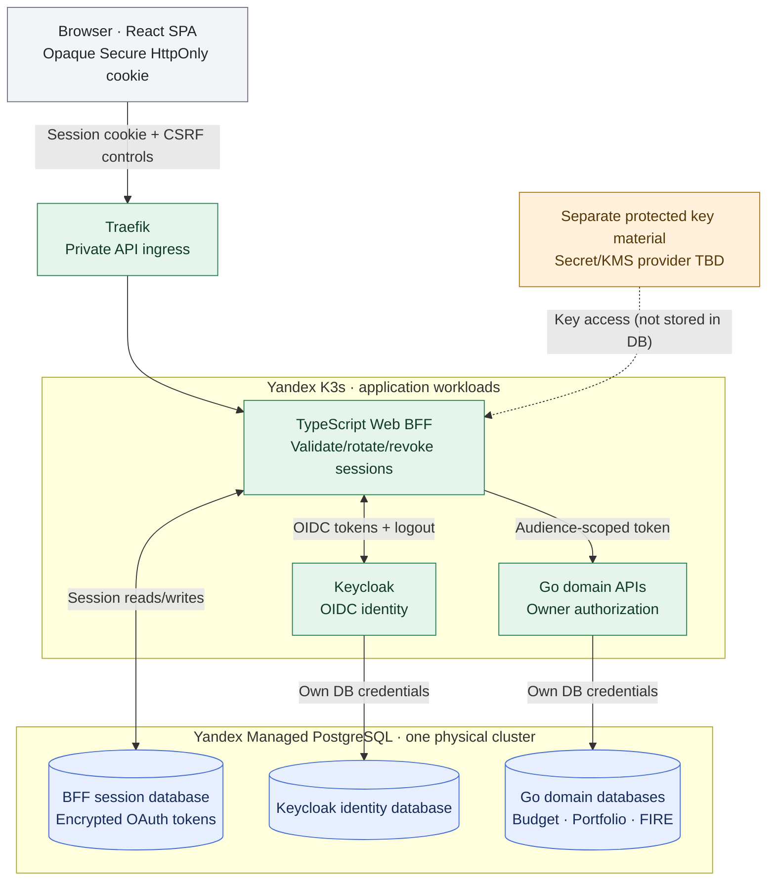

# ADR-023: PostgreSQL-backed Web BFF sessions and OAuth token lifecycle

- **Status:** Accepted (Release 1 target security architecture; not yet implemented or verified)
- **Recorded:** 2026-10-18
- **Scope:** TypeScript Web BFF browser sessions, server-side OAuth tokens, logout, expiration and recovery

## Context

ADR-013 establishes a browser-facing TypeScript Web BFF that authenticates with Keycloak using Authorization Code + PKCE and keeps OAuth tokens away from browser JavaScript. ADR-014 governs downstream user-token exchange. We must choose where multiple BFF instances securely share session state, how login and logout work, how rotating refresh tokens are coordinated, and what happens on storage failure or recovery.

Redis is currently a **non-authoritative Analytics simulation cache inside K3s** (ADR-015); it has no durable-security-state guarantees. Finance Lab already has **Yandex Managed PostgreSQL outside K3s** for separate Go financial-domain databases and Keycloak's database (ADRs 003 and 018). A small initial user base does not justify another separately managed session technology.

## Decision

### Storage and trust boundaries

- Store BFF-owned session metadata and **encrypted server-side OAuth access/refresh tokens in a dedicated logical PostgreSQL database inside the existing Yandex Managed PostgreSQL cluster**. The BFF owns its database role, schema, migrations, access policies and lifecycle queries. Its role cannot access financial-domain or Keycloak database tables.
- The BFF session database is **not a financial business database** and does not grant the BFF authority over budgets, investments or FIRE resources. PostgreSQL is shared physical infrastructure, **not shared logical data access**.
- The browser receives only a **cryptographically strong, opaque session identifier** in a Secure, HttpOnly cookie. Do not expose OAuth tokens or refresh tokens through JavaScript, browser local storage, URLs, logs, metrics, or client responses. Prefer storing a **non-reversible hash of the session identifier** as the database lookup key; never treat a guessable identifier as a session.
- Encrypt OAuth tokens and other sensitive session secrets **before saving them in PostgreSQL** using application-side authenticated encryption. Store encryption keys **separately in the protected Yandex Lockbox/ESO secret-delivery architecture of ADR-027**, never in the session database or source repository. The exact envelope encryption/KMS mechanism remains implementation work. Plan key rotation and recovery safely. Use protected network connectivity and TLS to PostgreSQL.
- Enforce least-privilege BFF database access and bounded retention/cleanup for expired or revoked records. Index lookups/expiry fields as needed; limit recorded personal metadata and exclude all secrets from logs/traces and public metrics.
- Redis and MongoDB **are not the BFF session store** under Release 1. Redis cache expiry or Analytics outages must not invalidate BFF security policy or change authentication semantics.

### Session lifecycle

- Preserve Keycloak as the identity provider. The BFF is the OIDC client using **Authorization Code + PKCE**, verified `state` and appropriate OIDC `nonce`, and server-side code/token exchange (ADR-013).
- Use Secure, HttpOnly cookies with a narrow `Path`, host/domain and an explicit compatible `SameSite` policy. Prefer the `__Host-` cookie convention when compatible with the final domain arrangement. Set HTTPS, avoid broad Domain cookies, and **defend state-changing requests against CSRF** in addition to `SameSite`; exact origins and browser cookie attributes depend on the final deployment.
- On authentication, **rotate the opaque session identifier** (prevent fixation); maintain server-enforced **idle timeout and absolute maximum lifetime**, never extending beyond the applicable Keycloak/OAuth authorization lifecycle. Refresh-token success may renew a valid session within these bounds; expiry, revocation or invalid refresh must invalidate it.
- **Coordinate concurrent refresh-token rotation** across BFF replicas using a transactional lock or compare-and-swap version policy in PostgreSQL. Do not allow racing requests to overwrite newer refresh tokens with stale credentials, nor return successful authentication when storage of refreshed state has failed.
- **Logout immediately invalidates the local BFF session** and expires its cookie. Integrate appropriate Keycloak end-session/token revocation and back-channel logout where configured; remote logout can fail and must be reported or reconciled rather than falsely claimed to have completed. A previously issued short-lived downstream JWT may remain valid until its own expiry; BFF session invalidation prevents new browser-mediated calls, not instant revocation of all existing bearer tokens.
- **Fail closed** for private browser requests when session lookup, token decryption, session expiry validation or required state updates cannot be completed. A database outage must not turn a missing/unknown session into an authenticated request. Static public React assets/allowlisted public observability metrics remain independently available (ADRs 010 and 011).
- When managed PostgreSQL is restored from an old backup, **invalidate all restored BFF sessions before reopening private web access**. Use an independently controlled restoration generation/epoch or equivalent operator-enforced global revocation so previously logged-out sessions cannot be resurrected by backup rollback; require sign-in again and test this in ADR-019 recovery drills. Simply restoring old rows is unsafe.

### Verification and open implementation details

- Test login, session-ID rotation/fixation defenses, cross-user isolation, logout and remote-logout failures, idle/absolute expiry, revoked/expired Keycloak authorization, token refresh concurrency, encrypted-at-rest tokens, key rotation and missing/wrong encryption keys.
- Test database/Keycloak outage behavior, restart/redeployment of BFF pods and cross-replica session continuity, as well as CSRF and forbidden origins. No silent fallbacks to Redis or in-process security state.
- Test a **restored historical PostgreSQL backup** in isolated staging and confirm previously revoked sessions stay invalid. Confirm domain-service authorization is still independent (ADR-006).
- Exact idle/absolute durations, CSRF token design, cookie/domain layout, database table schema, encryption/KMS provider, locking primitive, background garbage collection and Keycloak logout configuration are **implementation details**, not implicitly chosen here.

## Architecture diagram

The diagram is **logical**. A single managed PostgreSQL cluster contains separate logical databases and non-interchangeable service credentials; no cross-domain table reads are authorized. Browser session validation occurs at the BFF, not solely at Traefik.

## Consequences

- Avoids running another dedicated security datastore while preserving session continuity across BFF restarts and replicas.
- The BFF's private web availability now depends on managed PostgreSQL availability (already used by Go services and Keycloak); storage failures **deny authentication**, not authorize by default.
- Requires confidential storage, key management, refresh coordination, expiry enforcement and deliberate restore-time revocation. Database backups alone must not re-enable invalid sessions.
- Retains Go service-owned business authorization and the Analytics-only role of Redis/MongoDB.

## Related decisions and references

- [ADR-003: PostgreSQL database-per-service](0003-postgresql-database-per-service.md)
- [ADR-006: Keycloak identity and resource authorization](0006-keycloak-identity-service-authorization.md)
- [ADR-012: TypeScript BFF](0012-typescript-web-bff-api-composition.md)
- [ADR-013: BFF-managed browser sessions](0013-keycloak-bff-managed-browser-sessions.md)
- [ADR-014: Service-to-service token exchange](0014-keycloak-service-to-service-security.md)
- [ADR-015: Redis/MongoDB ownership](0015-analytics-redis-cache-mongodb-reports.md)
- [ADR-018: Managed PostgreSQL infrastructure](0018-hybrid-managed-postgresql-k3s-platform-state.md)
- [ADR-019: Backup and disaster recovery](0019-backup-recovery-objectives-drills.md)
- [ADR-027: Yandex Lockbox, ESO and workload security](0027-lockbox-external-secrets-k3s-workload-security.md)
- [OWASP Session Management Cheat Sheet](https://cheatsheetseries.owasp.org/cheatsheets/Session_Management_Cheat_Sheet.html)
- [Keycloak OIDC endpoints](https://www.keycloak.org/securing-apps/oidc-layers)
