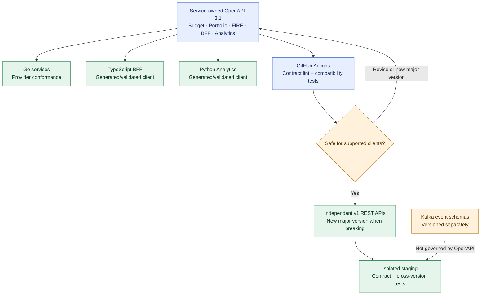

# ADR-024: Service-owned OpenAPI 3.1 REST contracts and independent API versioning

- **Status:** Accepted (Release 1 target API design; not implemented or verified)
- **Recorded:** 2026-10-18
- **Scope:** Finance Lab synchronous HTTP API contracts across Go services, TypeScript BFF and Python consumers

## Context

Finance Lab's Budget, Portfolio and FIRE capabilities have separate Go implementations and domain ownership (ADR-004). The TypeScript Web BFF adapts private browser requests (ADR-012), while Python Analytics may call explicitly authorized APIs (ADR-007). The services, clients and repositories must evolve independently without silently breaking one another.

The existing budget backup **V2 document contract** and Java/Spring T2 concurrency/idempotency design are separate from new Go REST APIs. Money precision/currency is accepted in ADR-022, and Portfolio Kafka event publication is accepted in ADR-009. These distinct versioning concerns must not be conflated.

## Decision

### Contract-first API ownership

- Use **OpenAPI 3.1** as the normative, language-independent description of each **new production REST API**. The service owning the API maintains the specification alongside its code in its own repository. Review a new endpoint or a breaking API change **in the contract before implementation**.
- Each Go domain service owns its API schema, semantics, authentication requirements and error responses. The TypeScript Web BFF owns a separate browser-facing contract and may adapt independently versioned domain responses. Optional Python Analytics HTTP endpoints follow the same approach. An optional central documentation index may **link** to the published specifications but cannot override them.
- Define requests, responses, required/optional properties, media types, authentication/security schemes, error cases, and domain-specific optimistic concurrency, idempotency or pagination requirements where applicable. **Do not invent endpoint paths or implementation-specific T2 error codes** before their own contract design.
- Generate or validate **TypeScript/Python client types or SDKs** from published service contracts when useful. Go servers must meet their contracts. Generated static types are **not** runtime input validation or authorization: verify data at trust boundaries and keep domain-level authorization (ADRs 006, 014).

### Independent major-version lifecycle

- Give each new REST API an explicit **major version starting at `v1`**, recognizable on the HTTP surface. A versioned URL path is preferred; the exact Traefik/BFF route layout is a later implementation detail. Budget, Portfolio, FIRE, Analytics and the Web BFF **version independently**.
- Prefer backwards-compatible extensions within an existing major version, **subject to actual consumer testing**. Changing required fields, field meaning, financial precision/currency representation, authorization or error semantics can be breaking even if a JSON diff tool calls the change compatible.
- **Use a new major version for breaking changes**, with a deliberate migration, documented deprecation/compatibility window and support for both versions when needed until existing clients have moved. Duration is determined by real consumers, not fixed by this ADR.
- The **OpenAPI format version**, service **REST API version**, budget backup **`formatVersion: 2`**, database migration version, T2 optimistic-concurrency version and **Kafka event schema version** have distinct meanings. The REST version does not change the existing currency-free V2 budget backup format, fixtures, original-string preservation or Java/Spring T2 idempotency/retry behavior. A future transition requires its own approved versioned migration (ADR-022).

### Standard response errors

- Use **RFC 9457 Problem Details**, media type **`application/problem+json`**, for standardized REST error responses. Include correct HTTP status and safe `type`/`title` information, optional `detail`/`instance` and narrowly scoped extensions. Define stable domain-specific problem types for validation, authentication/authorization, optimistic-concurrency conflict, idempotency and dependency unavailability **when those operations are implemented**.
- The BFF must make **unavailable or partial financial data distinguishable from a valid zero balance** (ADRs 010, 012). A partially successful aggregate response needs its own explicit contract; do not present silent fallback zeros or inconsistent success bodies as valid complete data.
- Do not leak account balances, OAuth/session secrets, raw exception traces, private service addresses or detailed internal topology through problem responses. A sanitized correlation identifier can be used for tracing (ADR-001).
- Use **ADR-022 exact decimal-string Money plus currency** in new financial REST request/response schemas. Money calculations remain in the owning Go service, never the TypeScript BFF.

### CI, compatibility and Kafka boundary

- Use **GitHub Actions** (ADR-021) to lint/validate service OpenAPI definitions, check changes against the **last released contract**, run provider/API conformance and compile/test affected TypeScript/Python clients. Static/schema checks are not proof of semantic compatibility; human review remains required.
- Test representative **Budget and Portfolio `v1` contracts first**: authorized/unauthorized requests, standard problems, exact Money serialization, and client compatibility. **ADR-030 prioritizes the Go Budget v1 contract and Keycloak/BFF adapter as the first end-to-end implementation**, while the historical Spring T2 endpoint/error bodies and currency-free V2 backups stay unchanged until separately approved migration. Exercise changed contracts in isolated staging (ADR-020) before production promotion. Expand to FIRE/Analytics once their endpoints exist.
- Kafka event schemas are **not OpenAPI REST contracts**. **ADR-025 separately accepts CloudEvents 1.0 structured JSON, producer-owned JSON Schema and `PortfolioChanged` on `portfolio.events.v1`**. Schema evolution and event consumer checks remain separate from REST major versions. Future monetary event payloads still obey ADR-022. Do not expose confidential internal API definitions publicly by default.

## Architecture diagram

This is a **target contract workflow**, not proof of an existing Go v1 API, published client SDK, passing GitHub check or migrated codebase. The event, backup and T2 designs are separate compatibility domains.

## Consequences and outstanding implementation work

- Encourages independent releases with traceable API contracts, standardized errors and measured backward compatibility.
- Requires contract updates, generated client verification and service tests whenever the owning API evolves.
- Exact REST paths, OpenAPI document locations, code generator, comparison tool, release cadence, deprecation window, error type catalog and runtime validation libraries remain implementation choices. **Do not change existing V2 backup/T2 contracts as part of this ADR**.

## Related decisions and references

- [ADR-004: Independent business services](0004-independent-polyglot-services.md)
- [ADR-009: REST + Kafka integration](0009-hybrid-rest-kafka-portfolio-events.md)
- [ADR-010: Independently hosted frontend](0010-independent-spa-and-api-first-clients.md)
- [ADR-012: TypeScript Web BFF](0012-typescript-web-bff-api-composition.md)
- [ADR-014: Keycloak service security](0014-keycloak-service-to-service-security.md)
- [ADR-020: Staging experiments](0020-local-staging-automated-reliability-tests.md)
- [ADR-021: GitHub Actions CI](0021-github-organization-actions-argocd-gitops.md)
- [ADR-022: Money representation](0022-exact-decimal-money-currency-contract.md)
- [ADR-025: CloudEvents and JSON Schema Portfolio events](0025-cloudevents-json-schema-portfolio-events.md)
- [ADR-030: Go migration and Release 1 implementation sequence](0030-release1-go-migration-implementation-sequence.md)
- [Existing V2 budget backup contract](../../budget-backup-contract.md)
- [Existing T2 budget design](../../t2/design.md)
- [OpenAPI 3.1 specification](https://spec.openapis.org/oas/v3.1.1.html)
- [RFC 9457: Problem Details](https://www.rfc-editor.org/rfc/rfc9457.html)
