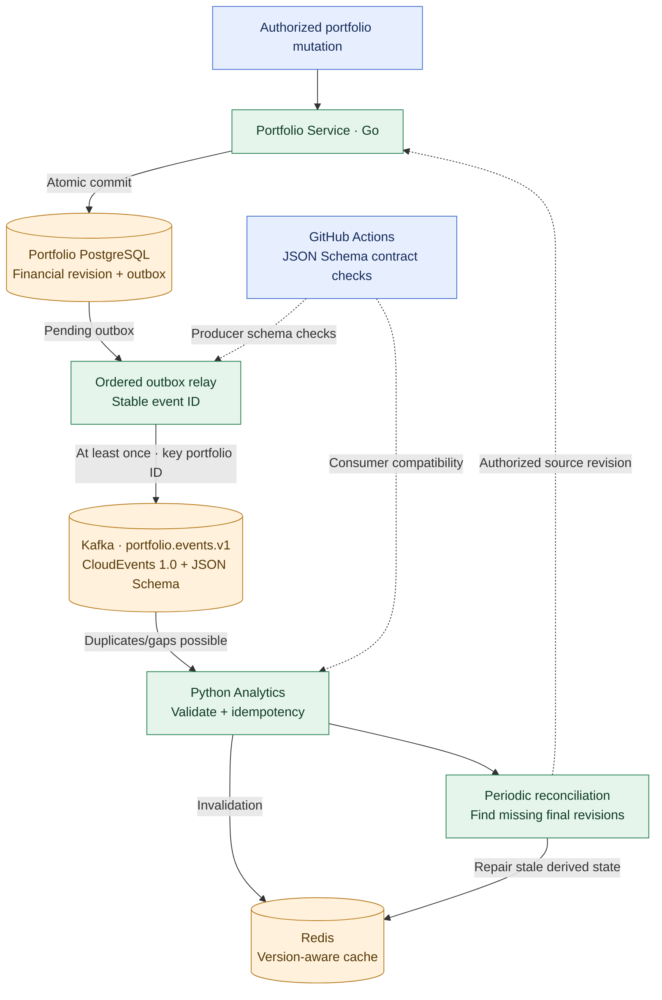

# ADR-025: CloudEvents 1.0 and JSON Schema for PortfolioChanged Kafka events

- **Status:** Accepted (Release 1 target event contract; implementation and verification pending)
- **Recorded:** 2026-10-19
- **Scope:** Initial Portfolio → Analytics Kafka topic, event schema, compatibility, reliability and reconciliation

## Context

ADR-009 accepts Portfolio Service committing an investment change and PostgreSQL outbox record in one transaction, then relaying events to Kafka for optional Python Analytics. Analytics may cache derived results in Redis (ADR-015) but never owns authoritative Portfolio data. ADR-019 requires recovery from broker interruptions, including acknowledged Kafka events that become unavailable **after the outbox relay marks them published**. The first release needs one measurable integration rather than a general event platform.

OpenAPI 3.1 under ADR-024 governs REST **only**. Kafka event contracts, REST API versions, the V2 budget backup format and financial-record revision numbers are distinct.

## Decision

### The first event and topic

- Define one initial event: **PortfolioChanged**, with CloudEvents `type` **`finance-lab.portfolio.changed.v1`**, produced by the **Go Portfolio Service** after a relevant committed mutation advances that portfolio's source revision. This event means *Portfolio state changed*, **not** that valuations or analyses have already been recalculated.
- Publish the event to **`portfolio.events.v1`**, initially the only integration topic. Use **`portfolio_id` as its Kafka partition key**, so events for the same portfolio map to the same partition. Kafka ordering applies within a partition **in append order**; this does not itself guarantee that concurrent outbox relays publish database revisions in the correct order.
- Use **CloudEvents 1.0 in structured JSON format** with **JSON Schema** validation of envelope and producer-owned `data` fields. Producer schemas and fixtures are versioned alongside Portfolio code; distribute a reviewed version to Analytics for consumption and testing. **No Schema Registry in Release 1**.
- Keep the first payload deliberately minimal: `portfolio_id`, `portfolio_version` (source-controlled, monotonically increasing per relevant portfolio mutation) and `schema_version: 1`. Do not include individual transactions, positions, balances, a user's identifying information, access or refresh tokens, or secrets.
- **An event does not grant permission to access financial data.** If Analytics needs an authoritative revision or private data, it must use a separately authorized Portfolio API with appropriate user delegation or narrowly restricted machine identity (ADRs 006 and 014), never Portfolio database tables.

### Illustrative structured CloudEvent

```json
{
  "specversion": "1.0",
  "id": "8c713c2e-40d8-4a7d-95e6-ccfd523802a1",
  "source": "/finance-lab/portfolio",
  "type": "finance-lab.portfolio.changed.v1",
  "time": "2026-10-19T05:00:00Z",
  "datacontenttype": "application/json",
  "data": {
    "portfolio_id": "portfolio-123",
    "portfolio_version": 7,
    "schema_version": 1
  }
}
```

All values are **synthetic**. The CloudEvents `id` is the **stable event ID**, preserved on every retry of the same outbox entry. `type`, topic suffix and `data.schema_version` express the approved v1 event contract and must remain consistent; they are **not** REST API versions. Appropriate correlation/causation identifiers and W3C trace context can be carried in safely reviewed CloudEvents extension attributes or broker metadata. Full schema constraints, identifier grammar and client wiring remain implementation decisions.

### Delivery, order, idempotency and recovery

- In one **Portfolio PostgreSQL transaction**, commit the validated financial change, its new portfolio revision and the uniquely identified outbox event. The direct REST command succeeds after this transaction commits, **not** after Kafka or Analytics acknowledges it.
- A separate relay publishes with bounded retries and marks delivery only after appropriate broker acknowledgment. Retried sends of the same outbox entry preserve its event ID. **Guarantee/verify per-portfolio publication order in the relay algorithm**; keying Kafka records by `portfolio_id` alone does not order two independent publisher workers.
- Treat Kafka integration as **at least once**, not exactly once: consumers may receive duplicates and stale/out-of-order revisions. The Python Analytics consumer checks CloudEvents/JSON Schema, uses `id` and monotonic `portfolio_version` to detect duplicates and revision gaps, and makes effects idempotent. Where an effect and inbox/deduplication marker are both durable, commit them atomically in the consumer's own storage when supported.
- The initial consumer can **invalidate affected Redis simulation caches** (ADR-015) or refresh derived calculations against an authorized, versioned source snapshot. A delayed event cannot prove fresh financial state; missing or unverifiable authoritative versions must cause recomputation, explicit stale status or invalidation, **never invented current balances**.
- **Periodically reconcile Analytics' tracked versions against authorized Portfolio source revisions** and repair/invalidate derived results when missing. Gap detection alone fails when an already-published **final event** disappears and no later revision arrives. The reconciliation scope must be explicitly authorized; it must not silently expand into scanning other users' portfolios.
- Provide **bounded retries with backoff**, failed-event monitoring and a private **quarantine/dead-letter mechanism** for persistently invalid or poison events. Do not silently skip errors as successful processing. Schema validation failures, reprocessing and any DLQ payload must not expose tokens or personal financial data to public systems.
- Use private networking, authenticated producers/consumers, scoped Kafka topic ACLs and protected broker storage. **A single in-cluster Kafka broker does not guarantee HA or prevent acknowledged-message loss**. Choose actual retention, topic partitions, broker ack policy, ordered relay concurrency, DLQ location and reconciliation cadence at implementation time.

### Compatibility and CI policy

- Maintain **producer-owned JSON Schemas and synthetic example fixtures** in the Portfolio repository. Compatible additive evolution inside event v1 requires demonstrable support from deployed Analytics consumers; schema-syntactic compatibility alone does not prove semantic compatibility.
- Breaking event changes require a **new major event contract**, potentially `finance-lab.portfolio.changed.v2` and **`portfolio.events.v2`**, with reviewed dual-publishing/consumer migration and deprecation behavior when needed. Do not silently repurpose the existing v1 topic/type with an incompatible meaning.
- Use **GitHub Actions** (ADR-021) to lint schemas, validate synthetic CloudEvents fixtures, test Portfolio serialization and Analytics consumer compatibility, and compare candidate versions with published schemas.
- **Schema Registry is deferred** until measured needs or a deliberate new learning objective justify its operations. Avro/Protobuf, additional Kafka domains, other event types and sophisticated topology are not accepted by this ADR.
- If a future event needs monetary fields, obey ADR-022's **exact decimal-string Money plus explicit currency** representation. The initial event has **no monetary amount**.

## Architecture diagram



**Boundary:** This is a logical integration diagram, not a claim that Kafka is highly available or that source revisions are automatically ordered by an outbox relay. Only Portfolio state and its outbox commit together; Kafka delivery and Analytics are asynchronous and may fail.

## Release 1 acceptance experiments and deferred details

- Verify success after one Portfolio+outbox transaction even during Kafka downtime, then later publication with the **same event ID**.
- Simulate duplicate/reordered events and multiple relay workers. Verify per-portfolio ordering protections, idempotent effects and safe revision-gap detection.
- Simulate loss of the **already-published latest event without a subsequent gap signal**; prove periodic reconciliation detects source divergence and repairs or invalidates derived Analytics state (ADR-019).
- Reject malformed/unknown schemas with bounded retry/quarantine, assert no financial data leaks in event payloads/logs, and verify release-to-release producer/consumer compatibility using synthetic fixtures in isolated staging (ADR-020).
- Finalize exact JSON Schema dialect/file layout, broker configuration and topic policy, publication ordering mechanism, consumer inbox persistence, auth permissions, reconciliation source API/cadence, monitoring thresholds and DLQ storage **during implementation**. Do not claim code, tests, brokers or schemas were deployed by accepting this ADR.

## Related decisions and technical references

- [ADR-001: Observability](0001-observability-baseline.md)
- [ADR-007: Python Analytics](0007-python-analytics-rust-library.md)
- [ADR-009: Portfolio REST + Kafka](0009-hybrid-rest-kafka-portfolio-events.md)
- [ADR-014: Service-to-service security](0014-keycloak-service-to-service-security.md)
- [ADR-015: Analytics Redis cache](0015-analytics-redis-cache-mongodb-reports.md)
- [ADR-018: Kafka in K3s](0018-hybrid-managed-postgresql-k3s-platform-state.md)
- [ADR-019: Backups and Kafka recovery](0019-backup-recovery-objectives-drills.md)
- [ADR-020: Staging reliability tests](0020-local-staging-automated-reliability-tests.md)
- [ADR-021: GitHub Actions](0021-github-organization-actions-argocd-gitops.md)
- [ADR-022: Exact Money contract](0022-exact-decimal-money-currency-contract.md)
- [ADR-024: OpenAPI governs REST separately](0024-openapi-contract-first-rest-versioning.md)
- [CloudEvents 1.0 specification](https://github.com/cloudevents/spec/blob/v1.0.2/cloudevents/spec.md)
- [JSON Schema](https://json-schema.org/specification)
- [Apache Kafka documentation](https://kafka.apache.org/documentation/)
