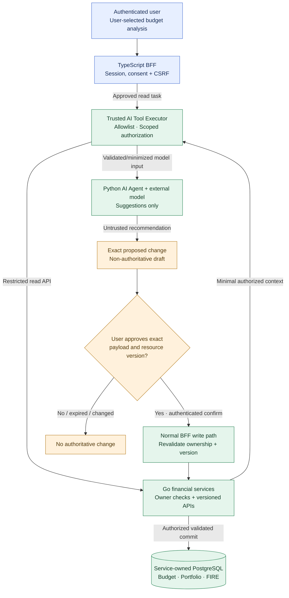

# ADR-026: Least-privilege product AI agents with human-approved financial writes

- **Status:** Accepted (Release 1 target agent authorization and approval architecture; not yet implemented or verified)
- **Recorded:** 2026-10-19
- **Scope:** Python Finance Lab product AI Agent, trusted tool execution, personal financial data access and human-controlled changes

## Context

Finance Lab includes a separate Python AI Agent Service (ADR-004) and a TypeScript Web BFF with Keycloak-managed browser sessions (ADRs 012–014 and 023). Budget, Portfolio and FIRE Go services retain authoritative financial state, authenticated resource ownership and domain validation (ADRs 003, 006, 022). The existing `anton415/finance-lab-agent` repository is a **learning prototype**: it makes Yandex AI Studio model requests and contains a single validated, read-only `get_budget` tool call using **synthetic** fixtures; it is not a production financial-data integration or a deployed write-capable agent.

The user wants helpful AI-driven financial analysis and future multi-agent workflows. A language model is not a trusted authorization decision maker: model responses, retrieved content and prompts can contain accidental or malicious instructions. Agents must never inherit unbounded service credentials or autonomous authority over money.

**This ADR governs agents used by Finance Lab product users.** The separate Codex/GitHub engineering workflow, human merge gate and staging test coordinator continue under ADRs 020–021 and are **not** authorized to access production user finances by this decision.

## Decision

### Release 1 capability and permissions

| Capability | Release 1 policy |
| --- | --- |
| Read a user's Budget, Portfolio or FIRE information for requested analysis | **Allowed only** for an authenticated, authorized, user-initiated task with limited data scope and required provider disclosure/consent |
| Analyze information and generate recommendations | **Allowed**, within resource/time/token/cost limits; label recommendations rather than presenting them as completed actions |
| Construct a proposed budget/portfolio change or transaction **draft** | **Allowed as non-authoritative proposed data**; no financial-domain database modification merely from a model response |
| Save, modify, or delete a financial record supported by the ordinary product | **Only after the authenticated user explicitly confirms the exact change**; the trusted BFF submits a regular authorized domain command |
| Execute financial trades, transfer real funds, or use banking/payment credentials | **Not supported** |
| Access another user's finances, read databases directly, manage Keycloak/infrastructure/secrets, or escalate tool permissions | **Forbidden** |
| Run ongoing autonomous financial mutations or unapproved external actions | **Not supported in Release 1** |

The initial complete scenario is **read-only analysis of a user-selected month's Budget**, producing a recommendation and optionally a proposed change. Actual edits, deletions, trades or other capabilities are **not created** by this policy; they are available only if an independently authorized ordinary product API implements them.

### Trust and execution boundaries

- Use a **trusted AI Tool Executor** as an application-controlled enforcement boundary; this is a logical component within approved existing services, **not a new independently deployed microservice mandated by this ADR**. Maintain an explicit allowlist of tool names, validated argument schemas, targets and maximum responses. The LLM **proposes** a tool call; only trusted application code decides whether, how and with which credentials to execute it.
- A tool requiring private data must receive **user-specific, time-limited, purpose/audience-restricted authorization** through an approved Keycloak/BFF delegation flow (ADR-014). The user's request grants no more than narrowly scoped read rights. A generic machine account **must not impersonate users or read arbitrary user records**. Go services independently validate token issuer, audience, effective scope, user identity and resource ownership.
- Keep bearer tokens, refresh tokens, BFF sessions, API keys and provider credentials **outside model prompts, model tool results and untrusted model-directed code**. Obtain the model-provider key through **ADR-027's least-privilege Lockbox/ESO delivery**, not user-provided prompts, shared configs or hard-coded images. Do not allow arbitrary model-selected URLs, outbound network destinations, filesystem paths, scripts, database SQL, or dynamic registration of privileged tools. Apply least-privilege network egress and service permissions.
- Treat **model text, untrusted user inputs, retrieved financial notes, imported files and tool output as untrusted data**; instructions embedded in them never change authorization policy, tool permissions or approval requirements. Validate output and tool inputs at deterministic application boundaries; model instructions/prompt wording alone do not enforce security.
- AI/Analytics access is via **approved service APIs only**, not another service's database or indiscriminate Kafka subscriber access. Agent failure, prompt injection or provider outage cannot change authoritative financial records.

### Explicit human approval for any financial write

- Display a **human-readable preview of the exact proposed operation** (action, resource/user-owned identifier, month/account, original and new values with currency when applicable, and the observed authoritative resource version). The model cannot approve its own action, hide fields or substitute a different payload after confirmation.
- Approval must be a **fresh, authenticated and CSRF-protected interaction** linked to the exact reviewed payload, its resource and version; approval is **one-time and bounded in time**. An old approval is not a blanket permission for future similar actions. Drafts do not modify authoritative tables.
- Once the user confirms, the **trusted BFF invokes the ordinary owning Go service's authorized write API**, not an elevated write tool exposed to the language model. The domain service rechecks authentication, resource ownership, input validity, operation-specific Money/currency rules (ADR-022) and **current revision/optimistic concurrency**. Use existing idempotency-key semantics for retries where the relevant API specifies them.
- If another browser/user action changed the underlying resource, or approval payload/session is missing, altered, consumed or expired, **reject or require a fresh preview and confirmation**. Show true server outcomes, never claim a draft was saved merely because the model proposed it.
- For destructive operations, use an additional clear warning/confirmation consistent with the ordinary product experience; do not grant the AI executor deletion credentials. Release 1 does **not** require implementing any financial-delete endpoint.
- **Consent is not authorization bypass:** a user approval cannot override service-level ownership rules, expired tokens, API validation or concurrency conflicts.

### Provider privacy, observability and resource budgets

- **Before sending personal finance data to an external model provider**, clearly disclose the provider and data categories to be sent, require an affirmative user choice, and permit declining AI analysis without blocking ordinary financial features. The user-initiated authorization and disclosure apply to each allowed use/context; future background use or materially different data sharing needs separate permission and policy.
- Send **only necessary, validated inputs** to Yandex AI Studio or another explicitly approved provider. Prefer aggregates or redaction where possible, and **never send account authentication tokens, secrets or unrelated users' data**. Review provider retention/training/data-handling terms before enabling real-data requests. The prototype's synthetic-only path does not authorize real-data use.
- Record **minimal, access-controlled audit events** for tool name, actor/subject reference, approval decision, authorized operation outcome, timestamps and safe correlation IDs. Avoid recording raw prompts, financial values, bearer tokens, model-provider credentials or identifying account data in logs/public dashboards; define retention/deletion and access rules before launch (ADRs 001, 011).
- Bound requests by **tool allowlists, model/token quotas, execution timeouts, maximum agent steps, outbound-call rate, per-user budgets and cost ceilings**. Stop or return a safe error after limits or provider failures; never retry financial writes autonomously.
- Generated analysis is **decision support, not guaranteed investment advice**. Clearly distinguish sourced financial data, uncertain interpretation and recommendations.

## Architecture diagram

**Boundary:** The model has **no direct arrow to write or storage**. Tool execution and user confirmation remain separate trusted code paths. Actual financial writes are performed only by owning Go services after a fresh, validated human request, subject to all ordinary domain rules.

## Release 1 verification and deferred details

- Run the first read-only Budget scenario with synthetic data, then verify real-data mode only after authenticated user opt-in, precise provider disclosure and effective delegated-read permissions are implemented.
- Test cross-user resource IDs, forged/fabricated model tool calls, unrecognized tools, malicious text in retrieved content, provider failure/timeout, cost limits, excessive agent loops and an unauthorized machine token.
- Test a recommendation that proposes a **write without approval** (no mutation), a changed/expired preview, a concurrent budget update, duplicate approved requests and a denied user or scope. Where a standard write flow exists, verify confirmation binds the exact amount, currency and resource revision; preserve T2 version/idempotency rules until migrated separately.
- Verify model inputs, telemetry and public dashboard exports do not contain secrets, unrelated users' finances or unapproved raw prompts; audit records identify actions without publishing private data.
- Keep implementation decisions separate: actual tool schema/policies, Keycloak client/scope mappings, disclosure/consent UX, provider data handling, approval binding/expiry mechanism, audit retention, budgets, session linkage and storage of unsaved drafts. No production AI deployment, write feature or real-data provider call is claimed by accepting this document.
- **Future release:** Evaluate multi-agent collaboration, background analysis and narrowly scoped autonomous actions only through new, separately reviewed security/consent decisions; this ADR grants none of them.

## Related decisions and references

- [ADR-001: Private observability](0001-observability-baseline.md)
- [ADR-004: Python AI Agent Service](0004-independent-polyglot-services.md)
- [ADR-006: Keycloak identity and resource ownership](0006-keycloak-identity-service-authorization.md)
- [ADR-007: Analytics separate from AI](0007-python-analytics-rust-library.md)
- [ADR-012: Browser BFF](0012-typescript-web-bff-api-composition.md)
- [ADR-013: BFF sessions and CSRF](0013-keycloak-bff-managed-browser-sessions.md)
- [ADR-014: Restricted delegation and Client Credentials](0014-keycloak-service-to-service-security.md)
- [ADR-020: Separate staging testing agents](0020-local-staging-automated-reliability-tests.md)
- [ADR-021: Separate development agents and human merge](0021-github-organization-actions-argocd-gitops.md)
- [ADR-022: Exact Money and financial revisions](0022-exact-decimal-money-currency-contract.md)
- [ADR-023: PostgreSQL BFF session lifecycle](0023-postgresql-bff-sessions-and-oauth-lifecycle.md)
- [ADR-024: Service-owned REST contracts](0024-openapi-contract-first-rest-versioning.md)
- [ADR-027: Yandex Lockbox, ESO and workload security](0027-lockbox-external-secrets-k3s-workload-security.md)
- [AI Agent prototype](https://github.com/anton415/finance-lab-agent)
- [OWASP AI Agent Security Cheat Sheet](https://cheatsheetseries.owasp.org/cheatsheets/AI_Agent_Security_Cheat_Sheet.html)
