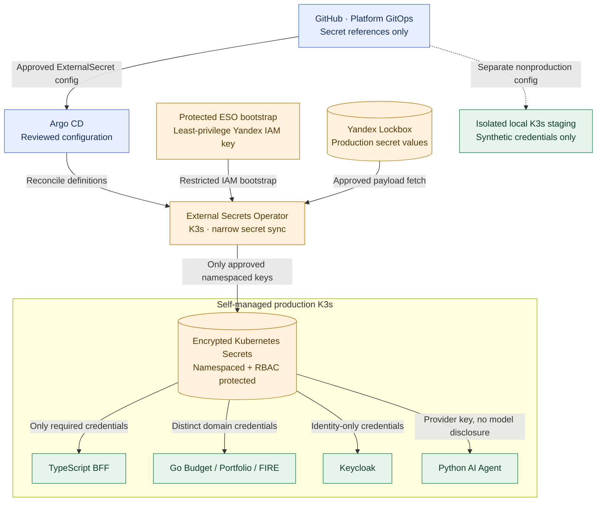

# ADR-027: Yandex Lockbox, External Secrets Operator and least-privilege K3s workloads

- **Status:** Accepted (Release 1 target secret/workload security architecture; not yet deployed or verified)
- **Recorded:** 2026-10-19
- **Scope:** Yandex Cloud K3s production secrets, Keycloak, BFF, Go services, Analytics/AI providers, GitOps, credential rotation and staging isolation

## Context

Finance Lab targets **self-managed K3s on Yandex Cloud VM(s)**, a separate Yandex Managed PostgreSQL cluster, self-hosted Keycloak/Kafka/MongoDB/Redis/observability and **GitHub Actions + Argo CD** (ADRs 016–018, 021). The TypeScript BFF stores encrypted OAuth access/refresh tokens in a dedicated PostgreSQL database; their **encryption keys must not live in that database** (ADR-023). Python AI Agent needs a carefully controlled model-provider key; it cannot expose credentials to an LLM or external inputs (ADR-026). Local K3s staging uses only synthetic data and separate nonproduction identity (ADR-020).

Secrets cannot be written into GitOps manifests, Helm values, OCI images, CI logs or model prompts. A cluster-internal Kubernetes Secret is **not** equivalent to an external secret manager: sufficiently privileged Kubernetes identities can read it, even with K3s datastore encryption. We need an auditable Release 1 method that does not add a self-hosted HashiCorp Vault service.

## Decision

### Secret source, synchronization and access

- Use **Yandex Lockbox as the authoritative production secret store** for database passwords, Keycloak confidential client/bootstrap credentials, BFF token-encryption key material and AI-provider API keys. Create separated secrets, identities and authorizations by purpose; do not let an Analytics or AI workload read Budget/Portfolio database credentials.
- Use **External Secrets Operator (ESO)** to **synchronize specific Lockbox entries into namespaced Kubernetes Secrets**. GitOps stores **only Kubernetes `ExternalSecret`/`SecretStore` references and non-sensitive configuration**, not literal secret payloads. Configure a dedicated, narrowly authorized Yandex IAM service account to fetch **only approved secret payloads**. Favor namespace-scoped stores and narrowly scoped ESO service-account/RBAC access over an unrestricted cross-namespace/global store.
- **Self-managed K3s caveat:** Yandex's packaged ESO/Lockbox installation guidance primarily documents **Yandex Managed Service for Kubernetes** and uses an **authorized service-account key**. The actual Helm/provider integration, supported versions, connectivity and authentication must be **verified on Finance Lab's self-managed K3s** before Release 1. Do not assume a managed-Kubernetes Marketplace deployment translates directly.
- For the **initial ESO integration**, provision any required IAM authorized-key **as a protected bootstrap credential** through an explicit out-of-band operator procedure (never Git, PRs, Actions logs or container images). Scope it to minimum Lockbox payload access, restrict its namespace/Kubernetes Secret read permissions, audit use, monitor exposure and document emergency revocation. Protect it using K3s encryption at rest and restricted cluster access. Its recovery material and bootstrap procedure must be securely preserved outside the source repository, per ADR-019.
- **Yandex Workload Identity Federation (OIDC)** supports keyless access from custom Kubernetes installations, but the accepted first-use ESO deployment **does not assume that the Yandex Lockbox provider supports it transparently**. Evaluate keyless ESO integration only after testing support; it is a **future improvement**, not a prerequisite. The bootstrap-key risk remains an explicit Release 1 tradeoff.
- **GitHub Actions should use GitHub OIDC ↔ Yandex IAM workload identity federation wherever the specific deployment integration supports it**, restricting accepted issuer/audience/repository/ref/environment claims and minimizing token scopes/duration. Never supply an untrusted pull request, fork workflow or privileged CI runner with production Lockbox read rights or direct, broad production K3s credentials. Argo CD reconciles reviewed GitOps configuration; it must not store exported plaintext Lockbox values in Git.
- Do **not** add **HashiCorp Vault** as another always-on production component in Release 1. Reconsider only if new access/rotation requirements or measured benefits justify its cost and operations.

### K3s security and workload boundaries

- **Enable and verify K3s Kubernetes Secrets encryption at rest**, using the built-in `--secrets-encryption` capability and supported key rotation. Preserve K3s encryption/restore material separately and test restoration; **encryption at rest does not protect values from cluster administrators or workloads that can read Secrets through the API**.
- Each application/worker has a **dedicated Kubernetes ServiceAccount**, namespaced role bindings and access only to the Secrets and Kubernetes API capabilities required. Set `automountServiceAccountToken: false` by default unless the workload has a specific authenticated Kubernetes API need. Avoid broad `get/list/watch secrets`, wildcard RBAC, cluster-admin bindings and unrestricted pod exec/deployment permissions.
- Use namespace and **network policy isolation only where supported and verified by the chosen K3s CNI and host networking**. Under ADR-028, back this with restrictive Yandex VPC security groups, private database routes and operator-only administration; the three public hostnames authorize only limited SPA/BFF/OIDC routes. Apply least-privilege ingress and egress for financial services, identity, databases, ESO and agents. In particular, **ordinary workload pods must not access the Yandex VM metadata token endpoint**; enforce at a verified host/network boundary rather than assuming Kubernetes NetworkPolicy alone blocks every host/metadata path. Prevent arbitrary outbound destinations from AI agents (ADR-026).
- Keep production secrets out of container arguments, shell history, logs, traces, crash dumps and public documentation. Prefer supported secret volume references over copying credentials through the BFF or other services; verify application behavior if secret values update. Do not expose ESO/Lockbox administrative interfaces through Traefik or public dashboards.
- **Lockbox → ESO → Kubernetes Secret is a materialization flow, not end-to-end secret invisibility.** Tokens/passwords become accessible to the authorized receiving pod and to cluster principals allowed to read that Kubernetes Secret. Protect Kubernetes backups, nodes, images, logs and impersonation/exec permissions accordingly.

### Rotation, failures, costs and recovery

- Maintain **a credential inventory** with owner, source, authorized consumers, rotation/revocation procedure and recovery contact/runbook. Rotate on suspected exposure and at approved lifecycle intervals; support overlapping credentials when the provider permits safe rollover. Merely changing a Lockbox value or Kubernetes Secret **does not guarantee an application reloads it**: verify refresh, restart/rollout where needed and that the old key is actually revoked.
- Test rotation of at least **one database password, one Keycloak confidential credential and the AI provider key**. For BFF application-side token encryption (ADR-023), adopt **key-version-aware encryption/decryption and recovery**, avoiding irreversible loss when rotating; the exact envelope/KMS strategy is implementation work. K3s storage-encryption key rotation is a **separate operation** from credential rotation.
- Monitor ESO sync freshness/failure and IAM retrieval errors **without revealing secret payloads**. A Lockbox outage may stop future refresh while previously synchronized Kubernetes Secrets remain available; expired/revoked credentials must not be treated as valid, and missing critical secrets must cause safe degraded/fail-closed behavior rather than use unsafe fallback credentials.
- Add Lockbox request/version pricing, ESO CPU/memory consumption and secret-retrieval/restart cadence to the Release 1 cost plan. Use bounded refresh schedules instead of aggressive polling that generates unnecessary cost.
- **Staging and production must use different credentials and trust roots.** The local test cluster must not import production Lockbox values, databases, identity realms, keys or API tokens; use synthetic fixtures and isolated test-only credentials. Any temporary cloud staging secret access needs separately scoped IAM and explicit teardown (ADR-020).
- **Disaster-recovery drills** (ADR-019) must include rebuilding ESO + GitOps references in a fresh cluster, restoring access through the protected bootstrap route, verifying K3s secret-encryption material and restarting services with valid credentials. Revoke intentionally exposed/old credentials and test failed secret retrieval. Lockbox stored in Yandex is **not an independent off-provider backup**; regional/provider outage is not solved by this ADR.

## Architecture diagram

**Boundaries:** Neither GitHub nor Argo CD receives secret *values* in Git; Argo CD deploys only their references. The diagram does not grant every K3s workload read access to every namespaced Secret. Staging has **no path to production Lockbox**. The supported bootstrap key is deliberately explicit rather than implying keyless ESO integration already works.

## Release 1 checks and deferred implementation work

- Validate Lockbox/ESO **with the exact self-managed K3s image/Helm versions** and least-privilege IAM, including initial bootstrap after a fresh-cluster installation. Verify wrong credentials, denied access, revoked bootstrap keys and ESO outage/retry behavior.
- Demonstrate K3s secrets encryption enabled, backup/restore of protected keys, ServiceAccount/RBAC separation, prohibited cross-namespace Secret reads, blocked VM metadata token access, and supported network isolation on the actual CNI/host setup.
- Confirm GitOps and CI contain **no secret values**, even in Helm templating, diff output, artifacts or logs; fork PRs cannot obtain production credentials. Verify GitHub-to-Yandex federation before claiming keyless CI deployment.
- Rotate database, Keycloak and AI credentials; prove services reload or restart correctly, old credentials are rejected, and no financial or authentication data is disclosed.
- Defer specific IAM policies/secret naming, ESO Helm release/secret refresh schedules, K3s networking/CNI, bootstrap-custody mechanism, application restart strategy, key rotation cadence, BFF envelope encryption/KMS implementation and provider cost ceiling to implementation design.
- Acceptance is **documentation only**: this ADR does not provision Yandex Lockbox, create IAM keys, install ESO, rotate real credentials or change production infrastructure.

## Related decisions and authoritative references

- [ADR-014: Restricted user/workload credentials](0014-keycloak-service-to-service-security.md)
- [ADR-016: K3s production deployment](0016-kubernetes-release1-deployment.md)
- [ADR-018: Stateful placement and service credentials](0018-hybrid-managed-postgresql-k3s-platform-state.md)
- [ADR-019: Backups and recovery drills](0019-backup-recovery-objectives-drills.md)
- [ADR-020: Isolated staging security](0020-local-staging-automated-reliability-tests.md)
- [ADR-021: GitHub Actions and Argo CD GitOps](0021-github-organization-actions-argocd-gitops.md)
- [ADR-023: BFF token encryption](0023-postgresql-bff-sessions-and-oauth-lifecycle.md)
- [ADR-026: Product AI agent trust boundary](0026-least-privilege-ai-agent-human-approved-writes.md)
- [ADR-028: Public DNS, private VPC and TLS](0028-public-dns-traefik-private-network-tls.md)
- [Yandex Lockbox + External Secrets Operator](https://yandex.cloud/en/docs/managed-kubernetes/operations/applications/external-secrets-operator)
- [Yandex OIDC federation with custom Kubernetes](https://yandex.cloud/en/docs/iam/tutorials/wlif-k8s-integration)
- [Yandex GitHub OIDC federation](https://yandex.cloud/en/docs/iam/tutorials/wlif-github-integration)
- [K3s secrets encryption](https://docs.k3s.io/security/secrets-encryption)
- [Kubernetes Secrets security](https://kubernetes.io/docs/concepts/security/secrets-good-practices/)
