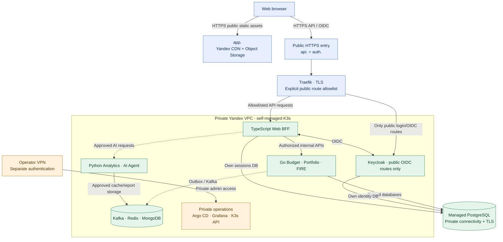

# ADR-028: Public DNS, Traefik HTTPS ingress and private Finance Lab networking

- **Status:** Accepted (Release 1 target network/security architecture; not provisioned or verified)
- **Recorded:** 2026-10-19
- **Scope:** Yandex Cloud public entry points, certificate lifecycle, K3s/VPC segmentation, administrative access and browser origin boundaries

## Context

Finance Lab serves a static React/TypeScript SPA from **Yandex Object Storage + Cloud CDN** (ADR-010), while **Traefik** routes private browser API requests to a TypeScript BFF and delegates OIDC traffic to **Keycloak** on self-managed Yandex K3s (ADRs 002, 006, 013, 016). The financial Go APIs, Python services, Kafka, Redis, MongoDB, observability and Kubernetes administration must not become public entry points. Yandex Managed PostgreSQL lives outside K3s but within the controlled cloud network (ADR-018). Workload identity, secret delivery and service metadata protections are governed by ADR-027.

The frontend, API and identity system need stable HTTPS origins that support server-managed sessions without exposing private bearer tokens. For Release 1, a single-node K3s deployment may be economical, but **neither a public ingress nor an external load balancer makes one backend node highly available**.

## Decision

### Public hostnames and browser origins

Define **three logical public hostnames under one as-yet-unselected registered domain**:

| Placeholder | Public purpose | Approved destination |
| --- | --- | --- |
| `https://app.<domain>` | Static React SPA and sanitized engineering dashboard | Yandex Object Storage + Cloud CDN (ADRs 010–011) |
| `https://api.<domain>` | Authenticated browser API and BFF login/callback/session routes | Approved Traefik routes → TypeScript Web BFF |
| `https://auth.<domain>` | Necessary public Keycloak sign-in, OIDC discovery, authorization/token and supported logout/account flows | Approved Traefik routes → Keycloak public authentication endpoints |

- **The actual domain is not selected, registered or purchased** by this ADR. All hostnames above are placeholders, not claims of working DNS/TLS.
- Hostnames sharing a registered domain are generally **same-site but different origins**. Configure the actual SPA→BFF requests with **only the approved Origin**, appropriately credentialed CORS where necessary, exact redirect URIs and **CSRF defenses** on state-changing requests (ADRs 013 and 023). A same-site relationship does **not** remove CSRF or XSS risks.
- Prefer a **Secure, HttpOnly, host-only BFF session cookie on `api.<domain>`**, with a narrow Path and a compatible, explicitly tested `SameSite` setting. Use the `__Host-` convention where technically compatible with the chosen cookie path; do **not** give `app.<domain>` access to the opaque API session cookie or expose OAuth tokens to JavaScript.
- Keep Keycloak's canonical public hostname and issuer consistent with `auth.<domain>`; configure correct forwarded/proxy headers, explicit trusted proxy hops, origin checks and protected redirect handling. **Never trust arbitrary client-supplied `X-Forwarded-*` or `Forwarded` headers**. Keycloak configuration must be verified end-to-end using actual domains.

### Public and private entry points

- Expose **only public HTTPS entry to the approved Traefik BFF and Keycloak routes**. Permit plain HTTP only as required for redirecting to HTTPS or controlled ACME validation, not for authenticated traffic.
- **Do not publish** direct Go Budget/Portfolio/FIRE services, Python Analytics/AI Agent, Kafka, Redis, MongoDB, Yandex Managed PostgreSQL, internal service discovery, Prometheus/Grafana/Loki/Jaeger, Argo CD, K3s API, SSH or other operator interfaces.
- Keycloak's **public sign-in/OIDC routes may be reachable**, but its **administration and management interfaces must be inaccessible from the public internet**. Prefer an isolated private administration hostname/listener; enforce route/port restrictions at Traefik *and* network controls as supported. Do not treat a hidden login link as protection, and test bypasses to any alternative admin path/port.
- Allow operations and admin consoles only through a **private VPN or equivalent tightly controlled operator channel**, authenticated separately from an ordinary public user session. Operator access is not granted by ordinary Keycloak user login.
- Expose no public raw telemetry endpoints. The public observability page uses reviewed, allowlisted **static CDN snapshots** (ADR-011), not direct Grafana/Prometheus APIs.
- Future native-client public API routes, if any, require **explicit authorization, route-specific policy and a separate review**; Traefik availability does not grant broad public reachability to Go APIs.

### Network boundaries and internal transport

- Use a **private Yandex VPC** for production K3s workload networking and Managed PostgreSQL connectivity. Configure **explicit restrictive Yandex VPC security groups/host firewall rules** for ingress and egress. Do **not** assume Yandex's permissive default security group is suitable for production.
- Allow external traffic only to the approved ingress listener(s). Restrict Managed PostgreSQL connections to approved workload/node source addresses, database TLS and separate per-service credentials. Internal Kafka/Redis/MongoDB and control/observability endpoints stay nonpublic.
- Apply **Kubernetes NetworkPolicy namespace/workload isolation where supported by the actual K3s CNI**, validate effective ingress/egress and block unauthorized pod-to-pod traffic. NetworkPolicy alone does not necessarily cover host-network traffic, node/control-plane traffic or cloud metadata endpoints; pair it with host/VPC/metadata protections from ADR-027.
- Sensitive internal HTTP, database and service-to-service connections require **authenticated TLS transport as governed by ADR-014**. Choose actual internal certificate trust, broker/database TLS clients and termination points at implementation time. Do **not** interpret this decision as permission to send private bearer tokens over unprotected internal transport. A service mesh/mTLS control plane is **not required** for Release 1.
- The **local Linux K3s staging lab** (ADR-020) has independent test identities, DNS/network boundaries and synthetic data. It must not obtain credentials, network routes or direct writable connectivity to the production database or production admin endpoints.

### TLS and certificate lifecycle

- Use **Yandex Certificate Manager** for the `app.<domain>` HTTPS certificate presented by the CDN and configure the static origin/CDN connection and DNS appropriately.
- Use **cert-manager + Let's Encrypt ACME** for the public `api.<domain>` and `auth.<domain>` certificate lifecycle at the Kubernetes ingress. Select supported HTTP-01 or DNS-01 validation for the actual Traefik/network/DNS configuration; challenge routing and Let's Encrypt rate limits must be tested, not assumed.
- Enforce valid TLS versions/cipher configuration, correct certificate hostname chains and renewals, HTTPS redirects, and appropriate HSTS **after confirming that all required hostnames are ready**. Verify renewal monitoring and alerting to prevent silent certificate expiry. Lockbox/ESO (ADR-027) supplies protected credentials where certificate automation needs DNS API keys.
- Define how TLS ends at Traefik and how authenticated/internal TLS continues to backend services and Keycloak. Trust forwarded headers only from the explicitly configured proxy address ranges. No blanket assumption of encryption solely because the public edge uses HTTPS.

### External entry-point cost choice

- **Direct public IP → Traefik** is an acceptable lower-cost first-release path **if** host hardening, public HTTPS, restrictive firewall/VPC rules, correct DNS and operational controls are verified.
- **Yandex Network Load Balancer → Traefik** is preferred for learning and a future multiple-node architecture **only if a measured cost estimate and node/topology constraints justify it**. It is not mandatory for the December 2026 release; using it in front of a single K3s node **does not establish high availability**.
- The chosen Yandex load-balancer type, VPC topology, ingress exposure method, target-node addressing, any static public IP, zone configuration, IP allowlists, SSH/VPN solution and cost ceiling remain follow-up implementation decisions.

## Logical network diagram

**Boundary:** The diagram shows *logical reachability*, not approved firewall rules, a deployed domain, available endpoint IPs or proof of TLS. Keycloak's public OIDC entry is not its administration interface. The local staging cluster is intentionally outside this production network path, and the exact external load-balancer choice is deferred.

## Release 1 verification and deferred work

- Probe the live public URLs, certificate chains, redirects and HSTS/CORS/cookie/CSRF behavior with the final DNS and BFF/Keycloak redirect URI configuration; verify Let's Encrypt issuance **and renewal**.
- From outside the VPC, verify denial of direct access to PostgreSQL, Kafka, Redis, MongoDB, private API ports, dashboards, Kubernetes API, SSH/Argo CD and **Keycloak administration/management endpoints**, including alternative host/port/path routes.
- Verify VPC/host firewall and CNI NetworkPolicy restrictions on the actual infrastructure. Test attempted unauthorized pod-to-pod communication and VM metadata token access; confirm approved internal TLS certificate validation.
- Prove operations are accessible only through the selected authenticated private operator channel and that local staging has **no production write or secret-fetch route**.
- Record public-IP versus Yandex Network Load Balancer costs, node sizing and intended failover claims (if any) before leaving load-balancing infrastructure running. **ADR-029 sets the overall Finance Lab recurring spending ceiling at ₽35,000/month and target at ₽15,000–20,000; a separate load balancer is conditional on measured need and all-in affordability.**
- Exact domain registration, DNS provider, K3s CNI, Traefik Ingress versus Gateway API provider, LB type, private administrative VPN, internal TLS PKI, detailed cookie and proxy-header settings, certificate-challenge method and firewall manifests are **not fixed** by this ADR.
- This ADR records **target architecture only**. No DNS/certificate purchase, VPC change, cluster provisioning or security scan is claimed complete.

## Related decisions and references

- [ADR-002: Traefik ingress](0002-traefik-api-gateway.md)
- [ADR-006: Keycloak authentication](0006-keycloak-identity-service-authorization.md)
- [ADR-010: Static SPA/CDN](0010-independent-spa-and-api-first-clients.md)
- [ADR-011: Public sanitized dashboard](0011-public-sanitized-observability-dashboard.md)
- [ADR-013: Browser cookies/OIDC](0013-keycloak-bff-managed-browser-sessions.md)
- [ADR-014: Internal TLS and token security](0014-keycloak-service-to-service-security.md)
- [ADR-016: K3s and Traefik runtime](0016-kubernetes-release1-deployment.md)
- [ADR-018: Managed PostgreSQL and K3s stateful placement](0018-hybrid-managed-postgresql-k3s-platform-state.md)
- [ADR-020: Isolated local staging](0020-local-staging-automated-reliability-tests.md)
- [ADR-023: BFF session lifecycle](0023-postgresql-bff-sessions-and-oauth-lifecycle.md)
- [ADR-027: Lockbox and workload security](0027-lockbox-external-secrets-k3s-workload-security.md)
- [ADR-029: Low-traffic K3s sizing and cloud budget](0029-low-traffic-k3s-sizing-cloud-spending-ceiling.md)
- [Traefik routing](https://doc.traefik.io/traefik/)
- [Keycloak reverse-proxy guidance](https://www.keycloak.org/server/reverseproxy)
- [Yandex VPC security groups](https://yandex.cloud/en/docs/vpc/concepts/security-groups)
- [Yandex CDN TLS](https://yandex.cloud/en/docs/cdn/concepts/clients-to-servers-tls)
- [cert-manager ACME](https://cert-manager.io/docs/configuration/acme/)
- [Cookie configuration](https://developer.mozilla.org/en-US/docs/Web/HTTP/Reference/Headers/Set-Cookie)
