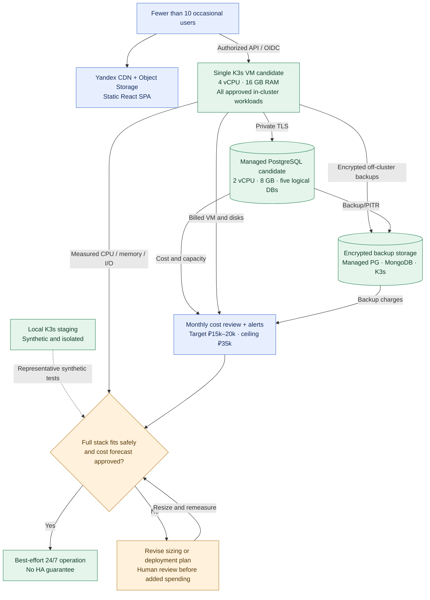

# ADR-029: Low-traffic K3s sizing and monthly cloud spending ceiling

- **Status:** Accepted (Release 1 capacity and cost guardrails; provisioning, benchmark and prices not verified)
- **Recorded:** 2026-10-19
- **Scope:** Finance Lab production capacity, ongoing cloud spending, billing alerts and scale-up approval for the December 31, 2026 release

## Context

Finance Lab expects **fewer than 10 occasional users** at its first public release. The existing architecture deliberately includes substantial fixed-cost infrastructure for hands-on learning: self-managed Yandex Cloud K3s, Keycloak, Traefik, three Go financial services, a TypeScript BFF, Python Analytics/AI, Kafka, MongoDB, Redis, Argo CD, External Secrets Operator and private Grafana/Prometheus/Loki/OpenTelemetry/Jaeger (ADRs 001–028). Five separate logical databases (Budget, Portfolio, FIRE, Keycloak and BFF sessions) reside in **one Yandex Managed PostgreSQL cluster** (ADRs 003, 018, 023). Static React assets and sanitized public metrics live outside K3s in Yandex Object Storage/CDN (ADRs 010–011).

The user accepts a **₽35,000 monthly spending ceiling**, but expects low sporadic usage. VM and managed-database costs are dominated by **provisioned resources running around the clock**, not by a small user count. We can test smaller resource allocations; we cannot safely assume an elaborate stateful stack fits on a small VM without measurement.

This decision revises the **previously proposed 8 vCPU / 32 GB K3s starting point** to a **4 vCPU / 16 GB candidate**. It does not change the accepted component boundaries, add a second cloud cluster, or weaken backup/security requirements.

## Decision

### Monthly budget policy

- **Approved recurring spending ceiling: ₽35,000 per month**, covering Finance Lab's production and explicitly approved temporary Yandex Cloud resources, managed PostgreSQL, VM time, persistent disks/snapshots/backups, Object Storage/CDN, IP/network/load balancing, secret/certificate services and application AI-inference usage. Costs in other paid providers used specifically to run Finance Lab must also be tracked when present. **Personal workstation purchases, learning courses and unrelated accounts are excluded.** The ceiling is a **governance target, not a technical hard billing limit**.
- **Normal 24/7 operating target: approximately ₽15,000–20,000/month** for the initial small audience. The **₽20,000 figure is a planning target**, not a guaranteed invoice or an authorization to omit required components. If forecasts exceed the target, optimize/compare options. New persistent paid resources, significant upgrades or a forecast exceeding the **₽35,000 ceiling** require explicit human review and approval **before provisioning**; do not silently exceed the approved ceiling.
- Use Yandex Cloud **billing budgets/alerts** (for example notification thresholds at **50%, 80% and 95%** of the ₽35,000 monthly ceiling), plus a periodically reviewed cost forecast and resource inventory. **Budget alerts do not automatically shut down resources or enforce a hard cap**; billing data may lag. Separate request/token quotas and cost alerts constrain AI usage (ADR-026).
- Review **actual costs after deployment**, validate billed usage against the pricing calculator and revise estimates when rates, taxes, region, disk class or network traffic change. Prefer removing unneeded temporary resources to disabling required security or deleting durable data.

### Initial resource candidates (not production guarantees)

| Resource | Release 1 starting candidate | Important boundary |
| --- | --- | --- |
| **K3s production** | **One Yandex Cloud VM, 4 vCPU / 16 GB RAM** running K3s control plane, application services and accepted in-cluster stateful systems | **Only if a representative full-stack benchmark passes**. Single-node is **not HA**; the VM is a common failure domain. |
| **Managed PostgreSQL** | **One host, 2 vCPU / 8 GB RAM** | Five separate **logical databases**, per-service roles, private TLS connectivity and backups. Host selection/pricing and provider availability must be verified. |
| **K3s durable storage** | **128–192 GB as an initial sizing hypothesis**, adjusted by actual Kafka/MongoDB/log retention and backup tests | Persistent volumes do not substitute for off-cluster Mongo/K3s backup and replay/reconciliation (ADRs 019, 025). |
| **PostgreSQL storage** | **20–30 GB initial sizing hypothesis**, adjusted to real database/service limits | Backups, PITR support and restore capability must be verified on the actual managed service configuration. |
| **Public frontend** | Existing independently deployed Yandex Object Storage + CDN | The frontend can load independently of backend availability, but private operations require the K3s/backend stack. |
| **Staging/testing** | **Local isolated Linux K3s when available**; otherwise a small, time-bounded approved nonproduction alternative | Synthetic data only. **No permanent second paid cloud cluster** approved (ADR-020). |
| **Optional public LB** | Compare direct public IP against Yandex Network Load Balancer (ADR-028) | Add a load balancer only when actual security/topology benefits and cost fit. No HA claim from a one-node backend. |

The **4 vCPU / 16 GB K3s plan is conditional**: include Keycloak, Kafka, MongoDB, Redis, private observability, Argo CD, ESO, cert-manager, all five language/runtime services and Traefik when measuring, plus K3s/OS overhead. Do not pass a benchmark by quietly removing previously accepted production dependencies or dropping their required data durability, authorization or observability.

### Preliminary monthly estimate, not a tariff quotation

| Planning category | Approximate monthly RUB | Confidence |
| --- | ---: | --- |
| 4 vCPU / 16 GB K3s VM compute | **₽7,373** | Illustrative published-example compute pricing for about 720 running hours; **not an account-specific live quote** |
| 2 vCPU / 8 GB Managed PostgreSQL compute | **₽5,628** | Illustrative published-example pricing for one host, excluding separately billed components |
| Storage, backup, networking/IP/CDN, Lockbox and light AI requests | **₽2,000–7,000** | **Unverified planning allowance**; could be higher depending on actual durable disks, traffic and tariffs |
| **Combined planning range** | **Approximately ₽15,000–20,000/month** | **Not guaranteed; must be replaced by a priced bill of materials before provisioning** |

These numbers are **not measured infrastructure consumption** and are **not verified October 2026 live tariffs**. Confirm the actual Yandex Cloud billing account, VM platform and CPU guarantee, tax treatment, region, instance type, disk class, object/backup retention, billable IP/LB, egress and AI-model pricing with current official pricing tools. Charges continue for many **running or provisioned** resources even when fewer than 10 users are active.

### Availability and capacity validation

- Provide a **best-effort 24/7 public demo**, not scheduled off-hours shutdown, a formal uptime SLA, multi-zone resilience or automatic failover. A single VM or single PostgreSQL host may make APIs/authentication unavailable; offline static HTML alone does not imply financial functionality is available.
- Before committing to 4 vCPU / 16 GB as production capacity, measure **K3s + control plane + all services**: startup and steady-state CPU/memory, burst usage under representative synthetic requests, OOM/restarts, pod requests/limits, disk fill rate/IOPS, log retention, load behavior, recoverability, and acceptable observed latency. Leave explicit memory and disk headroom; establish actual acceptance thresholds in the implementation test plan, not from assumption.
- Retain **small but meaningful telemetry retention** and resource limits (ADR-001), minimize idle cost and avoid unnecessary cloud staging. **Do not omit Kafka, MongoDB, Redis, Keycloak, private monitoring, Argo CD, ESO or required backups merely to satisfy the budget** without separately revising accepted architecture.
- If the full stack **does not fit or repeatedly OOMs**, evaluate a larger VM (e.g. the previous 8 vCPU / 32 GB candidate), splitting workloads across nodes or another reviewed option. **Obtain human approval for an increased ongoing commitment**, validate a new all-inclusive monthly estimate and preserve the ₽35,000 ceiling unless the user explicitly changes it. If safe deployment would exceed the cap, **revisit scope/deployment design before provisioning**, rather than claiming the smaller size suffices.
- Continue to test reliability and performance on local/synthetic staging (ADR-020), but **local benchmarks are not cloud production capacity measurements**. Validate real resource usage and costs on the target Yandex architecture before treating the estimates as a baseline.

## Architecture diagram

**Boundary:** The diagram is a **hypothetical configuration and approval loop**, not a deployed VM, successful 16 GB capacity test or a functioning billing-enforcement automation. The 24/7 objective is best-effort and does **not** override the recovery/backup policies in ADR-019 or the network and secrets boundaries in ADRs 027–028.

## Release 1 verification and deferred choices

- Produce a current priced bill of materials and compare all-in monthly forecasts with **both the ₽15,000–20,000 target and the approved ₽35,000 ceiling**; document all fees, including Object Storage, CDN, IPs, network load balancing if used, logs, certificates, backups, IAM/Lockbox and AI inference.
- Demonstrate and preserve an isolated synthetic **full-stack run**; test resource pressure, memory/disk headroom, Kafka broker restart/lost-event reconciliation, MongoDB report recovery, PostgreSQL recovery, BFF sessions and Keycloak restart (ADRs 019, 023, 025).
- Set alert thresholds and manual review; verify alerts are **notifications rather than spending shutoff**. Inventory anything that continues billing after VM shutdown.
- Choose actual VM platform/performance tier, image, disk class and size, storage retention, PG host/HA/PITR tier, ingress IP/LB and exact resource requests/limits from measured workload and provider availability. None is provisioned by this decision.
- Do not treat fewer than 10 occasional users as proof of correctness, zero ongoing cost or sufficient resources for an infrastructure-heavy demo.

## Related decisions and pricing references

- [ADR-001: Observability baseline](0001-observability-baseline.md)
- [ADR-003: PostgreSQL ownership](0003-postgresql-database-per-service.md)
- [ADR-016: K3s deployment](0016-kubernetes-release1-deployment.md)
- [ADR-017: K3s-first strategy and managed-Kubernetes comparison](0017-k3s-first-managed-kubernetes-comparison.md)
- [ADR-018: Stateful infrastructure placement](0018-hybrid-managed-postgresql-k3s-platform-state.md)
- [ADR-019: Recovery and backup drills](0019-backup-recovery-objectives-drills.md)
- [ADR-020: Local synthetic staging](0020-local-staging-automated-reliability-tests.md)
- [ADR-021: Argo CD / CI resource overhead](0021-github-organization-actions-argocd-gitops.md)
- [ADR-026: AI spending and tool quotas](0026-least-privilege-ai-agent-human-approved-writes.md)
- [ADR-027: Lockbox/ESO cost and isolation](0027-lockbox-external-secrets-k3s-workload-security.md)
- [ADR-028: Network and conditional load balancer](0028-public-dns-traefik-private-network-tls.md)
- [Yandex Compute Cloud pricing](https://yandex.cloud/en/docs/compute/pricing)
- [Yandex Managed PostgreSQL pricing](https://yandex.cloud/en/docs/managed-postgresql/pricing)
- [Yandex Cloud billing budgets](https://yandex.cloud/en/docs/billing/concepts/budget)
