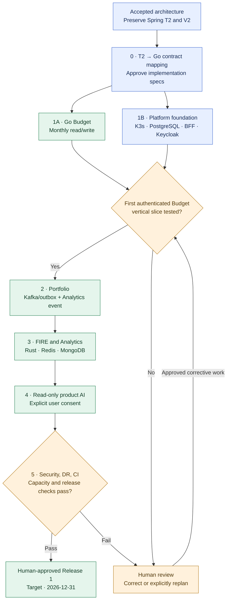

# ADR-030: Release 1 implementation sequence and Spring-to-Go migration

- **Status:** Accepted (Release 1 delivery strategy; implementation and release verification pending)
- **Recorded:** 2026-10-19
- **Scope:** Finance Lab December 31, 2026 delivery, Go Budget migration, reusable T2 evidence and platform-first vertical slices

## Context

The accepted product architecture (ADRs 001–029) has independent **Go Budget, Portfolio and FIRE** services, a TypeScript BFF, Keycloak, Python Analytics with an in-process Rust library, a separate Python product AI agent, Kafka, Redis, MongoDB and Yandex K3s with private observability, backups and managed PostgreSQL. The React SPA is delivered separately from the APIs. The first release expects fewer than ten occasional users and has an overall **₽35,000/month cost ceiling** (ADR-029).

In contrast, the current `anton415/finance-lab` **main branch** still has a React/TypeScript frontend plus a **Java/Spring Boot `backend/`** and historical T2 budget contracts. **T2.1 issue #123** is closed after PUT validation, with valid writes still at the **HTTP 501 checkpoint**. **T2.2 issue #124** (Spring PostgreSQL persistence) and **T2.3 issue #125** (Spring Security sessions) are open. Those issue specifications were written before the Go/Keycloak/BFF architecture was approved. The existing currency-free **V2 budget backup/restore contract** and fixtures preserve historical amount strings and local browser behavior (ADR-022).

Completing the Spring persistence and session architecture only to replace them risks duplicate work. Dropping reviewed T2 correctness invariants and tests would also be a mistake. We need a clear, human-governed sequence that delivers verifiable vertical slices instead of expanding the abstract architecture.

## Decision

### Implement Go directly; preserve valuable existing work

1. **Implement the accepted production architecture directly**: new budget persistence and API behavior belong to the **Go Budget Service**, authentication to **Keycloak**, and browser session/API adaptation to the **TypeScript BFF** (ADRs 004, 006, 012–014, 023). Do **not** first build another production Spring Security/session/persistence path solely to migrate it later.
2. **Preserve the existing source, React UX, docs, tests, fixtures and Java/Spring history** until a reviewed replacement and cutover have passed. This ADR does **not** remove the existing backend, change `main`, complete Spring T2 work or assert that any Go service has been implemented.
3. Before selecting implementation tasks, perform a **reviewed T2 → Go migration specification** covering #123/#124/#125, `docs/t2/design.md`, `docs/t2/api-contract.md` and `docs/budget-backup-contract.md`. Identify which requirements are reusable, which conflict with Go/Keycloak and which need an independently versioned transition. **Do not edit, close, relabel or reassign legacy issues solely because this ADR was accepted.** Any issue/project changes need separate approval.
4. Carry forward **user/month ownership isolation, validated month and amount inputs, atomic version checks, version-conflict review, unknown save outcomes, idempotency keys with 24-hour successful replay retention, and source-revision correctness** from historical design. The Go service must enforce its own authorization and financial invariants; a BFF or successful AI review cannot substitute.
5. New financial Go REST APIs obey **OpenAPI 3.1, independent major v1 contracts and RFC 9457 Problem Details** (ADR-024) with **exact decimal-string Money and explicit currency** (ADR-022). The existing Spring T2 wire format, errors, `formatVersion: 2` currency-free backup, browser-storage strings, legacy JavaScript display arithmetic and regression fixtures **remain unchanged until a separately approved compatibility/import plan**. No implicit currency assignment, loss of historical numeric spellings or silent migration.
6. Use **small, scoped, human-accepted issues**, existing GitHub Project Status/`needs:*` workflow, verifiable CI and bounded Codex review under ADR-021. The decision approves an implementation *direction*, not automatic implementation, PR merging, repo transfers or cloud deployments.

### Accepted Release 1 implementation order

| Sequence | Priority | Minimum verified outcome |
| --- | --- | --- |
| **0. Foundation specification** | Prerequisite | Review/reconcile T2 contract/fixtures with Go Budget v1, Money/currency, Keycloak delegation and BFF session contracts; approve changes before replacing earlier issues. |
| **1A. Go Budget domain** | **P0** | Versioned Go Budget contract and service-owned PostgreSQL persistence; authorized monthly read/create/update, concurrency/idempotency and exact-money checks. Reuse the existing React experience and V2 regression suite without silently changing the old format. |
| **1B. Platform foundation — in parallel with 1A** | **P0** | Secure incremental Yandex K3s deployment with Managed PostgreSQL, Keycloak, BFF sessions, Traefik HTTPS, GitHub Actions/Argo CD, secrets, private monitoring, backup and tested recovery. Start early, not at the end of December. |
| **First complete vertical slice** | **P0 checkpoint** | An invited authenticated user reads and saves **their own monthly budget** from the web app, then retrieves it from another browser/device after restart; exercise user isolation, CSRF, conflicts, duplicate-safe retries, persistence and evidence from actual integration tests. **HTTP 501 does not count.** |
| **2. Portfolio and event integration** | **P0 Portfolio; P1 event/Analytics follow-up** | Go Portfolio records investments and exposes authorized holdings independently. Then publish one `PortfolioChanged` outbox/Kafka event, consume it idempotently in Analytics and prove lost-event reconciliation (ADRs 009, 025). |
| **3. FIRE and advanced Analytics** | **P0 FIRE; P1 Analytics** | Independently usable Go FIRE target/progress tracker and one optional Python/Rust simulation, Redis cache and MongoDB saved-report workflow with authorization and data recovery (ADRs 007, 015). |
| **4. Product AI** | **P1** | One consented, read-only Python-agent monthly budget analysis, with trusted tool execution, narrow user delegation, provider controls and no autonomous financial writes (ADR-026). |
| **5. Release verification and publication** | **Release gate** | Synthetic-safe public demo, end-to-end browser/API/security tests, private observability, disaster-recovery drills, full-stack K3s capacity and cost checks, CI/release evidence and **human production approval**. |

**P0/P1 is the implementation order, not approval to drop P1 features.** Budget month/year capabilities, investments and FIRE tracking remain Release 1 responsibilities: **the first Budget slice** prioritizes monthly durable read/write; the broader budget summary follows before release. Likewise the accepted Analytics/AI experiments, Redis/MongoDB/Kafka learning integrations and security/backup/observability remain in scope unless the user separately approves a change.

### Dependencies and release governance

- Parallel Go Budget and platform work must share reviewed interfaces, tests and human gates. Keep work-in-progress bounded; parallel agents are not authorized to run uncontrolled tasks.
- **Budget, Portfolio and FIRE remain independent at runtime**. Budget saves must not depend on Kafka, Analytics or AI. FIRE tracking must work without the optional simulation engine. The platform can compose views but does not take domain ownership.
- Deploy and validate the first authorized Budget slice early. Build the **Portfolio Kafka workflow after financial write correctness**; then advance FIRE/Analytics and AI, rather than building a speculative cross-domain orchestration layer.
- Test with synthetic data in isolated staging (ADR-020), followed by controlled production-representative measurements. The initial **4 vCPU/16 GB K3s** and **2 vCPU/8 GB managed PostgreSQL** configurations remain *candidates*, not proven capacity. Respect the overall **₽35,000/month ceiling** and normally target **₽15,000–20,000** (ADR-029).
- **December 31, 2026 is a target, not evidence of feasibility.** At each stage, review actual working functionality, tests, risks, cost and remaining time. If full accepted scope cannot be safely shipped, obtain **explicit user approval to revise scope or date** rather than reporting a partial build as the complete release.
- Development agents (Codex review and PR acceptance) remain governed by ADR-021; **user-facing AI financial authorization** remains separately governed by ADR-026.

## Implementation flow

**Boundary:** This is a **planned delivery sequence**, not an assertion of completed Go APIs, authentication, cloud deployment or test results. It permits 1A and 1B to progress in parallel. The review branch does not automatically authorize a new release scope or bypass the human-controlled code/deployment gates.

## Acceptance criteria and separately authorized follow-ups

- Produce a **T2-to-Go migration matrix** referencing [#123](https://github.com/anton415/finance-lab/issues/123), [#124](https://github.com/anton415/finance-lab/issues/124), [#125](https://github.com/anton415/finance-lab/issues/125), existing T2 design/API contract and V2 fixtures. Show explicit ownership of security, versioning and idempotency in Go/Keycloak/BFF.
- After **separate explicit authorization**, adjust T2 issue specifications and GitHub Project status using the established workflow; preserve historical acceptance evidence. Do not claim #124/#125 completed simply by deciding to migrate.
- Contract- and test-verify cross-language Money strings/currencies and legacy V2 backup round-trips; define an **independent migration** where needed. Reconcile T2 `{"code": "..."}` errors with the new RFC 9457 API without undocumented wire incompatibility.
- Provide a deployed invited-user **Go Budget + Keycloak + BFF + PostgreSQL** vertical slice with restart/cross-user/concurrent edit/idempotency/CSRF tests before marking the first checkpoint complete.
- Demonstrate the remaining product services and learning integrations with security, correctness, recovery, cost and public-safety evidence for the accepted Release 1 scope. No claim of success without observed test results.
- This ADR **does not change existing T2 GitHub issues, migrate repositories, provision infrastructure or implement source code**. Those require independently authorized work items.

## Related decisions and project contracts

- [ADR-003: Database ownership](0003-postgresql-database-per-service.md)
- [ADR-004: Go service boundaries](0004-independent-polyglot-services.md)
- [ADR-006: Keycloak](0006-keycloak-identity-service-authorization.md)
- [ADR-007: Analytics / Rust](0007-python-analytics-rust-library.md)
- [ADR-009: Portfolio Kafka](0009-hybrid-rest-kafka-portfolio-events.md)
- [ADR-010: Existing React SPA](0010-independent-spa-and-api-first-clients.md)
- [ADR-012: TypeScript BFF](0012-typescript-web-bff-api-composition.md)
- [ADR-015: Analytics Redis/MongoDB](0015-analytics-redis-cache-mongodb-reports.md)
- [ADR-016: Release 1 K3s](0016-kubernetes-release1-deployment.md)
- [ADR-020: Staging and testing](0020-local-staging-automated-reliability-tests.md)
- [ADR-021: GitHub Actions/Argo CD governance](0021-github-organization-actions-argocd-gitops.md)
- [ADR-022: New Money + unchanged V2 backups](0022-exact-decimal-money-currency-contract.md)
- [ADR-023: BFF sessions](0023-postgresql-bff-sessions-and-oauth-lifecycle.md)
- [ADR-024: OpenAPI v1 and RFC 9457](0024-openapi-contract-first-rest-versioning.md)
- [ADR-025: PortfolioChanged event](0025-cloudevents-json-schema-portfolio-events.md)
- [ADR-026: Product AI permissions](0026-least-privilege-ai-agent-human-approved-writes.md)
- [ADR-029: Cloud monthly cost ceiling](0029-low-traffic-k3s-sizing-cloud-spending-ceiling.md)
- [T2 API contract](../../t2/api-contract.md)
- [T2 concurrency/idempotency design](../../t2/design.md)
- [V2 budget backup contract](../../budget-backup-contract.md)
